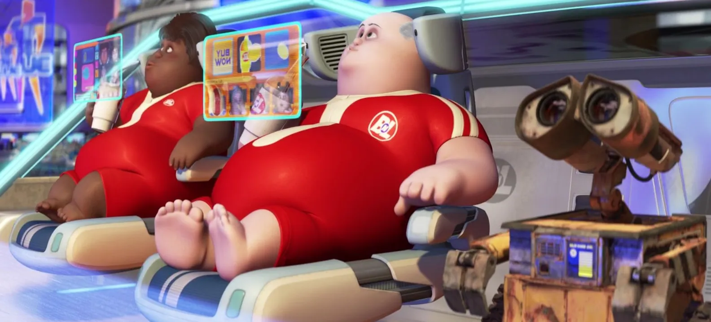

+++
title = "Missing the Psychosis Forest for the AI Trees"
date = 2026-10-19T20:00:00-07:00
[extra]
location = "Stanford, CA"
type = "post"
+++

I do not believe that software engineering is undergoing a tectonic
shift due to large language models. I have, at this point, seen a large
enough sample of code produced by the frontier of so-called artificial
intelligence: it is often impressive but always incomplete. The nature
of a computer program is that it does exactly what you tell it to do.
Any programmer would tell you that bugs are almost never an error on
the computer's side of things, but rather of our own misrepresented
instructions. This makes Claude and friends, in my eyes, practically
useless: if I want something done, I want it done right. Programmers are
in the [business of perfection]. So why is the field in crisis?
<!-- more -->

## I. Preamble
Because of course, I'm not ignorant enough to suggest that there's
not something going on. I don't think there has been a real shift in
software engineering, but there has unquestionably been a shift in [the
vibes]. Aaron Horwath recently asked [why everyone in tech is sad], to
much acclaim. An internet microcelebrity with whom [my sister works]
described AI as [eviscerating global decision-making]. And a whole new
[disease] has entered the modern lexicon: "AI psychosis," a condition
endorsed by even [proponents of the hype] to describe those who have
lost all touch with reality and descended into a manic, bot-fueled
internal universe.

Running parallel to this collapse of programmer self-esteem, there is
the now fully-legitimized field of [apocalyptic AI discourse]. This of
course exists alongside claims that, somehow, are also taken seriously
that ["the impact of superhuman AI over the next decade will...
\[exceed\] that of the Industrial Revolution."][ai2027] The global mania
is fueled and "evidenced" by [cyberattacks], [executive orders], and a
breathless [news cycle].

These simultaneous phenomena are related, and they have nothing to do
with the LLM craze. They have, by contrast, everything to do with [the
technology that ate the world]: software.

## II. Value
At Stanford, there is a required course called [COLLEGE 101: Why
College? Your Education and the Good Life][college101]. I haven't taken
it—the mandate is new and the COLLEGE program is terrible. But I hope
to take advantage of its status as the cornerstone of a prestigious
academic curriculum to gesture at the central importance of the concept
of "the good life" to the human experience.[^1] Defining and enacting a life
well lived is perhaps the primary purpose of [religion], child-rearing,
[philosophy], [intellectual discourse], even [popular] [media].
Allegorical fables on the subject are our [oldest inheritance].

I will refrain from descending into specifics about what I believe "the
good life" to be, as I believe such conclusions to be highly individual
and variable. I will, however, make the claim that any definition
is defined by corporeal experience. Depending on one's culture, the
good life may involve abstract concepts—such as, for example, piety
or leisure. However, these concepts must be achieved through the
accumulation of concrete actions—by concerted prayer or [luxurious
vacationing]. These things take place in the real world. To change one's
degree of good-life living, one must affect these actions in some way.

And so enters the problem of software: the good life takes place in
the real world, where software exists in the so-called "digital world."
This reflexive term is bogus: there is no world to speak of except
for our own, that of dirt and water and flesh. The picture we paint
ourselves of a reality within machines, one made of data, is no more
fanciful than a depiction composed of [humans with light discs]. Digital
devices are inert metal boxes and digital processes are ephemeral
and incoherent.[^2] Software alone is thus powerless to create value,
insofar as value is defined as the unit by which we approach a life
well lived.[^3]

## III. Interlude
How can we gel this conclusion with the fact that software appears to,
at least on its face, have [created some value]? I would contend that
this is because the value has been almost entirely confined to enhancing
humanity's symbolic pursuits. Mankind's great advantage over beast,
after all, is in the [organization of knowledge].[^4] Over millenia, we
have shaped this command over information into great material advances,
such as plumbing, putting men on the moon, making Caesar salads, and
building the Eiffel Tower. The software titans of our world have not
done this.

Rather, software in our world works for two primary goals: efficiency
and convenience. The former is the domain of the most digitized industry
in the world—finance. This comprises flashy companies like [Stripe] who
keep a ticking percentage on their website of the world's commerce that
is conducted through their platform, but also every bank and the COBOL
infrastructure that replaced their paper ledgers too. Digitization lends
itself naturally to finance, as its primary value is in acceptance. The
fundamental difference between a sheet of paper that we say is worth $20
and the text "$20" on your screen is nothing, provided that the person
you're buying your coffee from accepts both. The transition to digital
money has created value in allowing the speed of commerce to increase
exponentially and the knock-on effects of such—but it's still a pretty
roundabout means of buoying the good life.

The software titans of convenience are companies like Uber and DoorDash,
which have revolutionized their respective industries while at times
actively detracting from people's experience of the good life. Rather
than value creation in the real world, which is out of software's
reach, these companies divert human activity to achieve their aims via a
combination of on-screen instructions and digital economic rewards. This
funneling of portions of the human experience that previously took place
in the physical world onto their digital platforms entirely eliminates
the possibility that such experiences will contribute to the good life,
which as previously established can only be accomplished in our world of
flesh and blood.

It is thus that software's propensities toward efficiency and
convenience work in concert with the largely digital economic system
to create the illusion of value, reshaping the world in a manner which
increasingly resembles Pixar's prophecy from 2008:

[Wireheading], though, is necessarily not the good life.

## IV. Trees
So then, to invert the wisdom of Itai Zvulun, [why now]? What has
changed to engender such disillusionment in the public? Software's
inability to affect change in favor of the good life has historically
been denied; has our gradual march toward software ruling every aspect
of our lives simply reached a turning point, a level in which it is
impossible to ignore? I think not. Rather, in this limited domain, I
agree with the boosters: it's AI.

The general public has always thought of programmers as somewhat
ridiculous, but the [in-group] had first-hand experience and knew that
their work was non-trivial. After all, at the outset of the industry,
they were inventing the personal computer and putting men on the moon.
In the decades since, however, software jobs have proliferated. Their
technical mettle has not reduced—but their individual significance has.
When computers were the size of a bus and cost millions of dollars, the
only people who could afford to work on it were those being employed
to solve [world-historical] problems. Now, you can work to solve [hard
problems] at a company that has been feature-complete since 2012.

But complexity does not world-historical make! And with the advent of
generative large language model technology, the practical challenge—the
complexity—of creating middling-quality software has been significantly
reduced. Thus, the experience of programmers working on such difficult
but insignificant problems has significantly changed. Were they working
on problems that they found inherently satisfying and intellectually
stimulating, what would it matter how you get at them? Sure, the
experience of using chatbot may be worse than programming yourself,
much in the same way as the experience of asking a stupid person to
do something is worse than just doing it yourself—but if the results
furthered your pursuit of a worthy goal then surely you would be proud
of the results nevertheless. This, of course, has not happened: instead,
much of the software class has discovered that they were working really
hard on things that don't matter. Things that cannot affect the good
life.

The remainder of the software class has doubled down on their [mania]:
arguing that with even more and even "smarter" software, the industry
will finally render true change unto the world and usher in an era
of either [utopian prosperity] or [ultimate doom].[^5] As I have
attempted to rigorously iterate, the great challenge with either of
these predictions is that they must take place in reality, a substrate
fundamentally foreign to programs. Even in manufacturing, perhaps the
most automated physical industry in the world, I have seen first-hand
the overwhelming amount of human intervention required to make even
the most basic of products and correct even the simplest of routine
mistakes. These can be startlingly stupid: for example, two pallets that
have duplicate labels. From a software perspective, it is impossible
to tell these apart—they are the same thing. A human could trivially
recognize the error and operate on the two batches of parts as separate
entities. At best, software is operating on information that barely
manages to correspond to reality, whereas humans are operating in
reality as a baseline. Neither vision of the end times could be realized
through code.

## V. Forests
These faithful, and the freshly disenchanted programmers before them,
are simply the latest in a long chain of people who have suffered from a
common, heretofore nameless affliction: Digital Psychosis.[^6]

> __Digital Psychosis__  
> _noun_  
> The belief that software in itself is capable of affecting change in
> the corporeal world, held either at the personal or societal level.

As outlined throughout this essay, this is not true: only by acting
in concert with mechanical or organic counterparts can software make
an impact in the so-called real world.[^7] This limitation is fundamental
to software, and attempts to [circumvent it] are cursed to forever
be working against its nature.[^8] Further, the natural tendency of
software is to detract from the viscerality of the human experience.[^9]
This quality places it in opposition to the good life, which is
universally defined as being derived from ones embodied experience.

So then, having named this delusion, how do we proceed? How can we
enhance the visceral goodness of the human experience rather than
detract from it? I am asking these questions both personally, as someone
who writes a ton of software, and societally, in terms of where we
should allocate resources and look for solutions. To that I proffer the
following two-tiered system:

### V.I. The Society
The means by which real change occurs in the world is worldly. That
is perhaps a tautology, but what I mean to say is that we should be
focused on [building hardware]. Mechanical innovation has been the
most transformative force in human history, and today it is all that
_plus_ the interface by which we access the leverage of modern software.
Critically, hardware's tangible nature enables it to perform good-life
enhancing work.[^10] Charging forward on this alternative path of
development would represent a strong endorsement of tangible, visceral
experience and the good life. And we don't even have to leave anyone
behind: many advancements in the field of hardware, especially in recent
times, have been [software-enabled].

What sort of hardware should you be building? Whatever you believe may
enrich and advance the human experience. A short and incomplete list,
based—of course—on my own biases:

1. The most important hardware device of our time [actively detracts
   from our experience of the good life]. Replace it with something
   that doesn't.
2. Events a world away can cause shortages and soaring prices
   due to the fragile and interconnected supply chain. Build the
   machines for [local solarpunk manufacturing].
3. Provide water, food, energy, and medicine to the billions around
   the world who need it and don't have it. Avoid the [mistakes of the
   past].
4. Bring people together face-to-face. Not virtually: [literally].
5. Explore [the unknown]. Boldly go [where no man has gone before].

The good life is complex and multifaceted: there is no shortage of
problems. Go seek one out and viscerally elevate people's lives.

### V.II. The Individual
Each individual should pursue what moves them. Live your good life
fully; no societal restructuring will make people more fulfilled if it
doesn't allow them to pursue their own convictions. If coding late into
the evening brings you visceral joy and is among your profound skills, I
wish you to pursue it with all your heart, and this screed be damned. If
soccer does the same, never the leave the pitch. If it's hardware, then
I truly hope you join the effort to remake our world into one in which
the human experience is restored to a position of primacy.

## VI. Coda
Recall that [life is lived] outside the machines. It is upon you to live
it. Here's to a societal Jerusalem, built quickly and in our days.

_Many thanks to Jacob Neplokh and Ben Fischer for reviewing drafts of
this post._

---

[^1]: Coincidentally, my little sister has just started college at a
      separate elite West Coast institution and is taking a course
      entitled _Labor and the Good Life_.
[^2]: By which I mean two things: first, a platform like Instagram is
      truly composed of countless short-lived processes. These perform
      disparate tasks for fractions of a second—encrypting bytes,
      querying databases, etc.—before passing off those results to other
      processes in turn. Second, there is no shared fabric composing
      a distinct internet, but rather a hodgepodge of computers that
      are only occasionally and delicately connected. Every point of
      data interconnect must be painstakingly designed and implemented
      or else it will break (which happens routinely). The digital dance
      only appears coherent at a distance: to be truly red-pilled,
      investigate the technical process of [logging in].
[^3]: Be that concerted worship or piña coladas, as previously discussed.
[^4]: Or, uh, tools, or a divine mandate, or something.
[^5]: Hard to say which, of course, but they're feeling lucky.
[^6]: Which I have purposely named distinctly from its
      [fictional][johnny] [counterpart][cyberpunk], cyberpsychosis.
      William Gibson's universe may be a dystopia and not my personal
      image of the good life, but at least it's more interesting than
      what we have going on.
[^7]: One could make a compelling argument that America's focus on
      software while the rest of the world continued to slowly develop
      in hardware capabilities is what has led to the precarity of
      American Empire and the rise of a multipolar world order. I will
      defer this essay for another time.
[^8]: This does not mean that they won't be successful, but it does mean
      that I predict such leaps to be limited in scope. Artificial life
      will not come from software.
[^9]: A quality that is made all the more extreme due to the interfaces
      we have devised for interacting with it, namely large glowing
      glass panels.
[^10]: Returning to our example good life scenarios: a monastery is
       a form of hardware which enables concerted prayer by providing
       shelter, isolation, and beautiful architecture to enhance
       contemplation, whereas a piña colada machine is a form of
       hardware which enables a great tropical vacation by providing you
       with a delectable coconut-pinapple-rum concoction.

[business of perfection]: https://var0.xyz/posts/perfection-is-not-over-engineering.html
[the vibes]: https://www.astralcodexten.com/p/vibecession-much-more-than-you-wanted
[why everyone in tech is sad]: https://www.noemamag.com/why-is-everyone-in-tech-so-sad/
[my sister works]: https://mirawelner.com/posts/hermit_15hours.html
[eviscerating global decision-making]: https://ludic.mataroa.blog/blog/ai-mania-is-eviscerating-global-decision-making/
[disease]: https://www.astralcodexten.com/p/in-search-of-ai-psychosis
[proponents of the hype]: https://x.com/mitchellh/status/2055380239711457578
[apocalyptic AI discourse]: https://ifanyonebuildsit.com/
[ai2027]: https://ai-2027.com/
[cyberattacks]: https://www.astralcodexten.com/p/the-hugging-face-incident
[executive orders]: https://www.whitehouse.gov/presidential-actions/2026/06/promoting-advanced-artificial-intelligence-innovation-and-security/
[news cycle]: https://daringfireball.net/linked/2026/07/09/fidji-simo-out
[the technology that ate the world]: https://a16z.com/why-software-is-eating-the-world/
[college101]: https://explorecourses.stanford.edu/search?q=COLLEGE101
[religion]: https://www.sefaria.org/
[philosophy]: https://en.wikipedia.org/wiki/Hedonism
[intellectual discourse]: https://blog.samaltman.com/how-to-be-successful
[popular]: https://letterboxd.com/film/the-odyssey-2026/
[media]: https://www.youtube.com/watch?v=Iu9xmEaHwpU
[oldest inheritance]: https://www.astralcodexten.com/p/your-book-review-the-epic-of-gilgamesh
[luxurious vacationing]: https://poolsuite.net/
[humans with light discs]: https://www.youtube.com/watch?v=SqSuRdkglxM
[created some value]: https://x.com/FutureJurvetson/status/2000604956571881760
[organization of knowledge]: https://en.wikipedia.org/wiki/Knowledge_is_power
[Stripe]: https://stripe.com/
[Wireheading]: https://en.wikipedia.org/wiki/Wirehead_(science_fiction)
[why now]: https://music.apple.com/us/album/%D7%9C%D7%9E%D7%94-%D7%9C%D7%90-%D7%A2%D7%9B%D7%A9%D7%99%D7%95-feat-%D7%A9%D7%9C%D7%95%D7%9E%D7%99-%D7%A1%D7%A8%D7%A0%D7%92%D7%94/1029197007?i=1029197457
[in-group]: https://letterboxd.com/film/hackers/
[world-historical]: https://tmpout.sh/5/2.html
[hard problems]: https://github.com/Tinder/bazel-diff
[mania]: https://daringfireball.net/linked/2026/06/15/anthropic-safety-superpower
[utopian prosperity]: https://blog.samaltman.com/the-gentle-singularity
[ultimate doom]: https://www.decisionproblem.com/paperclips/
[circumvent it]: https://www.figure.ai/
[building hardware]: https://caseyhandmer.wordpress.com/2023/08/25/you-should-be-working-on-hardware/
[software-enabled]: https://nominal.io/
[actively detracts from our experience of the good life]: @/posts/time-to-build-new-hardware.md
[local solarpunk manufacturing]: https://formlabs.com
[mistakes of the past]: @/reading/in-the-dark.md
[literally]: https://boomsupersonic.com
[the unknown]: https://www.theoceancompany.com
[where no man has gone before]: https://www.spacex.com
[life is lived]: https://herman.bearblog.dev/the-gods-of-toil/

[logging in]: https://spec.matrix.org/v1.19/client-server-api/#legacy-login
[johnny]: https://letterboxd.com/film/johnny-mnemonic/
[cyberpunk]: https://www.cyberpunk.net/us/en/
