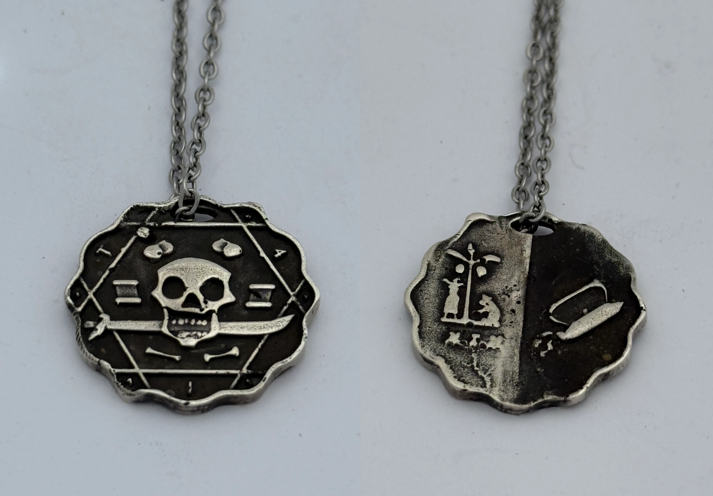

+++
title = "Pendants"
description = "A pirate, an Oscar, and an abstract concept walk into a bar."
date = 2026-08-01T12:30:00-06:00
[extra]
icon = """<svg xmlns="http://www.w3.org/2000/svg" fill="none" viewBox="0 0 1045 1151"><mask id="a" fill="#fff"><path fill-rule="evenodd" d="M436.719 2.25c.006 1.238.681 4.459 1.5 7.159s1.489 6.841 1.489 9.203.484 5.356 1.076 6.655c1.193 2.619-.707 11.649-4.026 19.137-4.598 10.371-5.511 15.578-5.367 30.596.304 31.562 2.54 54.567 6.256 64.338 1.579 4.153 1.305 7.158-1.133 12.423-1.207 2.606-2.445 4.964-2.75 5.239-.637.573-2.817 4.3-4.737 8.097-3.12 6.171-4.195 21.106-2.405 33.403.787 5.411 3.451 12.176 10.629 27 1.332 2.75 2.972 7.137 3.646 9.75s1.517 4.75 1.872 4.75.736 3.375.846 7.5c.124 4.709-.194 7.5-.854 7.5-.579 0-1.053.462-1.053 1.027 0 .564-1.316 2.477-2.924 4.25-5.942 6.549-7.225 8.239-10.207 13.453-3.831 6.696-8.862 9.42-22.501 12.184-8.459 1.714-15.295 2.078-47.868 2.548-20.9.301-41.375.805-45.5 1.12-21.832 1.665-46.415 11.827-60.306 24.929-2.075 1.957-4.216 3.284-4.758 2.949s-.862-.188-.711.326-1.668 3.135-4.043 5.825c-3.817 4.322-7.27 8.682-19.863 25.084-1.772 2.307-4.485 5.457-6.03 7s-6.385 6.798-10.755 11.678c-10.462 11.684-18.232 17.799-34.376 27.054-9.624 5.517-13.944 7.481-15.5 7.046-1.332-.373-1.692-.277-.941.25.841.591-.086 1.539-3 3.068-2.319 1.218-10.742 5.661-18.717 9.874s-15.043 7.662-15.706 7.664-.988.357-.722.787-.541 1.324-1.794 1.984-2.503 1.484-2.778 1.833c-.275.348-2.75 2.273-5.5 4.278-7.223 5.264-13.27 11.949-20.843 23.039-3.66 5.362-6.657 10.006-6.657 10.319s-1.276 2.452-2.836 4.751c-3.633 5.357-9.487 19.159-12.007 28.312-1.943 7.056-2.758 13.859-3.64 30.368-.44 8.248-2.598 24.403-4.074 30.5-1.1 4.542-4.134 10.206-9.91 18.5-2.874 4.125-5.94 8.884-6.814 10.575s-3.016 4.602-4.76 6.469-5.24 6.333-7.77 9.925-5.999 8.331-7.71 10.531c-2.973 3.823-8.42 12.761-13.752 22.568C1.45 646.237-1.24 664.982.561 678c1.517 10.952 2.036 13.094 4.18 17.25 1.064 2.062 1.633 3.75 1.264 3.75s.487 1.237 1.904 2.75 2.863 3.709 3.216 4.881c.65 2.155 3.863 6.369 4.857 6.369.296 0 .055-1.575-.535-3.5s-1.43-3.5-1.867-3.5c-1.45 0-3.314-7.958-2.139-9.133.758-.758 1.257-.473 1.72.981.852 2.689 4.195 3.678 7.127 2.109 2.05-1.097 2.758-.937 5.663 1.279 1.827 1.394 4.207 2.715 5.29 2.937 1.1.226 1.907 1.149 1.832 2.095-.165 2.051 11.346 14.028 12.686 13.201 1.6-.989 1.058-4.061-1.05-5.969-1.1-.995-2-2.383-2-3.084 0-.7-.708-1.98-1.572-2.845C40.272 706.707 40 706 40.53 706c2.61 0 1.973-3.66-1.549-8.893-2.075-3.084-4.032-5.832-4.348-6.107s-1.636-2.412-2.934-4.75c-1.297-2.337-2.672-4.25-3.054-4.25-.859 0-2.595-4.405-3.46-8.777-.356-1.803-.054-5.593.671-8.422.956-3.73 1.01-5.248.197-5.519-.805-.269-.73-1.675.267-4.987 1.755-5.832 1.746-7.295-.042-7.295-1.858 0-2.338-3.53-1.122-8.25.924-3.589 2.513-5.124 2.587-2.5.046 1.617 2.883-3.319 2.93-5.097.02-.74 1.806-3.358 3.97-5.817s4.225-5.789 4.58-7.4c.402-1.836 4.066-6.42 9.814-12.282 12.845-13.098 13.345-13.731 14.623-18.477.628-2.331 1.49-4.022 1.916-3.758 1.397.863 8.58-8.697 9.52-12.669.387-1.638 1.35-2.782 2.381-2.829.983-.045 1.207-.292.517-.571-.795-.323-.912-1.072-.34-2.171 3.222-6.194 3.575-8.366 3.382-20.797C80.803 529.473 80.67 528 79.541 528c-1.466 0-.89-6.707.688-8.017 1.056-.877 1.491-2.978 1.424-6.873-.053-3.085.092-6.285.323-7.11s.751-2.85 1.157-4.5c1.287-5.233 2.915-8.974 4.266-9.8.72-.44 1.31-1.965 1.31-3.39 0-2.29 2.602-9.05 5.124-13.31.488-.825 1.151-2.175 1.472-3 1.673-4.294 3.213-6.417 9.52-13.124 3.785-4.026 6.883-7.895 6.883-8.598s.434-1.278.966-1.278c.531 0 2.346-1.35 4.034-3s3.766-3 4.618-3 1.352-.562 1.112-1.25c-.241-.687-1.291-1.107-2.334-.933-1.192.199-.599-.589 1.598-2.125 1.922-1.343 4.04-2.232 4.707-1.977s2.876-1.15 4.909-3.125c2.033-1.974 4.24-3.59 4.904-3.59 1.81 0 8.486-6.634 8.486-8.433 0-1.845.465-1.924 3.083-.522 1.463.782 2.504.657 4.157-.5 1.323-.927 1.649-1.545.816-1.545-.764 0-1.1-.289-.747-.643.354-.353 1.262-.128 2.019.5 2.039 1.693 7.672-.477 7.672-2.955 0-1.046.466-1.902 1.035-1.902.57 0 2.223-.778 3.675-1.73 1.452-.951 4.623-1.859 7.048-2.017s5.608-.891 7.075-1.629 4.402-1.61 6.523-1.937c2.121-.328 4.517-1.404 5.325-2.391s1.182-1.233.834-.546c-.92 1.816.175 1.539 3.43-.868 1.576-1.165 3.31-1.842 3.854-1.506s2.243-.961 3.775-2.882 3.3-3.494 3.928-3.494 3.241-2.25 5.805-5 5.036-5 5.493-5 1.843-1.8 3.08-4c1.236-2.2 2.597-4 3.023-4 .819 0 3.242-4.525 3.696-6.9.148-.77.641-1.67 1.098-2 .456-.33 1.273-1.913 1.816-3.518 1.221-3.61 3.6-4.706 3.24-1.493-.18 1.603.735 2.935 3.156 4.592 3.571 2.445 5.861 2.339 2.518-.117-1.828-1.342-1.841-1.562-.263-4.248 1.162-1.978 1.57-4.564 1.355-8.574-.279-5.18-.113-5.742 1.693-5.742 1.419 0 1.824-.463 1.392-1.59-.336-.875-.288-2.112.106-2.75s.58-2.46.413-4.051c-.25-2.38 0-2.776 1.413-2.234 1.224.47 3.04-.713 6.34-4.13 6.206-6.429 8.091-8.945 7.293-9.742-.366-.367.207-1.305 1.274-2.085 2.368-1.731 4.434-1.895 2.757-.218-.66.66-1.2 1.648-1.2 2.195 0 .548 1.575-.724 3.5-2.825s3.5-4.419 3.5-5.149c0-4.125 4.961-8.911 6.558-6.327.308.498 1.716.906 3.129.906 2.437 0 2.536-.205 1.929-4-.392-2.453-.248-4 .372-4 .557 0 1.012.505 1.012 1.122 0 .752.521.69 1.576-.185 1.034-.858 1.808-.956 2.25-.285.371.563 1.736 1.292 3.035 1.621 1.772.449 2.483.129 2.851-1.282.271-1.033 1.459-2.027 2.64-2.209s2.041-.865 1.91-1.52c-.236-1.178 2.138-.746 4.238.771.55.397 2.125 1.056 3.5 1.463s3.175 1.312 4 2.011 2.962 1.581 4.749 1.961c2.817.599 3.16.459 2.581-1.049-.561-1.464-.282-1.62 1.751-.986 4.931 1.537 7.93 1.759 10.708.791 2.091-.729 3.746-.618 6.206.416 2.079.874 3.584 1.041 3.956.44.779-1.261 14.322-.888 15.284.42.455.619.74.524.75-.25.008-.687.69-1.25 1.515-1.25s1.5.35 1.5.778 1.84.676 4.088.55c3.217-.179 3.969.081 3.531 1.222-.306.797-.158 1.45.329 1.45s1.112-.562 1.39-1.25c.301-.747.536-.545.583.5.043.962.529 1.75 1.079 1.75s1.036-.788 1.079-1.75c.048-1.056.28-1.252.585-.494.279.691.872 1.031 1.317.756.446-.276 2.031.132 3.523.906l2.713 1.407-2.609 2.268c-1.434 1.247-2.608 2.997-2.608 3.887s-.469 2.089-1.042 2.662c-.724.724-.57 1.435.5 2.323.848.704 1.542 2.215 1.542 3.357 0 1.616-.267 1.811-1.2.878-1.434-1.434-6.436-1.598-7.276-.238-.381.615-1.513.612-3.143-.007-2.658-1.011-4.381-.55-4.381 1.171 0 .555.9.723 2 .374 1.192-.378 2-.18 2 .492 0 .619-.337.987-.75.817s-3.61 2.504-7.107 5.941c-3.63 3.569-5.692 6.25-4.809 6.25.852 0 1.826-.45 2.166-1s1.126-1 1.748-1c.621 0 .206.86-.923 1.912-1.128 1.051-2.882 1.839-3.896 1.75-1.115-.098-2.376.925-3.191 2.588-.741 1.513-1.943 2.75-2.671 2.75-.729 0-1.891 1.462-2.583 3.25s-2.391 4.222-3.776 5.411c-1.807 1.551-2.491 3.097-2.423 5.48.052 1.825.571 3.478 1.155 3.672 2.499.833.768 2.315-2.386 2.043-4.874-.42-5.409.755-1.732 3.801 2.681 2.221 3.178 3.314 3.178 6.988 0 2.395.243 4.355.54 4.355s2.383-.94 4.635-2.09c3.255-1.66 4.262-1.821 4.904-.783.444.719 2.295 1.321 4.114 1.34 2.907.029 3.266.322 2.971 2.422-.296 2.099-.053 2.298 2 1.637 1.285-.413 4.182-.687 6.439-.609 4.906.171 6.626-1.49 6.955-6.715.128-2.036.28-4.095.338-4.574s.773-.317 1.591.361c.818.679 2.113.995 2.878.701s1.836-.089 2.38.455c.652.652 1.188.473 1.571-.527.705-1.837-.934-2.374-8.316-2.726-9.764-.465-17.947.009-20.107 1.165-1.524.816-2.41.826-3.2.036-.601-.601-1.889-1.093-2.862-1.093-1.263 0-1.584-.5-1.123-1.75.356-.962.91-1.975 1.232-2.25s1.039-1.85 1.593-3.5c.651-1.94 1.795-3.113 3.235-3.319 1.352-.194 2.459-1.239 2.815-2.656.692-2.755 5.417-7.582 5.417-5.533 0 2.04 1.353.248 1.52-2.012.08-1.089-.256-1.98-.746-1.98-.491 0-.614-.45-.274-1s1.459-1 2.486-1 2.754-1.125 3.835-2.5c1.082-1.375 2.465-2.5 3.073-2.5s1.151-.675 1.206-1.5c.315-4.729.225-6.166-.459-7.272-.945-1.528-.419-1.54 2.826-.061 1.833.835 2.396 1.688 1.98 3-.75 2.363.713 2.334 3.684-.072 2.344-1.898 2.345-1.912.39-4.072l-1.962-2.168 2.97.323c2.793.303 2.956.128 2.717-2.928-.182-2.338.168-3.25 1.25-3.25.827 0 1.688.113 1.913.25s1.38-.983 2.565-2.49c2.238-2.845 1.998-4.76-.596-4.76-1.911 0-1.474-4.016.622-5.718 1.045-.849 1.121-1.228.25-1.25-1.794-.046-1.55-2.032.25-2.032.825 0 1.5.708 1.5 1.573 0 .978.663 1.429 1.75 1.191.962-.211 1.675-.806 1.584-1.323-.092-.518.921-1.006 2.25-1.085 1.329-.08 2.416.29 2.416.821 0 .532 1.237.821 2.75.645 2.447-.287 2.729-.019 2.562 2.428-.197 2.869 1.089 3.753 2.001 1.376.29-.755 2.138-1.676 4.107-2.045 3.177-.596 5.161-2.581 2.58-2.581-.55 0-1-.477-1-1.059s.419-.8.931-.484 1.219.11 1.571-.46c.683-1.106 8.494-.95 8.497.17.002 1.198-2.46 1.583-4.249.663-1.865-.959-2.547.56-.75 1.67.55.34.986 1.379.968 2.309-.028 1.506-.186 1.487-1.449-.181-1.281-1.691-1.568-1.722-2.968-.321-2.894 2.893-1.162 5.625 2.368 3.737 2.03-1.087 3.999.271 2.097 1.446-.559.345-1.016 1.406-1.016 2.357 0 2.563 7.21 2.684 9.495.159.935-1.034 1.376-2.406.978-3.05-.465-.752-.946-.81-1.348-.163-.344.554-1.509 1.165-2.589 1.357-3.183.567-2.769-2.327.93-6.496l3.412-3.846 2.249 2.096c2.376 2.214 4.873 2.775 4.873 1.096 0-.55-.661-1-1.469-1-.898 0-1.243-.586-.89-1.508.429-1.116-.034-1.441-1.781-1.25-1.546.169-2.36-.26-2.36-1.242 0-1.112 1.107-1.479 4.283-1.421 2.355.044 3.77-.237 3.143-.625-.756-.467-.794-.917-.113-1.338.564-.349 1.758.098 2.654.994 1.471 1.471 1.479 1.793.08 3.338-2.137 2.361-1.935 4.667.561 6.415 1.16.813 1.808 1.963 1.441 2.557s-.303 1.077.142 1.074c.811-.007 4.067-4.909 5.517-8.306 1.124-2.634 3.632-4.905 4.693-4.249 1.261.779 6.099-5.155 6.099-7.482 0-1.898 5.765-8.957 7.315-8.957.455 0 1.503-.675 2.328-1.5 1.968-1.968 2.882-1.895 3.136.25.115.962.606 5.125 1.091 9.25.486 4.125 1.401 9.685 2.034 12.355l1.151 4.854-6.882 7.246c-3.785 3.985-7.115 8.325-7.399 9.645s-.827 3.132-1.205 4.027c-.508 1.201.004 1.8 1.962 2.291 1.937.487 3.905-.076 7.31-2.089 5.385-3.184 8.681-4.954 19.659-10.56 2.75-1.404 7.7-3.137 11-3.849s6.291-1.726 6.648-2.252c.626-.923 2.454-.676 6.102.826 2.498 1.028 2.258-1.578-.463-5.038-1.516-1.927-1.829-2.942-.994-3.22.671-.224.988-.782.704-1.241-.283-.458-4.754-.581-9.935-.272-12.425.742-12.919.296-12.832-11.568.071-9.704 2.398-21.998 4.397-23.233.723-.447 1.015-1.114.647-1.481s.039-2.433.903-4.592c1.016-2.539 1.401-5.686 1.091-8.917-.566-5.885.341-6.941 2.772-3.231 3.675 5.61 7.635 8.299 12.218 8.299 2.372 0 5.339.673 6.593 1.495 1.916 1.255 2.573 1.281 4.103.162 3.035-2.219.949-8.447-3.943-11.769-3.721-2.528-6.256-6.936-6.435-11.195-.073-1.742.04-1.742 3.174 0 1.788.994 3.394 2.127 3.57 2.518s1.602.455 3.167.142c2.052-.411 3.272-.051 4.368 1.289l5.083 6.203c1.959 2.389 3.562 4.667 3.562 5.061s.942 1.728 2.093 2.963c1.788 1.92 2.173 3.919 2.645 13.734.551 11.472.179 14.072-3.417 23.897-2.95 8.056-7.517 16.379-11.312 20.614-2.372 2.647-3.473 4.599-2.821 5.002 2.819 1.743-1.523 3.671-13.291 5.902-4.373.829-5.899 1.617-6.954 3.588-1.247 2.33-1.723 2.474-6.147 1.866-2.959-.407-4.796-.278-4.796.336 0 1.363 5.569 3.284 10.9 3.761 2.421.216 5.219 1.134 6.219 2.038 1.69 1.53 2.385 1.5 9.905-.434 4.448-1.143 9.525-2.972 11.282-4.063 3.257-2.023 8.826-8.212 12.247-13.61 1.045-1.65 2.186-3.225 2.534-3.5 1.49-1.178 7.946-15.067 9.993-21.5 1.225-3.85 2.777-8.575 3.448-10.5s1.646-4.85 2.168-6.5c.595-1.884 1.48-2.843 2.376-2.579.785.232 2.553.493 3.928.582 3.285.21 7.892 1.363 11 2.753 1.375.615 3.4 1.227 4.5 1.36 4.263.517 6.019.905 6.5 1.436.874.965 7.748 3.947 9.151 3.97.742.012 2.474.902 3.849 1.978s2.862 1.966 3.305 1.978 2.918.992 5.5 2.178c2.7 1.24 7.992 2.452 12.452 2.852 6.868.617 8.039 1.025 10.219 3.562 1.354 1.576 2.967 4.085 3.584 5.576.618 1.491 1.869 2.994 2.782 3.341 1.27.484 1.384.355.487-.549-.896-.903-.568-1.738 1.396-3.559 2.723-2.523 4.275-3.024 4.275-1.379 0 .55.45 1 1 1s1.923.923 3.051 2.051c1.324 1.324 2.742 1.832 4 1.433 1.474-.468 1.949-.147 1.949 1.319 0 1.747.788 1.948 8 2.042 6.084.079 8-.219 8-1.241 0-1.985 9.159-2.914 10.585-1.074.795 1.026 1.381 1.104 2.194.291.611-.611 5.523-1.281 10.916-1.49 5.393-.208 10.353-.574 11.023-.811s1.461-.04 1.757.44c.634 1.025 16.864.129 18.275-1.008.138-.111 2.163-.268 4.5-.349 3.642-.127 4.202-.431 3.916-2.125-.268-1.595-.084-1.736.95-.728.706.688 1.901 1.25 2.655 1.25.755 0 2.088.717 2.964 1.592 1.055 1.055 2.55 1.401 4.429 1.025 1.754-.351 2.836-.143 2.836.545 0 .755 2.076.945 6.461.593 4.144-.332 6.385-.151 6.25.506-.221 1.074 8.202 3.687 11.989 3.72 1.21.01 2.56.626 3 1.368.794 1.339 3.711 3.112 10.156 6.173 7.312 3.472 21.116 17.795 28.258 29.322 5.83 9.407 9.131 10.78 14.325 5.956 3.478-3.23 6.517-1.546 6.223 3.449l-.162 2.739c0-.501-10.023-2.783-10.616-2.416-1.763 1.089-.819 5.157 2.088 9 1.635 2.16 2.989 4.603 3.008 5.428s2.283 3.898 5.028 6.828c2.746 2.931 4.992 5.801 4.992 6.38 0 1.844 16.372 16.77 19.75 18.005 1.788.654 3.25 1.5 3.25 1.879 0 .38 1.202.993 2.671 1.362 1.469.368 3.78 1.542 5.135 2.608s3.218 1.938 4.139 1.938 4.798 1.52 8.615 3.377 8.582 3.669 10.59 4.026c2.007.358 4.199 1.313 4.872 2.123s1.819 1.474 2.548 1.474c1.891 0 10.476 4.699 13.43 7.351 1.375 1.234 3.801 2.896 5.391 3.691 1.591.796 4.516 2.895 6.5 4.664 5.526 4.927 5.983 5.294 6.584 5.294.853 0 9.525 9.246 9.525 10.156 0 .439 1.168 1.563 2.596 2.499 2.635 1.727 8.521 9.891 16.075 22.297 5.99 9.839 9.197 20.423 10.884 35.924.217 1.993.763 6.56 1.214 10.149s.451 10.563.001 15.5c-1.545 16.942-.335 28.974 3.668 36.475.734 1.375 2.594 4.867 4.134 7.761 1.54 2.893 3.568 6.086 4.508 7.094.939 1.008 2.489 3.366 3.445 5.239.955 1.873 4.153 6.175 7.106 9.56 2.953 3.384 5.369 6.555 5.369 7.047 0 .491 1.8 2.651 4 4.799 2.202 2.148 4.002 4.474 4.002 5.168s1.25 2.741 2.78 4.547c5.92 6.999 11.49 18.032 15.05 29.785 1.18 3.925 1.71 13.704.85 16-.3.825-.76 3.3-1.01 5.5-.76 6.756-3.24 15.09-5.39 18.118-1.13 1.585-3 4.907-4.17 7.382s-4.15 7.191-6.62 10.48-4.492 6.349-4.492 6.799c0 .449-3.825 5.114-8.5 10.364s-8.5 10.344-8.5 11.317-.925 2.946-2.056 4.384c-2.865 3.642-9.596 24.812-10.395 32.692-.38 3.752-.231 7.671.351 9.201.557 1.466 1.092 4.599 1.189 6.964.255 6.208 1.834 13.134 3.186 13.969.877.542.824 1.666-.213 4.525-.758 2.093-1.451 6.505-1.54 9.805-.09 3.351-.894 7.395-1.821 9.16-.913 1.738-2.349 7.115-3.192 11.948s-1.977 9.063-2.52 9.399c-.544.336-1.063 2.523-1.155 4.86-.116 2.969-.797 4.759-2.26 5.941-2.442 1.974-9.574 11.76-9.574 13.138 0 .517-.796 1.529-1.768 2.247-.973.719-5.197 5.599-9.386 10.844-8.85 11.079-18.818 20.635-23.615 22.64-1.848.772-5.198 2.735-7.445 4.363s-4.858 2.96-5.801 2.96-2.788.827-4.1 1.838c-4.152 3.2-14.537 8.012-25.135 11.647-12.229 4.195-20.501 9.557-31.327 20.309-9.577 9.512-11.307 11.41-12.768 14.008-.635 1.129-3.008 4.693-5.272 7.92s-4.442 6.889-4.839 8.138c-.396 1.249-2.018 3.749-3.603 5.554s-3.808 5.264-4.94 7.686c-1.132 2.42-3.057 5.99-4.279 7.93-2.457 3.9-21.825 23.97-23.131 23.97-.453 0-2.908 1.48-5.457 3.3-6.306 4.48-21.04 11.54-27.411 13.12-2.873.72-7.473 1.37-10.223 1.46s-8.6.65-13 1.24c-4.4.58-10.925.79-14.5.45-9.081-.85-45.573-.92-57-.11-14.47 1.03-29.729 5.07-36.023 9.56-1.486 1.05-2.989 1.63-3.34 1.28-.35-.35-.637-.16-.637.42 0 .57-.788 1.31-1.75 1.63-.962.33-4.9 2.38-8.75 4.57-13.551 7.7-26.112 13.39-36.879 16.72-5.983 1.85-11.623 3.36-12.532 3.36s-4.114.68-7.121 1.52c-3.007.83-12.893 1.95-21.968 2.49-9.075.55-18.214 1.4-20.309 1.9-2.751.65-6.364.41-13-.87-5.055-.98-12.341-2.32-16.191-2.98-3.85-.65-8.575-1.8-10.5-2.54-1.925-.75-5.975-2.09-9-2.99-11.552-3.45-28.381-11.08-38.5-17.47-18.869-11.92-30.287-16.89-44-19.14-4.077-.67-18.9-1.16-35.5-1.18-31.716-.04-35.464.51-46.033 6.7-4.003 2.35-7.247 3.4-11.729 3.8-6.143.56-6.23.53-10.218-3.34-4.305-4.18-5.833-4.62-9.164-2.65-1.696 1-2.208 1-2.572-.01-.25-.69-.866-1-1.369-.69s-.918-.02-.921-.74c-.006-1.17-1.652-2.45-8.445-6.54-1.127-.68-3.271-1.25-4.764-1.25-2.906-.02-5.172-2.85-4.236-5.29.74-1.92-1.441-3.53-6.127-4.51l-3.922-.82.339-4.69c.313-4.32.125-4.77-2.382-5.73-1.497-.56-3.456-.8-4.355-.51-1.039.33-1.992-.29-2.618-1.69-.541-1.22-2.109-2.47-3.484-2.79-1.974-.45-2.739-1.53-3.636-5.14-.626-2.5-1.601-5.42-2.167-6.48-.567-1.06-1.03-3.98-1.03-6.481 0-2.505-.78-6.317-1.733-8.472-1.475-3.334-1.932-7.186-.973-8.197.147-.154 1.665-.458 3.374-.674s3.577-.682 4.148-1.036c1.557-.962 31.961-.668 36.165.35 2.007.486 4.198.544 4.868.13.671-.415 2.297-.466 3.614-.114s7.225.311 13.132-.091c11.043-.753 20.22-.292 23.738 1.191 1.1.463 2.73 1.072 3.622 1.353s2.627 2.587 3.856 5.125c1.228 2.538 2.78 5.162 3.449 5.83.668.669 3.208 4.996 5.644 9.626 2.436 4.62 5.254 9.35 6.263 10.5 1.008 1.15 4.344 5.69 7.413 10.09 6.384 9.15 10.153 13.5 11.708 13.5.594 0 2.736 1.12 4.76 2.5s3.928 2.5 4.232 2.5c1.545 0 .24-6.04-1.947-9-1.375-1.86-2.5-4.37-2.5-5.56 0-1.2-1.701-4.38-3.78-7.06-3.438-4.44-4.995-7.12-6.606-11.38-.521-1.38-4.945-8.39-11.864-18.818-3.237-4.876-3.489-7.716-.813-9.148 1.212-.649 7.672-.862 17.25-.569 28.878.883 42.322.792 50.154-.338 4.313-.623 8.363-.796 9-.384.638.411 4.12.81 7.74.886s8.344.422 10.5.768c10.143 1.631 196.52 3.055 201.121 1.536 2.644-.872 3.726-.823 4.995.227 1.945 1.609 37.977 1.883 39.116.297.378-.526 2.116-1.468 3.862-2.092 2.65-.947 3.667-.835 6.155.678 2.458 1.494 5.657 1.869 18.218 2.135 18.324.387 18.445.467 14.75 9.663-1.365 3.396-3.715 7.559-5.223 9.249-1.507 1.69-2.485 3.33-2.174 3.64.312.32-.551 1.61-1.917 2.87-1.366 1.27-2.484 2.67-2.484 3.11s-2.009 3.25-4.464 6.25c-2.456 2.99-4.737 6.68-5.069 8.19-.333 1.52-1.433 3.81-2.444 5.09-2.291 2.92-2.633 4.52-1.711 8.01.483 1.83 1.389 2.75 2.707 2.75 2.377 0 8.417-5.85 13.011-12.6 1.836-2.69 3.608-5.12 3.938-5.4 2.189-1.82 5.032-6.63 5.032-8.51 0-1.23 1.717-4.12 3.815-6.41 6.174-6.76 9.43-14.144 9.026-20.484-.463-7.253.362-7.837 9.914-7.025 15.647 1.331 20.737.086 18.296-4.475-1.203-2.249-.559-4.528 1.007-3.56.505.312.669-.085.362-.883-.306-.798-.076-1.748.512-2.111.587-.363 1.068.04 1.068.896s1.587 3.312 3.526 5.459c3.884 4.3 6.975 4.547 8.447.675.45-1.185 1.541-2.753 2.423-3.486.882-.732 1.604-1.916 1.604-2.632 0-1.025-.632-.985-2.987.19-3.182 1.587-5.013 1.148-5.013-1.203 0-.968-1.1-1.441-3.351-1.441-1.843 0-4.768-.494-6.5-1.098-2.669-.93-3.149-1.598-3.149-4.379 0-3.216 6.16-15.029 7.263-13.927.292.292 1.722-1.984 3.177-5.06 1.464-3.095 4.839-7.662 7.559-10.229 2.703-2.551 4.682-5.014 4.399-5.473s.212-.834 1.102-.834 1.372-.398 1.071-.885c-.3-.486 1.188-3.074 3.308-5.75s4.174-5.892 4.565-7.147 3.487-5.755 6.88-10c6.256-7.828 9.676-13.935 9.676-17.28 0-3.09 2.222-6.938 4.006-6.938 2.543 0 4.994-3.284 4.994-6.691 0-3.309 2.434-6.74 10.628-14.982 4.08-4.105 5.03-5.667 4.65-7.654-.363-1.896.16-2.914 2.173-4.233 1.476-.967 2.42-2.334 2.131-3.088-.286-.744-.149-1.352.304-1.352.895 0 8.443-10.537 9.336-13.033.302-.843-.319-2.603-1.379-3.912l-1.927-2.38-1.519 2.168c-.835 1.193-2.758 2.81-4.273 3.593-3.228 1.669-8.16 8.398-8.39 11.444-.088 1.166-.67 2.12-1.293 2.12-1.693 0-8.441 6.868-8.441 8.591 0 .822-1.953 3.613-4.34 6.202-4.381 4.752-7.332 9.577-10.073 16.471-.823 2.07-2.305 4.051-3.292 4.402-2.664.947-5.295 3.452-5.295 5.043 0 .77-1.375 2.838-3.056 4.595-1.681 1.758-3.762 4.519-4.624 6.136-.863 1.617-2.337 3.642-3.277 4.5s-4.12 5.385-7.066 10.06c-2.947 4.675-7.409 11.568-9.917 15.319-2.508 3.75-6.631 10.17-9.163 14.267s-6.596 10.028-9.032 13.181c-5.493 7.109-9.865 15.393-9.865 18.692 0 1.546-.934 3.107-2.457 4.105-1.351.885-3.368 3.033-4.483 4.773-2.467 3.851-2.619 2.693-.406-3.1.981-2.57 1.286-4.689.75-5.215-1.526-1.493-22.948-2.042-98.904-2.534-95.846-.621-233.084-1.921-294.19-2.787l-14.19-.201-3.56-3.446c-1.958-1.896-3.56-3.936-3.56-4.534 0-1.057-5.861-10.8-7.957-13.228-.574-.664-1.043-1.488-1.043-1.83s-1.529-2.949-3.398-5.793c-1.869-2.843-5.289-8.769-7.6-13.169s-5.23-9.125-6.488-10.5c-1.257-1.375-2.971-3.85-3.808-5.5s-3.476-5.999-5.864-9.664c-5.168-7.931-9.224-14.343-13.445-21.255A716 716 0 0 0 246.819 867c-2.3-3.575-4.703-7.705-5.338-9.177-.636-1.472-2.195-3.15-3.465-3.728-1.269-.579-2.308-1.536-2.308-2.128s-1.698-3.64-3.774-6.772-4.567-7.27-5.535-9.195c-3.432-6.819-6.551-11.355-8.543-12.421-1.109-.593-2.084-1.529-2.167-2.079-.278-1.845-2.21-3.5-4.084-3.5-1.149 0-2.099-.955-2.486-2.5-.345-1.375-.921-2.5-1.28-2.5-.725 0-6.131 4.843-6.131 5.493 0 .741 2.465 5.982 3.296 7.007 1.062 1.31 3.814 6.5 7.572 14.28 1.668 3.453 4.856 8.083 7.083 10.288s4.049 4.667 4.049 5.471c0 .803.398 1.461.883 1.461.731 0 1.51 1.564 2.491 5 .516 1.809 7.258 14.035 9.098 16.5 1.232 1.65 2.56 4.012 2.952 5.25.391 1.237 1.13 2.25 1.643 2.25s.957.563.987 1.25c.029.688 2.167 4.286 4.75 7.997 19.695 28.294 19.867 28.55 21.232 31.753 2.416 5.666 5.354 10.68 8.076 13.78 1.588 1.809 2.888 3.729 2.888 4.265 0 .845 4.923 8.418 8.422 12.955.636.825 1.275 2.675 1.421 4.111.212 2.095-.388 2.914-3.04 4.15-2.822 1.314-8.257 1.485-37.303 1.17-33.807-.367-46.962-1.411-51.237-4.069-2.318-1.441-6.263-8.197-6.263-10.724 0-3.272-11.949-13.075-21-17.229a562 562 0 0 1-7.953-3.755c-2.907-1.402-6.381-2.149-10-2.151l-5.547-.003-.24 3.929c-.314 5.121 1.349 11.163 3.519 12.784.971.726 1.769 2.738 1.831 4.616.08 2.384 1.076 4.267 3.511 6.632 3.6 3.496 6.991 12.668 4.937 13.353-.582.194-1.006 2.228-.942 4.519s.323 3.374.576 2.405c.703-2.696 2.308-1.007 2.308 2.428 0 2.298-.369 2.906-1.5 2.472-.825-.316-1.5-.167-1.5.332 0 1.132 8.471 2.475 9.929 1.574 1.337-.827 1.394-3.821.097-5.118-.57-.57-.643-2.209-.176-3.95l.798-2.976 2.926 3.2c2.184 2.387 2.917 4.164 2.891 7-.029 3.094-.383 3.769-1.906 3.635-1.03-.091-2.48.443-3.223 1.186-1.967 1.967.055 5.785 4.808 9.079 2.395 1.659 3.863 3.47 3.873 4.79.018 2.19 3.94 6.61 5.874 6.61.61 0 1.166.79 1.237 1.75.07.96.234 2.77.364 4.03.131 1.25-.159 2.51-.644 2.81-.484.3-.617.97-.295 1.5.322.52 1.074.64 1.671.27.63-.39.799-.21.403.43-.376.61.23 1.6 1.345 2.19 1.134.61 2.028 2.1 2.028 3.39 0 1.26.337 2.63.75 3.05.412.41.75 1.14.75 1.62s.9 1.6 2 2.49 1.325 1.33.5.97c-.981-.42-.895-.15.25.79.962.79 1.75 2.17 1.75 3.07s.401 1.64.892 1.64c.49 0 1.196 1.21 1.568 2.7.531 2.11.875 2.38 1.593 1.25.685-1.08.92-.76.932 1.3.008 1.51.465 2.75 1.015 2.75s1.001.56 1.001 1.25c.001.69 1.126 2.56 2.5 4.16 1.375 1.59 2.499 3.51 2.499 4.25s.525 1.34 1.167 1.34c.641 0 .884.28.539.63-.543.54 4.562 8.98 6.277 10.37.338.28 2.822 3.88 5.519 8s7.85 10.47 11.451 14.1c10.361 10.45 19.076 13.97 34.853 14.08 12.784.08 12.882.05 12.398-3.25-.347-2.36.012-2.82 2.65-3.4 1.679-.37 4.086-1.48 5.349-2.46 4.291-3.36 12.542-6.98 15.424-6.77 2.235.16 2.938-.27 3.171-1.9.166-1.15 1.548-3.59 3.073-5.41 2.699-3.24 2.883-3.3 7.051-2.24 4.201 1.07 4.272 1.04 3.825-1.29-.562-2.94 2.271-5.74 7.503-7.41 2.062-.66 3.75-1.62 3.75-2.13s1.773-.92 3.941-.92 4.23-.47 4.584-1.04c.866-1.4 11.179-.19 19.475 2.28 3.575 1.06 7.063 1.97 7.75 2.01.688.05 1.25.41 1.25.82 0 .4 1.4 1.22 3.112 1.82 2.71.94 2.952.89 1.877-.4-.783-.95-.845-1.49-.17-1.49.584 0 1.341.45 1.681 1s1.511 1 2.603 1c1.31 0 1.885.57 1.691 1.68-.331 1.9 2.65 3.06 8.256 3.22 1.952.06 4.043.59 4.646 1.2.603.6 2.83 1.32 4.95 1.59 6.077.8 22.645 6.4 24.888 8.42 1.118 1.01 3.782 2.11 5.92 2.45s4.823 1.22 5.967 1.96c1.143.73 3.728 1.63 5.742 2 2.015.37 4.525 1.47 5.577 2.45 1.053.98 2.892 2.1 4.087 2.47 1.195.38 2.173 1.08 2.173 1.55 0 .84 1.944 1.56 11.28 4.14 4.342 1.2 4.732 1.56 4.268 3.85-.607 2.99 1.04 5.44 4.369 6.49 1.325.42 3.921 1.4 5.769 2.17 2.914 1.22 3.219 1.67 2.302 3.38-.582 1.09-1.718 1.98-2.523 1.98-2.411 0-1.817 5.29.785 6.99 4.643 3.04 10.333 3.98 24.25 3.99 10.488.01 14.719-.37 16.864-1.49 3.455-1.8 12.299-2 12.868-.29.293.88 1.314.93 3.834.21 4.171-1.19 4.981-4.31 2.374-9.15-2.019-3.75-1.847-4.12 2.143-4.63 1.605-.2 4.042-.88 5.417-1.5s7-1.54 12.5-2.03c5.5-.5 12.025-1.59 14.5-2.42 2.475-.84 6.893-2.25 9.818-3.14 9.881-3.02 17.562-7.18 21.987-11.93 2.368-2.53 4.73-4.67 5.25-4.73 1.164-.16 1.409-.22 6.8-1.77 2.395-.68 4.982-1 5.75-.71.767.3 1.395.21 1.395-.19 0-.86 4.311-2.73 8.494-3.69 1.647-.37 3.622-1.2 4.388-1.84.766-.63 2.793-1.22 4.505-1.29 1.712-.08 4.913-.62 7.113-1.21s5.713-1.35 7.806-1.68c2.093-.34 4.641-1.45 5.661-2.47 1.42-1.42 3.066-1.79 7-1.58 3.915.21 5.023-.03 4.64-1.03-.631-1.65 13.386-1.24 20.608.6 3.475.88 5.538.91 7.842.11 2.511-.87 3.422-.79 4.633.42 1.687 1.68 6.793 1.19 11.626-1.12 1.777-.85 4.719-1.16 7.971-.84 5.152.51 7.097 1.8 6.234 4.16-.27.74.363 1.25 1.535 1.25 1.097 0 4.427.86 7.402 1.9 2.974 1.05 5.6 1.71 5.836 1.47.236-.23 1.645.04 3.131.6 2.28.87 2.653 1.53 2.388 4.26-.335 3.46-1.453 4.11-9.244 5.32-2.545.39-3.474.89-2.637 1.41 1.046.65 1.033.9-.069 1.34-.75.3-.013.58 1.637.63s4.736.38 6.857.73c3.754.62 3.842.73 3.296 4.09-.555 3.42-.524 3.45 2.643 2.94 6.373-1.04 14.44-3.47 16.916-5.09 1.391-.91 3.893-1.76 5.561-1.88s2.777-.63 2.466-1.14c-.314-.51.2-.63 1.149-.26 1.015.39 1.467.26 1.108-.33-.335-.54.654-1.54 2.198-2.23 1.543-.68 3.926-2.26 5.296-3.5 1.369-1.24 2.864-2.26 3.321-2.26s1.507-.68 2.332-1.5 1.262-1.5.971-1.5 1.702-2.13 4.429-4.74c2.726-2.6 4.957-5.29 4.957-5.96 0-.68.9-1.71 2-2.3s2-1.63 2-2.31c0-.69.9-1.9 2-2.69s2-1.82 2-2.29c0-.79 4.779-7.62 6.095-8.71.333-.28 1.847-2.53 3.364-5s3.272-4.95 3.9-5.5c.627-.55 2.883-3.59 5.013-6.75s4.267-5.75 4.75-5.75.878-.43.878-.95c0-.53 1.013-2.09 2.25-3.47s3.375-3.88 4.75-5.56 2.725-3.31 3-3.63-.4-.49-1.5-.37c-3.75.4-3.671-.02.896-4.77 4.841-5.03 10.604-15.746 10.604-19.712 0-1.304.562-2.63 1.25-2.945.688-.316.234-.322-1.007-.014l-2.258.56 2.106-3.569c1.159-1.964 2.751-3.57 3.539-3.57s1.681-.646 1.983-1.435 2.786-1.914 5.518-2.5c6.134-1.315 6.869-1.322 6.869-.065 0 .55-.822 1-1.826 1s-2.882 1.125-4.174 2.5-3.062 2.5-3.934 2.5-2.088.805-2.702 1.788c-1.595 2.554-2.763 10.212-1.558 10.212.98 0 4.825-3.542 8.787-8.095 4.275-4.913 17.537-17.109 18.048-16.597.606.606 10.042-4.739 18.859-10.683 11.417-7.697 17.298-9.55 22.76-7.17 2.26.985 6.06-1.898 16.905-12.825 7.285-7.34 9.421-10.396 16.957-24.264 8.775-16.148 9.227-17.206 12.968-30.366 3.666-12.897 4.994-17.133 9.405-30 5.325-15.531 6.741-24.321 7.061-43.815.203-12.37.558-15.653 1.847-17.078.879-.971 1.597-2.292 1.597-2.936s.45-1.171 1-1.171.893-.337.763-.75c-.131-.413 1.219-2.856 2.999-5.43s3.24-5.124 3.24-5.667c0-.542.39-1.136.86-1.32.47-.183 2.95-4.045 5.5-8.583s6.66-11.84 9.14-16.227c2.47-4.387 4.5-8.572 4.5-9.3s.38-1.751.84-2.273 1.44-2.525 2.17-4.45 3.29-7.649 5.67-12.72c7.03-14.924 10.45-31.716 10.44-51.28-.01-20.647-4.56-33.273-17.13-47.508-3.29-3.734-5.99-7.197-5.99-7.695s-1.81-3.573-4.03-6.832c-2.21-3.259-4.31-6.722-4.66-7.695-.36-.974-2.44-3.939-4.63-6.59-4.36-5.277-16.682-26.263-16.682-28.416 0-.739-.906-3.119-2.012-5.288-1.806-3.539-2.044-6.235-2.318-26.211-.23-16.762-.737-24.119-2.05-29.765a4304 4304 0 0 1-3.658-15.912c-2.29-10.066-9.364-24.4-18.185-36.846-7.162-10.107-27.345-30.547-33.225-33.649-1.14-.601-4.255-2.668-6.922-4.593-5.723-4.13-18.929-11.432-37.63-20.805-24.179-12.119-26.436-13.622-44.714-29.762-4.136-3.652-6.43-7.018-11.091-16.269-3.232-6.415-6.364-13.014-6.96-14.664-5.166-14.305-11.367-28.168-13.195-29.5-.377-.275-.958-1.24-1.291-2.144-1.261-3.427-17.481-13.069-27.249-16.198-7.807-2.501-24.932-3.561-34.164-2.115-4.31.675-14.508 1.284-22.662 1.353-11.982.101-18.025.723-31.5 3.24-22.001 4.111-40.457 4.471-52.688 1.028-4.407-1.241-9.641-3.248-11.631-4.46s-6.146-3.709-9.236-5.549c-3.181-1.894-5.335-3.806-4.965-4.405.383-.618.179-.765-.488-.352-1.353.836-8.366-2.265-7.67-3.392.263-.426-.978-1.368-2.759-2.095-1.78-.726-5.218-2.566-7.64-4.089-2.422-1.522-6.022-3.283-8-3.913s-4.947-1.713-6.597-2.407c-5.641-2.373-16.386-4.31-24.589-4.433-3.952-.059-4.756-.434-5.786-2.694-.658-1.444-2.868-4.663-4.911-7.154l-3.714-4.529-.674-14.596c-.702-15.225-1.509-22.787-2.62-24.553-2.115-3.365-1.097-5.612 5.547-12.245 11.133-11.116 16.459-23.215 16.637-37.798.112-9.172-1.116-15.111-4.457-21.557-1.015-1.957-1.912-5.332-1.994-7.5s-.609-6.239-1.171-9.046c-1.409-7.047.109-11.014 5.828-15.222 7.715-5.677 15.905-18.337 19.513-30.165.775-2.542 1.342-8.613 1.307-14-.054-8.15-.454-10.368-2.796-15.51-5.818-12.77-5.535-11.447-5.683-26.53-.087-8.944.255-13.496 1.09-14.503C573.79.196 572.728 0 564.768 0h-9.184l3.132 4.362c3.052 4.249 3.103 4.501 2.002 9.75-.622 2.963-1.375 6.595-1.674 8.071-.691 3.412-3.02 4.389-3.894 1.634-.369-1.162-.944-1.623-1.301-1.045-.353.57-.702-1.837-.776-5.349-.156-7.39-1.139-13.44-2.158-13.29-2.188.322-3.207-.356-3.207-2.133 0-1.893-.667-2-12.475-2h-12.475l.867 2.281c.995 2.618 2.484 18.278 2.303 24.219-.099 3.226-.815 4.636-3.701 7.291-1.968 1.81-4.085 2.978-4.703 2.595-.619-.382-.851-.251-.515.292s-1.061 2.524-3.103 4.404-4.8 4.947-6.128 6.816l-2.417 3.397-1-2.397-1-2.398-.396 2.25c-.58 3.295-2.081 2.745-2.728-1-1.59-9.203-2.5-18.063-2.594-25.25-.057-4.4-.516-10.7-1.019-14s-.99-6.562-1.082-7.25C495.427.389 493.264 0 488.6 0c-6.07 0-9.256 1.039-7.158 2.335.654.405.835 3.965.391 7.724-.211 1.788-2.125-.056-2.125-2.047 0-1.028-.675-2.544-1.5-3.369s-1.5-2.207-1.5-3.072c0-1.376-2.485-1.571-20-1.571h-20zm37.989 15.282c0 .843-.634 3.049-1.408 4.902-1.295 3.1-1.215 3.785 1 8.567 2.882 6.22 3.011 8.451.592 10.192-.999.719-2.121 1.982-2.493 2.807a30 30 0 0 1-1.625 3c-.521.825-1.204 2.725-1.519 4.223-.534 2.543-.753 2.646-3.309 1.557-1.506-.642-3.448-1.755-4.317-2.473-2.222-1.839-3.685-1.626-4.405.642-.34 1.072-1.503 2.229-2.584 2.573s-2.633 2.221-3.449 4.173c-1.783 4.268-1.955 13.433-.283 15.105.66.66 3.39 1.2 6.066 1.2 5.65 0 8.734 1.346 8.734 3.813 0 .958.784 2.855 1.742 4.214 2.081 2.954 1.863 12.12-.368 15.525-1.316 2.009-1.169 2.33 2.098 4.555 1.933 1.316 3.517 2.766 3.521 3.222.008 1.002 6.118-.173 7.457-1.434.522-.492 1.214-.895 1.536-.895 1.052 0 .389 6.844-.803 8.279-.702.847-1.06 4.228-.907 8.565.281 7.922-1.073 9.092-2.746 2.373-1.383-5.555-7.264-11.066-10.8-10.12-1.829.489-2.954.122-4.242-1.382-1.672-1.953-1.671-2.108.027-3.349.979-.716 2.163-1.065 2.632-.775 1.403.867.964-1.337-.572-2.873-1.008-1.008-1.253-2.708-.838-5.821.547-4.099.468-4.299-1.161-2.953-1.223 1.01-1.58 2.288-1.187 4.25.459 2.297.212 2.806-1.364 2.806-1.059 0-2.384-.787-2.945-1.75-.566-.971-1.033-1.194-1.05-.5-.016.688-.492 1.25-1.056 1.25-.584 0-.357-1.292.526-3 .853-1.65 1.303-3 1-3s.13-1.318.963-2.929c1.541-2.979 1.204-8.36-.673-10.757-.584-.746-.492-2.003.248-3.386 1.101-2.056 1.006-2.156-1.452-1.539-1.903.478-2.797.226-3.233-.912-.409-1.066-1.609-1.476-3.728-1.274-2.874.273-3.15.033-3.441-2.99-.174-1.807.839-9.123 2.25-16.257s2.566-13.278 2.566-13.652c0-.375.918.304 2.039 1.507 2.661 2.856 4.719 2.766 7.14-.311 1.944-2.472 5.821-3.456 5.821-1.477 0 1.651 4.862-2.014 5.551-4.184.392-1.234-.052-2.735-1.176-3.977-1.708-1.888-1.874-1.901-3.09-.237-1.097 1.5-1.285.847-1.285-4.472 0-6.198.014-6.227 2.75-5.941 2.443.256 2.785-.075 3.063-2.962.236-2.44.796-3.25 2.25-3.25 1.073 0 1.937.683 1.937 1.532m73.579 17.121c.846-2.203 5.695-2.141 7.601.097 3.087 3.625 4.033 8.299 4.176 20.623.127 10.976-.39 14.938-1.768 13.544-.226-.23.016-2.762.539-5.629 1.076-5.903-.006-11.751-2.19-11.839-.79-.032-2.787-.609-4.437-1.283a297 297 0 0 0-4.5-1.801c-1.172-.451-1.008-.805.75-1.624 1.495-.695 2.245-1.918 2.235-3.644-.018-3.001-1.549-5.867-2.582-4.834-.884.885-3.339-2.249-3.339-4.263 0-1.147.339-1.052 1.44.403 1.299 1.717 1.503 1.741 2.075.25m-16.47 11.134c.736 1.936 1.403 2.264 3.646 1.793 1.51-.317 3.384-.166 4.166.336 1.21.778 1.17 1.297-.273 3.499-1.97 3.006-2.461 3.105-5.356 1.077-1.962-1.375-2.204-1.343-2.743.354-.325 1.024-2.157 2.705-4.07 3.735-1.913 1.031-3.479 2.137-3.479 2.458s-.794 1.456-1.764 2.522c-1.781 1.959-5.236 11.708-5.236 14.777 0 .955-.793 1.662-1.863 1.662-1.772 0-1.788-.231-.319-4.75.849-2.612 1.911-4.9 2.361-5.083s.558-1.367.24-2.632c-.605-2.413 3.758-14.784 6.212-17.614.753-.868 1.369-1.958 1.369-2.421s.743-1.664 1.652-2.668c1.921-2.123 3.943-1.028 5.457 2.955M464.708 45c0 1.312.667 2 1.938 2 1.321 0 1.89-.636 1.787-2-.09-1.198-.867-2-1.938-2-1.12 0-1.787.746-1.787 2m68.722 12.122c.617.617.882 1.747.589 2.511-.351.915-.032 1.197.933.827.819-.314 3.525 1.007 6.12 2.988 3.895 2.973 5.466 3.552 9.645 3.552 4.519 0 4.988.213 4.959 2.25-.017 1.237-.71 3.148-1.539 4.245-1.302 1.722-1.648 1.791-2.534.5-.794-1.157-.885-.992-.4.732.434 1.545-.051 2.924-1.582 4.5-1.214 1.25-1.889 1.711-1.501 1.023.388-.687.262-1.25-.282-1.25-.543 0-3.077-2.002-5.631-4.45-3.661-3.507-5.635-4.592-9.322-5.126-2.572-.372-5.192-1.085-5.822-1.585s-1.597-.781-2.15-.624c-2.208.626-1.521-1.339 2.153-6.157 4.105-5.383 4.607-5.693 6.364-3.936m-2.139.744c-.431.697-.513 1.537-.183 1.867.895.895 1.871-.421 1.387-1.871-.338-1.016-.574-1.016-1.204.004m8.012 1.276c1.898 2.134 1.897 2.136-.345.759-1.237-.76-2.25-1.724-2.25-2.142 0-1.205.557-.909 2.595 1.383m-46.665 9.108c-.12 2.135-1.373 4.239-2.68 4.5-1.54.308-1.548-.001-.089-3.203 1.213-2.663 2.89-3.448 2.769-1.297M552.866 70c0 1.375.227 1.938.504 1.25.278-.687.278-1.812 0-2.5-.277-.687-.504-.125-.504 1.25m-15.358 2.2c.66.66 1.2 3.149 1.2 5.531 0 5.016 2.353 6.875 4.677 3.696 1.343-1.837 1.406-1.826 1.969.327.32 1.223.98 1.977 1.468 1.676.487-.302.886-.081.886.491 0 .571-1.755 1.934-3.899 3.028-4.723 2.409-8.101 7.542-8.101 12.311 0 2.898.431 3.631 2.433 4.134 1.339.336 2.719 1.51 3.068 2.608.348 1.099 1.23 1.998 1.959 1.998 1.872 0 2.167 1.566 1.742 9.25-.295 5.339-.704 6.75-1.959 6.75-2.697 0-5.243 3.134-5.243 6.455 0 1.73-.486 3.631-1.081 4.226-.775.775-.532 2.177.858 4.95 1.066 2.128 2.218 6.119 2.559 8.869l.619 5-2.332-2.637c-3.993-4.514-5.778-4.987-8.852-2.342-1.491 1.282-2.269 2.48-1.727 2.66s1.197 1.986 1.456 4.012c.396 3.087.048 4.018-2.149 5.745-3.595 2.828-4.718 2.613-7.472-1.431-2.126-3.122-3.879-4.462-3.879-2.965 0 2.131 9.951 11.287 13.562 12.478 1.891.624 3.438 1.581 3.438 2.125s-.9.704-2 .355c-1.227-.389-2-.18-2 .542 0 .756-1.251 1.031-3.5.768-2.483-.29-3.5-.014-3.5.95 0 .772.498 1.05 1.155.645.716-.443.883-.275.439.443-.794 1.284-4.594-.208-4.594-1.803 0-.486-2.302-1.649-5.116-2.584-2.814-.934-4.693-1.983-4.175-2.33s1.806-2.117 2.863-3.933c1.3-2.235 2.482-3.156 3.657-2.848 1.432.374 1.558.121.718-1.448-1.374-2.569-2.214-2.399-4.189.848-2.151 3.537-8.837 10.505-9.471 9.871-.797-.797.823-8.671 1.675-8.144.432.267 1.307-2.167 1.945-5.409s1.89-7.358 2.782-9.147l1.623-3.253 1.724 2.129c2.536 3.131 8.182 2.383 12.076-1.601 2.86-2.924 2.975-3.368 2.433-9.383-.368-4.084-.253-5.607.325-4.313.8 1.792.938 1.688 1.324-1l.43-3 1.088 2.5c1.146 2.633 1.048 2.731 3.234-3.25.552-1.513 1.691-2.75 2.529-2.75 1.028 0 1.525-.978 1.525-3 0-1.867-.472-2.906-1.25-2.75-.836.167-1.353-1.407-1.56-4.75-.364-5.875-1.233-7.083-4.022-5.59-1.126.603-2.262.747-2.524.322-.263-.425.404-4.364 1.481-8.752 1.791-7.291 3.056-15.465 3.285-21.23.05-1.237.445-2.25.879-2.25 1.783 0-2.981-3.845-5.289-4.269-1.375-.252-.227-.52 2.55-.595s5.59.404 6.25 1.064m-14.3 1.8c-.995 1.1-2.303 1.99-2.905 1.978s.03-.902 1.405-1.978c3.221-2.52 3.78-2.52 1.5 0m10.5-1c0 .55.45 1 1 1s1-.45 1-1-.45-1-1-1-1 .45-1 1m14.5 4c-.34.55-.141 1 .441 1s1.059-.45 1.059-1-.198-1-.441-1-.719.45-1.059 1m-61.926 3.774c-1.728 1.65-1.755 1.623-.61-.61.659-1.284 1.472-2.061 1.807-1.726.336.335-.203 1.386-1.197 2.336m-1.574 5.191c0 1.61-6.137 8.068-7.101 7.473-.494-.306-.899-.004-.899.67s-.309.916-.688.538 1.291-2.703 3.709-5.167c4.714-4.804 4.979-4.991 4.979-3.514m13.47 7.168c1.083 2.26 1.931 5.405 1.885 6.988-.054 1.808.423 2.879 1.28 2.879.751 0 1.365-.45 1.365-1s.442-1 .983-1 .082 1.604-1.019 3.565-1.742 3.985-1.424 4.5c1.071 1.733-1.522.953-3.54-1.065-2.412-2.412-2.737-8.503-.5-9.362.825-.316 1.5-1.066 1.5-1.666s-.45-.812-1-.472-1-.338-1-1.507-.466-2.995-1.035-4.059c-.57-1.064-.682-1.929-.25-1.923s1.671 1.861 2.755 4.122m-3.769 3.015c-1.208.675-1.36 1.553-.682 3.918.481 1.677.625 3.698.321 4.491-.305.794-.056 1.443.553 1.443 1.374 0 1.464 2.661.118 3.493-.587.363-.721-.086-.33-1.105.417-1.087.268-1.475-.406-1.058-1.362.842-2.419-1.786-1.207-2.998.537-.537.553-2.167.04-3.956-.955-3.33.317-6.849 2.082-5.759.688.426.514.969-.489 1.531m8.299 3.293c0 .243-.45.719-1 1.059s-1 .141-1-.441.45-1.059 1-1.059 1 .198 1 .441m3.569 13.827c-.164 5.078-.43 10.357-.591 11.732-.505 4.315-1.561-11.232-1.137-16.733.678-8.791 2.046-4.832 1.728 5.001m-8.069-.268c.34.55.141 1-.441 1s-1.059-.45-1.059-1 .198-1 .441-1 .719.45 1.059 1m1.368 5.75-.131 3.75-.737-3.5-.737-3.5-.247 3c-.161 1.941-.413 2.362-.717 1.192-.58-2.24.292-4.692 1.67-4.692.567 0 .972 1.688.899 3.75m-20.185 11.438c-.319.797-.556.56-.604-.605-.043-1.054.193-1.644.525-1.312s.368 1.195.079 1.917m-9.837 5.26c.22 1.14-.14 1.621-1 1.334-.741-.246-1.501-1.25-1.692-2.23-.22-1.14.14-1.621 1-1.334.741.246 1.501 1.25 1.692 2.23m-4.846 4.052c1.292 1.375 2.79 2.5 3.328 2.5 2.245 0 11.672 12.664 11.672 15.679 0 1.445-.229 1.424-2.01-.188-1.95-1.765-2.081-1.754-4.315.345-1.267 1.19-3.062 2.164-3.989 2.164-.928 0-2.521.835-3.541 1.855s-3.064 2.159-4.541 2.53c-1.477.37-2.416 1.11-2.086 1.644s-.052.971-.848.971-1.385-.787-1.309-1.75c.098-1.23-.456-1.647-1.861-1.405-1.1.19-2.019.415-2.042.5s-1.312 2.137-2.865 4.558c-1.554 2.422-3.058 6.247-3.344 8.5-.285 2.254-.872 4.55-1.304 5.103-.432.554-.763 3.526-.735 6.606s-.416 6.434-.987 7.454c-.872 1.559-1.134 1.144-1.646-2.606-1.378-10.089-1.32-14.755.314-25.557.944-6.239 2.035-11.662 2.423-12.051.389-.388 1.963.497 3.499 1.969 2.079 1.991 3.081 2.385 3.924 1.542s.732-1.744-.438-3.529c-2.289-3.494-.729-4.12 2.516-1.011 3.598 3.447 5.404 3.373 9.238-.375 2.97-2.903 3.044-3.159 1.506-5.25-1.764-2.4-3.928-6.915-5.007-10.448-.945-3.096 1.43-2.963 4.448.25m28 8.418c0 .505.286 1.743.635 2.75.557 1.61.44 1.59-.969-.168-1.857-2.318-2.082-3.5-.666-3.5.55 0 1 .413 1 .918m47.683 9.27c-.319.797-.556.56-.604-.605-.043-1.054.193-1.644.525-1.312s.368 1.195.079 1.917m-59.704 15.554c-1.06 1.648-1.094 1.644-.555-.074.317-1.007.657-3.932.756-6.5l.18-4.668.375 4.742c.206 2.607-.135 5.532-.756 6.5M514.708 164c-.825.533-1.05.969-.5.969s1.675-.436 2.5-.969 1.05-.969.5-.969-1.675.436-2.5.969m1.008 9.004c1.816.972 1.866 1.772.415 6.746-.747 2.559.237 2.823 2.927.785 1.153-.874 1.552-1.898 1.058-2.718-.555-.924-.255-.881 1.004.142.988.802 2.211 2.549 2.718 3.882.798 2.1.411 2.86-2.909 5.702-2.251 1.926-4.317 4.862-5.008 7.116-1.114 3.629-1.021 3.995 1.727 6.743 2.753 2.753 3.08 2.835 6.233 1.583 1.83-.728 6.193-3.294 9.695-5.703s6.541-4.206 6.753-3.994c.54.539-6.756 7.179-9.507 8.651-1.25.669-3.153 1.969-4.228 2.889-1.93 1.649-1.925 1.68.329 2.235 1.656.407 2.249 1.233 2.154 3-.908 16.854-1.489 23.436-2.117 23.959-.414.345-2.102.309-3.752-.079-1.65-.389-2.212-.76-1.25-.825 1.489-.1 1.75-1.163 1.75-7.118 0-7.24-1.864-10.034-2.168-3.25-.126 2.797-.337 2.226-.832-2.25l-.664-6-.168 8.25-.168 8.25-7.75-.136c-4.263-.075-6.737-.331-5.5-.57 2.438-.469 2.688-1.054 1.352-3.164-.701-1.106-1.078-1.01-1.955.5-.597 1.029-1.127 1.645-1.178 1.37s-.253-3.537-.451-7.25c-.307-5.754-.113-6.765 1.311-6.85 1.014-.06.688-.414-.829-.9-2.18-.698-1.988-.815 1.5-.916 6.753-.194 7.875-2.051 1.25-2.069-5.67-.015-5.75-.055-5.75-2.904 0-1.669.528-2.869 1.25-2.842.688.025 3.443-.025 6.122-.111 4.209-.137 4.703-.362 3.628-1.658-.685-.825-1.752-1.515-2.372-1.533-2.193-.065-5.628-3.819-5.606-6.127.03-3.251 3.535-10.657 5.994-12.669 1.465-1.197 2.102-3.018 2.248-6.421.225-5.27.133-5.143 2.744-3.746m-4.325 3.184c-.319.797-.556.56-.604-.605-.043-1.054.193-1.644.525-1.312s.368 1.195.079 1.917m-48.899 13.062c1.583 2.338 3.166 5.037 3.516 6s1.358 1.75 2.24 1.75c2.157 0 4.793 2.676 3.451 3.505-.563.348-.778 1.031-.477 1.518s.244 2.092-.126 3.566l-.673 2.682-1.195-2.234c-1.187-2.217-1.205-2.211-2.498.91-.988 2.386-1.033 3.735-.183 5.598 1.163 2.554 2.615 3.148 3.641 1.488.329-.532 1.93-.701 3.559-.375 1.837.367 2.961.177 2.961-.502 0-.601-.788-.846-1.75-.543-1.449.456-1.406.269.25-1.085 1.907-1.558 2.016-1.505 2.338 1.139.238 1.955-.34 3.321-1.959 4.632-2.196 1.778-2.325 1.781-2.926.067-.429-1.224-.852-.402-1.33 2.588-.471 2.945-.318 4.617.467 5.101.805.498.968 2.693.526 7.083-.353 3.499-.625 7.652-.604 9.23.021 1.577-.519 3.538-1.199 4.358-1.008 1.213-.886 1.747.652 2.872 2.606 1.905 1.43 2.717-1.233.852-1.294-.907-1.913-2.117-1.557-3.045.325-.847.125-2.522-.444-3.722-4.012-8.464-6.57-28.061-4.951-37.944.531-3.243.386-5.474-.455-7-.679-1.231-1.107-3.072-.95-4.09s-.584-2.817-1.646-4c-3.005-3.344-3.52-4.649-1.836-4.649.831 0 2.807 1.912 4.391 4.25m-4.884 22.167c.055 3.804-.167 6.649-.493 6.323-.327-.326-.717-4.564-.868-9.417-.161-5.18.043-7.791.494-6.323.422 1.375.812 5.612.867 9.417m58.738 17.083c-.316.825-.139 1.5.393 1.5.533 0 .969-.675.969-1.5s-.177-1.5-.393-1.5-.652.675-.969 1.5m-4.909 5.104c-.332.332-1.195.368-1.916.079-.798-.319-.561-.556.604-.604 1.054-.043 1.644.193 1.312.525m-49.899 25.146c1.156 2.247.432 4.25-1.536 4.25-1.254 0-1.309-.277-.294-1.5.86-1.036.898-1.5.122-1.5-.617 0-1.122-.675-1.122-1.5 0-2.046 1.727-1.893 2.83.25m10.17.156c0 1.321-2.407 3.094-4.2 3.094-1.955 0-2.056-.17-1.288-2.168.521-1.356 5.488-2.194 5.488-.926m51.355.611c-.32.834-.368 2.634-.107 4s.087 2.483-.387 2.483c-.473 0-.861.45-.861 1 0 1.068 6.258 1.409 7.27.397.761-.761-3.376-9.397-4.501-9.397-.457 0-1.094.683-1.414 1.517m-67.355 3.59c0 .491.75.893 1.667.893 1.875 0 1.241 1.04-.825 1.353-.738.112-1.853.523-2.478.913-1.1.688-2.617-3.68-1.623-4.674.692-.692 3.259.501 3.259 1.515m-5 4.893c0 .55-.702 1-1.559 1s-1.281-.45-.941-1 1.041-1 1.559-1 .941.45.941 1m45.813 2.683c.721.289 1.584.253 1.916-.079s-.258-.568-1.312-.525c-1.165.048-1.402.285-.604.604m-30.084 2.921c-.332.332-1.195.368-1.916.079-.798-.319-.561-.556.604-.604 1.054-.043 1.644.193 1.312.525M504.708 275c-3.563.554-2.626.706 4.5.731 6.038.022 8.013-.219 6-.731-3.582-.912-4.637-.912-10.5 0m15.8.2c.933.933 1.467.933 2.4 0s.667-1.2-1.2-1.2-2.133.267-1.2 1.2m-28.802 1.346c-2.464 1.364-2.444 1.383 1.502 1.403 2.2.011 3.55-.315 3-.726-.55-.41-1.226-1.042-1.502-1.403-.275-.361-1.625-.034-3 .726m103.292.454c-.544 2.08-3.713 2.742-4.79 1-.34-.55.084-1 .941-1s1.559-.45 1.559-1 .633-1 1.406-1c.914 0 1.224.7.884 2m118.523 11.683c.721.289 1.584.253 1.916-.079s-.258-.568-1.312-.525c-1.165.048-1.402.285-.604.604M756.708 290c1.085.701.256.954-3 .914-3.425-.041-4.022-.26-2.5-.914 2.677-1.15 3.72-1.15 5.5 0m-70.25 2.662c.688.278 1.813.278 2.5 0 .688-.277.125-.504-1.25-.504s-1.937.227-1.25.504M389.708 295c1.127.729.631.977-2 .998-1.925.016-4.625.309-6 .652-1.731.431-2.192.299-1.5-.429.863-.908 3.266-1.618 7-2.07.55-.066 1.675.316 2.5.849m54 2c0 .55-.423 1-.941 1s-1.219-.45-1.559-1 .084-1 .941-1 1.559.45 1.559 1m169.083 1.359c.23.198 1.767.662 3.417 1.031 2.191.49 2.595.397 1.5-.344-1.35-.914-5.92-1.552-4.917-.687m-97.83 6.225c-3.085 1.082-4.778 1.205-6.185.453-1.065-.571-2.754-1.019-3.752-.997-1.087.024-.252.82 2.078 1.983 2.588 1.292 4.767 1.713 6.5 1.257 1.433-.377 3.354-.573 4.267-.435s1.953-.221 2.309-.797.059-1.08-.661-1.118-.409-.457.691-.93c3.442-1.479-.666-1.022-5.247.584M780.706 307c1.036 0 2.101.351 2.366.78.973 1.574-4.686.501-5.865-1.113-.671-.917-1.845-1.674-2.609-1.682-1.143-.013-1.131-.179.062-.934 1.023-.648 1.852-.348 2.807 1.015.745 1.064 2.202 1.934 3.239 1.934m-223.998-1.267c0 1.354 2.248 3.267 3.84 3.267.792 0 1.951.699 2.576 1.554 1.188 1.625 5.036.987 4.015-.666-1.244-2.012-10.431-5.672-10.431-4.155m10 .767c.685.825 1.64 1.5 2.122 1.5.483 0 .878-.675.878-1.5 0-.862-.902-1.5-2.122-1.5-1.774 0-1.918.247-.878 1.5m4.5 1.5c.34.55.141 1-.441 1s-1.059.654-1.059 1.453c0 1.216.49 1.175 2.994-.25 3.673-2.089 3.828-3.203.447-3.203-1.451 0-2.292.433-1.941 1m-149.031 2.05c-.95 1.538.351 2.53 1.635 1.246.718-.718.735-1.277.052-1.699-.56-.346-1.319-.142-1.687.453m155.668-.156c-1.151.729-1.151.948 0 1.406.968.385 1.001.565.113.621-1.429.09-1.737 2.079-.321 2.079.51 0 1.591-.662 2.4-1.472 1.296-1.296 1.618-1.296 2.694 0 1.537 1.851 3.087 1.921 2.391.107-.288-.75-1.645-1.875-3.016-2.5-2.938-1.338-2.563-1.317-4.261-.241m-139.137.547c0 .243-.45.719-1 1.059s-1 .141-1-.441.45-1.059 1-1.059 1 .198 1 .441m-15 2.559c0 .55.423 1 .941 1s1.219-.45 1.559-1-.084-1-.941-1-1.559.45-1.559 1m-27.369 1.788c-.355.574-.112 2.319.54 3.878 1.118 2.672 1.208 2.707 1.573.613.458-2.628-1.151-6.048-2.113-4.491m284.519 5.547c-.991 2.412-.866 3.256.842 5.654 1.105 1.551 2.008 3.313 2.008 3.915 0 .603.45 1.096 1 1.096s1 .637 1 1.416 1.835 3.367 4.078 5.75 5.211 6.247 6.595 8.584 3.197 4.25 4.029 4.25c.918 0 1.291.576.949 1.466-.325.848 1.211 3.644 3.643 6.631 6.984 8.574 6.968 8.545 5.781 10.763-.59 1.102-1.861 2.253-2.824 2.558-2.739.865-30.187.993-59.251.276-14.575-.359-34.6-.683-44.5-.719s-20.025-.152-22.5-.258c-2.475-.105-10.913-.182-18.75-.171-7.837.012-14.25-.273-14.25-.634 0-.36 4.465-.971 9.922-1.358 7.708-.546 10.058-1.058 10.532-2.296 1.071-2.789-.971-3.497-5.583-1.935-4.367 1.479-7.961 1.067-4.305-.493 1.254-.535.75-.613-1.434-.222-2.543.455-3.26.277-2.926-.725.243-.73 1.534-1.591 2.868-1.912l2.426-.584-2.381-.634c-1.483-.395-2.924-.091-3.821.806-.793.793-2.871 1.493-4.619 1.556-1.749.064-3.629.22-4.179.348s-1.562.301-2.25.385c-1.89.23-1.497 2.942.5 3.452.962.245.288.391-1.498.323s-3.249-.385-3.25-.706c-.006-1.64-3.34-.27-4.26 1.75L533.387 371l-34.09.101c-18.749.056-35.521.024-37.272-.071-4.476-.242-7.826 1.652-6.259 3.54 2.486 2.995-1.637 1.434-5.275-1.998-2.556-2.41-4.965-3.627-8.119-4.1-4.886-.732-19.638.83-29.164 3.09-3.3.783-7.35 1.539-9 1.68-3.845.331-7.724 6.618-5.859 9.497 1.481 2.287 6.98 2.005 12.128-.621 4.173-2.129 9.921-2.237 11.175-.209.591.957 5.21 1.314 18.175 1.404 9.559.066 16.368.279 15.131.473s-2.247.659-2.243 1.034c.01 1.014 9.201 1.247 10.431.264 1.918-1.533 12.473-1.188 15.036.491 1.835 1.202 2.864 1.315 4.418.483 1.93-1.033 11.71-.6 15.108.669 1.925.719 6.722.329 9.65-.784 1.51-.574 2.717-.457 3.566.345 1.399 1.321 2.756 1.353 14.02.332 6.563-.595 7.61-.463 8.182 1.027.586 1.528.816 1.548 2.175.189 1.2-1.2 2.597-1.349 6.648-.709q5.128.811 6.463-.296c.999-.83 1.799-.686 3.191.574 1.724 1.561 1.904 1.562 2.493.026.476-1.239.966-1.382 1.948-.567.954.791 1.644.756 2.529-.129.862-.862 1.426-.9 1.927-.129.762 1.172 17.191 1.141 19.095-.036.594-.367 2.774-.344 4.846.052 5.474 1.044 8.457.897 11.144-.549 1.721-.926 2.568-.972 3.067-.164.688 1.113 11.526.917 19.056-.344 1.925-.322 3.95-.544 4.5-.493 6.94.645 12.249.477 13.707-.433 1.355-.847 2.314-.795 3.927.213 1.78 1.111 2.29 1.11 3.076-.01.735-1.047 1.054-1.067 1.449-.092.6 1.478 6.341 1.705 6.341.25 0-1.59 4.002-1.158 4.638.5.788 2.052 2.344 1.893 2.441-.25.047-1.045.282-1.247.583-.5.281.695 2.207 1.25 4.338 1.25s4.057-.555 4.338-1.25c.301-.747.536-.545.583.5.086 1.908 1.593 2.346 2.579.75.938-1.517 4.776-1.271 3.887.25-.402.688.169.462 1.27-.5 2.677-2.342 5.146-2.423 3.223-.106-1.221 1.471-1.107 1.563 1.085.867 4.832-1.534 23.879-2.098 25.707-.762.941.688 2.074 1.251 2.519 1.251 1.287 0 .937-1.809-.441-2.283-.687-.237-.35-.252.75-.034s3.248.584 4.773.812c1.526.229 3.208.684 3.739 1.012.562.347.688-.125.303-1.129-.538-1.402-.302-1.572 1.261-.907 1.058.45 2.712.849 3.674.888.962.038 1.75.675 1.75 1.414 0 .74.427 1.081.95.758s1.419.29 1.993 1.363 1.609 2.565 2.3 3.317c1.42 1.543 2.908 4.055 5.992 10.112 1.847 3.626 3.957 6.5 10.126 13.79.751.887 2.618 3.916 4.15 6.73 1.531 2.814 3.538 5.355 4.459 5.647.921.293 2.736 2.439 4.034 4.771 2.691 4.835 5.701 9.266 8.246 12.14.962 1.087 1.75 2.58 1.75 3.319s.675 1.602 1.5 1.918c.825.317 1.5 1.026 1.5 1.575 0 .55 1.125 1.884 2.5 2.966 1.375 1.081 2.5 2.612 2.5 3.401 0 1.311 10.387 17.256 12 18.42.38.275.993 1.729 1.361 3.232.392 1.604 1.885 3.361 3.617 4.256 3.627 1.876 5.276 7.05 5.42 17.012.097 6.675.218 7.016 2.602 7.346 1.375.19 2.964.726 3.531 1.191.567.464 2.235 1.063 3.706 1.33 5.157.935 6.425 2.283 12.349 13.133.901 1.65 3.388 5.106 5.526 7.679s3.888 4.955 3.888 5.291c0 .783 3.991 6.362 6.185 8.646.927.965 2.126 3.351 2.665 5.303.613 2.221 3.538 6.188 7.815 10.6 3.759 3.877 7.901 8.947 9.203 11.265 3.165 5.635 5.981 9.594 9.399 13.216 1.557 1.65 3.73 4.935 4.829 7.3 1.1 2.364 2.637 4.544 3.416 4.843.78.299 3.07 3.089 5.089 6.2 9.019 13.898 11.066 16.742 13.652 18.969 1.514 1.304 2.498 2.782 2.186 3.286-.311.504.138 1.186.998 1.516.859.33 1.563 1.172 1.563 1.871 0 .698.708 1.858 1.573 2.576s2.474 3.071 3.575 5.229 3.423 5.313 5.16 7.011 3.165 3.671 3.175 4.385c.009.713 1.254 2.611 2.767 4.216s2.75 3.354 2.75 3.886.708 1.555 1.573 2.273 2.461 3.045 3.545 5.171 2.929 4.22 4.098 4.652c1.437.532 1.741 1.024.939 1.52-.653.404-.96 1.102-.682 1.552s-.165 1.373-.984 2.053-1.489 1.77-1.489 2.424-1.255 2.51-2.789 4.127-4.334 4.965-6.223 7.44-4.009 4.86-4.711 5.3c-1.703 1.066-1.615 3.773.208 6.376 1.242 1.773 2.044 1.994 4.899 1.35 4.073-.918 9.757-5.052 11.548-8.398 1.918-3.585 5.724-4.754 12.068-3.708 1.038.171 6.5 5.278 6.5 6.078 0 1.837 1.495 2.178 2.143.489.471-1.227-.023-2.377-1.555-3.617-2.218-1.796-2.503-5.574-.388-5.157 2.039.403 2.19-4.765.175-6.023-1.207-.754-1.875-2.326-1.875-4.411 0-2.71-.451-3.349-2.75-3.898-1.513-.361-3.399-1.157-4.192-1.769-1.152-.888-1.264-.81-.558.388.738 1.252.627 1.292-.671.241-.855-.692-1.449-2.267-1.32-3.5l.363-3.465c.204-1.953 5.359-4.128 7.628-3.218 3.037 1.217 3.77 1.087 3.138-.558-.316-.825-.13-1.5.415-1.5s1.519-1.16 2.165-2.579c.646-1.418 2.843-4.386 4.883-6.595 2.039-2.21 4.438-4.886 5.33-5.948 2.718-3.235 7.569-12.799 7.569-14.922 0-1.175 1.057-2.481 2.566-3.168 2.555-1.164 5.434-6.385 5.434-9.853 0-1.002.858-2.422 1.906-3.157 2.697-1.888 3.229-8.091.738-8.592-2.1-.423-8.903 5.586-7.993 7.059.316.51-.746 2.351-2.358 4.091s-3.76 4.514-4.77 6.164c-1.011 1.65-2.442 3.36-3.18 3.8-.739.44-1.343 1.452-1.343 2.25 0 .797-.429 1.45-.953 1.45s-1.816 1.913-2.87 4.25-3.325 5.572-5.047 7.187-3.13 3.507-3.13 4.203c0 5.525-7.628 11.028-13.706 9.887-2.633-.494-3.765-1.398-4.8-3.837-.745-1.754-2.511-4.74-3.925-6.634s-2.569-3.947-2.569-4.562c0-.614-.849-2.028-1.886-3.141-1.037-1.114-3.175-4.275-4.75-7.025s-3.875-6.312-5.111-7.914c-3.592-4.659-7.253-10.425-7.253-11.423 0-.506-.9-1.402-2-1.991s-2-1.552-2-2.141-1.237-2.713-2.75-4.719-3.2-4.376-3.75-5.266-3.025-4.438-5.5-7.884-6.221-9.016-8.325-12.378-4.858-7.237-6.12-8.612-3.122-3.85-4.132-5.5-3.02-4.396-4.468-6.102c-1.448-1.705-5.188-6.88-8.311-11.5-6.381-9.439-10.79-15.44-13.516-18.398-1.013-1.1-2.137-2.935-2.498-4.077-.36-1.142-4.057-6.092-8.214-11-4.158-4.908-8.395-10.528-9.415-12.49s-2.563-4.154-3.428-4.872-1.573-1.787-1.573-2.375c0-1.553-10.091-16.686-11.126-16.686-.481 0-.874-.481-.874-1.07 0-1.689-7.149-11.723-11.75-16.492-.687-.712-1.25-1.743-1.25-2.29s-1.471-2.942-3.268-5.321c-1.798-2.38-5.042-7.027-7.21-10.327-2.167-3.3-5.984-8.634-8.481-11.853-2.498-3.219-5.216-6.908-6.041-8.198-3.937-6.155-7.712-11.203-10.309-13.785-1.569-1.56-2.618-3.07-2.332-3.356s.105-1.036-.404-1.665c-.509-.628-2.086-2.592-3.504-4.364-1.594-1.99-2.729-4.85-2.97-7.485-.224-2.452-.044-3.704.425-2.946.641 1.036.956.955 1.467-.378.422-1.099 1.351-1.514 2.638-1.177 1.093.285 2.23.126 2.527-.354s1.76-.666 3.251-.412 5.186.633 8.211.843 6.266.702 7.202 1.094 2.224.391 2.862-.004c.638-.394 1.525-.125 1.972.598.591.956 1.172 1.021 2.138.237 1.213-.986 12.262-.954 17.326.049 1.1.218 2.838-.038 3.862-.569s4.062-.948 6.75-.927c4.341.033 4.901-.208 5.006-2.155.187-3.46-.228-5.135-1.468-5.928-1.796-1.147-2.378-.915-2.923 1.17-.365 1.398-1.092 1.782-2.616 1.384-2.793-.731-2.703-2.296.139-2.405 1.859-.071 1.728-.242-.75-.984-3.202-.959-6.36-.363-7.996 1.509-.637.729-2.466.91-5.004.497-2.2-.359-2.961-.716-1.691-.794s2.031-.592 1.691-1.142c-.771-1.248-4.5-1.326-4.5-.094 0 1.575-4.66-1.221-5.6-3.359-.595-1.354-2.594-2.468-5.9-3.29-4.397-1.093-5.147-1.046-6.218.397-.67.902-.938 2.094-.595 2.648.36.584.119.696-.573.268-.658-.406-.922-1.6-.587-2.654.494-1.556.114-1.916-2.019-1.916-1.496 0-2.36.43-2.008 1 .34.55.104 1-.524 1-.629 0-.946.563-.706 1.25.241.688 1.291 1.125 2.334.973 1.779-.26 1.789-.193.162 1.099-.954.756-1.442 1.669-1.084 2.027s-.085.651-.984.651-1.424-.562-1.165-1.25c.739-1.967-10.448-2.136-12.598-.191-1.513 1.369-1.749 1.369-2.274.001-.744-1.939-3.65-.918-3.693 1.297-.029 1.494-.142 1.499-1.25.056-1.403-1.829-4.873-2.127-5.953-.512-.507.759-.739.713-.75-.151-.008-.687-.605-1.25-1.326-1.25s-2.194-.822-3.272-1.826-2.453-1.662-3.056-1.461c-.602.201-1.358-.947-1.678-2.55-.321-1.603-2.181-4.609-4.133-6.679-1.953-2.07-3.55-4.451-3.55-5.291 0-.839-.308-1.218-.685-.841-.377.376-1.614-1.28-2.75-3.681-2.244-4.744-5.25-8.935-10.315-14.378-1.788-1.921-3.25-3.843-3.25-4.271 0-2.152-3.036-3.207-6.229-2.163-3.156 1.031-3.192 1.013-1.021-.517 1.237-.872 2.25-2.176 2.25-2.897 0-1.51-3.494-2.876-4.991-1.951-.555.343-1.009-.294-1.009-1.416 0-1.33-.851-2.254-2.445-2.654-1.345-.337-2.624-1.358-2.842-2.269-.293-1.217-.707-.904-1.563 1.18m-277.503 3.503c-1.554 1.717-1.543 1.946.174 3.5 1.989 1.8 4.179 2.203 4.179.769 0-.491-.64-1.139-1.422-1.439-.871-.334-1.214-1.345-.884-2.607.666-2.546.109-2.606-2.047-.223m84.553 5.362c-1.862 1.862-1.422 2.971 1.04 2.62 1.232-.176 2.39-1.108 2.573-2.07.382-2.006-1.822-2.341-3.613-.55m335.879 6.383c.048 1.165.285 1.402.604.605.289-.722.253-1.585-.079-1.917s-.568.258-.525 1.312m-574.722 8.301c-.123 3.344.117 3.805 1.756 3.376 1.044-.273 2.581.071 3.416.764 2.602 2.159 2.827.214.258-2.219-1.34-1.268-2.726-3.093-3.08-4.055-1.086-2.952-2.2-1.941-2.35 2.134m495.495-.178c-4.848.745-4.161 6.294.78 6.294 1.924 0 6.368-4.469 6.368-6.404 0-.622-2.645-.581-7.148.11m8.148 4.141c0 .443 1.066 1.806 2.37 3.031 2.356 2.213 2.373 2.214 2.906.174.295-1.129 1.254-2.052 2.13-2.052.877 0 1.594-.352 1.594-.783 0-.43-2.025-.87-4.5-.978s-4.5.166-4.5.608M253.208 352c.34.55.816 1 1.059 1s.441-.45.441-1-.477-1-1.059-1-.781.45-.441 1m224.5 3.48c0 1.426 5.831 5.065 11 6.863 9.613 3.344 27.577 4.079 33.25 1.36 6.489-3.109 4.692-4.117-9-5.048-3.437-.234-6.25-.027-6.25.46s1.013.914 2.25.948l2.25.064-2.366.947c-3.676 1.472-8.977 1.486-16.952.045-5.667-1.024-7.192-1.651-6.76-2.776.374-.975-.582-1.93-2.9-2.898-4.291-1.793-4.522-1.791-4.522.035m91.632-.779c-1.281 1.281-12.088 2.06-12.828.924-.949-1.456-2.191-.06-1.27 1.429 1.149 1.86 15.827.728 17.938-1.383 1.561-1.561 1.513-1.671-.734-1.671-1.323 0-2.72.315-3.106.701m-38.929 4.83c-.988 1.358-1.395 2.469-.905 2.469 1.004 0 4.202-3.295 4.202-4.329 0-1.4-1.567-.516-3.297 1.86m31.11 2.152c.721.289 1.584.253 1.916-.079s-.258-.568-1.312-.525c-1.165.048-1.402.285-.604.604m8.27.679c.23.199 3.108.627 6.398.951 3.885.384 5.462.262 4.5-.346-1.354-.856-11.858-1.439-10.898-.605m-1.354 4.242c-.332.332-1.195.368-1.916.079-.798-.319-.561-.556.604-.604 1.054-.043 1.644.193 1.312.525m-325.315 5.492c-1.662 1.835-1.601 1.909 1.681 2.054 2.866.126 2.986.214.757.556l-2.648.407 2.548 2.548c3.177 3.178 7.822 4.921 9.519 3.573.676-.538 2.129-.794 3.229-.57 1.897.386 3.391.444 8 .308 1.1-.033 4.025.145 6.5.395 2.87.289 5.302-.057 6.715-.957 2.814-1.792 3.643-1.785 2.948.025-.784 2.044 1.597 2.55 3.068.653 1.057-1.363 1.365-1.385 2.174-.152.745 1.135 1.247 1.183 2.397.228 1.015-.842 2.215-.918 3.969-.251 3.206 1.219 7.02.287 6.317-1.544-.294-.767.107-1.369.912-1.369.867 0 1.209.595.862 1.5-.395 1.029.06 1.5 1.449 1.5 1.114 0 2.771.286 3.682.636 1.084.416 1.59.156 1.464-.75-.406-2.904.153-3.71 3.757-5.421 3.241-1.538 3.464-1.853 1.75-2.476-2.248-.817-5.122-.623-7.846.53-1.116.472-2.663.309-3.797-.399-1.053-.657-3.581-1.22-5.618-1.251-25.039-.376-38.025-.223-39.544.465-1.105.501-3.023.344-4.803-.394-4.714-1.952-7.577-1.905-9.442.156m29.043 1.835c.317.512.118 1.213-.441 1.559s-1.016-.074-1.016-.931c0-1.757.6-2.015 1.457-.628m437.793.731c-.687.278-1.812.278-2.5 0-.687-.277-.125-.504 1.25-.504s1.938.227 1.25.504m-475.25 1.436c0 .582-.878.758-2 .402-2.053-.652-2.805.885-.984 2.01.559.346.751 1.058.426 1.584-.325.525-.22.891.234.812.453-.078 2.114-.09 3.691-.024 2.302.095 2.768.493 2.368 2.024-.419 1.603.158 1.976 3.633 2.345 2.273.241 4.973.014 6.001-.505 1.756-.887 1.726-1.014-.492-2.12-1.297-.647-2.528-2.054-2.735-3.126s-1.064-2.453-1.905-3.069c-1.967-1.438-8.237-1.692-8.237-.333m139 4.376c0 2.895.532 3.75 3.19 5.124 3.08 1.593 3.254 1.573 5-.585 3.628-4.479 1.09-8.013-5.755-8.013-2.113 0-2.435.46-2.435 3.474m440 2.526c-1.282.828-1.246.972.25.985.962.008 1.75-.435 1.75-.985 0-1.22-.113-1.22-2 0m-176 3c0 .55.45 1 1 1s1-.45 1-1-.45-1-1-1-1 .45-1 1m-167.187 1.683c.721.289 1.584.253 1.916-.079s-.258-.568-1.312-.525c-1.165.048-1.402.285-.604.604m-157.785 4.891c-1.909 1.334-3.972 2.426-4.584 2.426-.613 0-2.338 1.375-3.835 3.055-1.99 2.233-2.64 3.907-2.416 6.224.274 2.824-.02 3.231-2.693 3.73-2.718.508-2.973.884-2.716 3.997.156 1.891 1.139 4.35 2.183 5.466 1.045 1.115 2.382 3.3 2.971 4.854.707 1.867 2.423 3.394 5.056 4.5 2.192.921 3.99 2.163 3.996 2.76s1.811 1.157 4.012 1.243 4.789.57 5.75 1.075c3.469 1.824 11.691 3.793 13.672 3.275 1.113-.291 1.474-.713.8-.938-1.729-.576-1.524-2.241.276-2.241.825 0 1.5.528 1.5 1.174s1.105.136 2.456-1.132c1.35-1.269 2.422-2.585 2.381-2.925-.248-2.066.463-3.155 2.817-4.312 1.809-.89 3.049-2.661 3.898-5.569 1.119-3.831 1.059-4.395-.583-5.545-1.005-.704-2.14-2.525-2.522-4.047-.575-2.289-.328-2.862 1.429-3.322 2.374-.621 2.518-1.156 1.222-4.563-1.353-3.559-7.447-7.736-11.915-8.166-2.151-.207-4.759-.813-5.797-1.347s-4.586-1.224-7.886-1.534c-5.255-.494-6.431-.263-9.472 1.862m3.972 5.544c0 .55-.45.722-1 .382s-1-1.068-1-1.618.45-.722 1-.382 1 1.068 1 1.618m1.935 12.303c.968 1.167.81 1.325-.878.884-1.131-.296-2.057-.936-2.057-1.422 0-1.348 1.614-1.053 2.935.538m15.01 16.005c-.546.564-1.681.218-2.898-.883-2.722-2.464-1.511-3.979 1.434-1.794 1.415 1.049 2.002 2.122 1.464 2.677m-50.581.219c-.905 1.907-3.179 4.637-5.052 6.066-1.874 1.43-3.214 3.102-2.978 3.716s-1.334 2.444-3.489 4.065c-2.155 1.62-5.345 5.21-7.088 7.977s-5.13 7.361-7.524 10.209c-2.444 2.907-4.217 5.978-4.043 7 .23 1.351-.421 1.906-2.519 2.146-1.964.225-2.661.759-2.282 1.748.619 1.612-2.479 3.863-6.647 4.83-4.693 1.089-9.07 5.77-8.961 9.585.051 1.825.642 3.657 1.313 4.071.829.512-1.631 3.82-7.687 10.337-4.899 5.271-9.584 10.826-10.411 12.345-2.458 4.513-11.116 17.115-12.611 18.355-.762.633-1.385 1.67-1.385 2.305s-1.238 2.309-2.75 3.719-4.634 4.773-6.937 7.473a1141 1141 0 0 1-6.368 7.408c-3.024 3.466-6.945 9.729-6.945 11.095 0 .717.908.54 2.465-.48 1.355-.888 3.387-1.615 4.513-1.615 1.127 0 2.831-.429 3.786-.954s4.886-1.909 8.736-3.076c5.933-1.799 7.478-2.758 10.139-6.296 1.727-2.296 3.45-5.636 3.83-7.424s1.217-3.267 1.86-3.288c.644-.021 2.521-1.866 4.171-4.099 7.066-9.566 8.118-10.766 10.359-11.815 1.644-.77 2.206-1.691 1.853-3.04-.278-1.064.123-2.456.891-3.094s1.415-.766 1.437-.286c.022.479.752-.478 1.622-2.128.869-1.65 2.474-3.979 3.564-5.176 1.091-1.197 1.688-2.654 1.327-3.237-.36-.584 1.299-2.98 3.687-5.324 2.389-2.345 5.672-6.063 7.296-8.263s3.323-4.27 3.775-4.6.949-1.23 1.104-2c.6-2.972 1.856-4.9 3.192-4.9.766 0 1.393-.398 1.393-.883 0-.486.928-1.126 2.062-1.423 1.311-.343 1.948-1.204 1.75-2.366-.188-1.098.217-1.718 1.012-1.553.729.151 1.068-.141.754-.649s.565-1.981 1.953-3.275c2.865-2.67 9.469-11.467 9.469-12.614 0-.416 1.125-1.971 2.5-3.454 1.375-1.482 2.5-3.165 2.5-3.739s.663-1.044 1.474-1.044c1.808 0 4.873-5.629 3.912-7.184-.424-.687-.245-.847.461-.41 1.341.828 3.515-4.021 2.725-6.078-.317-.827.234-1.328 1.459-1.328 1.083 0 2.905-.936 4.05-2.081 2.004-2.004 2.013-2.132.25-3.468-1.007-.763-3.181-1.409-4.831-1.435-1.819-.028-2.519-.352-1.778-.823.821-.521.248-1.143-1.746-1.896-2.82-1.065-3.047-.949-4.612 2.348M403.208 425c-.34.55-.168 1 .382 1s1.278-.45 1.618-1 .168-1-.382-1-1.278.45-1.618 1m-3.041 3.067c-.363.586-.445 1.281-.183 1.543s.743-.218 1.069-1.067c.676-1.762.1-2.072-.886-.476m238.284 11.519c-2.098 2.418-9.361 6.414-11.66 6.414-3.516 0-13.178 5.716-17.833 10.55-4.555 4.731-5.25 5.983-5.25 9.465 0 2.207.439 4.794.975 5.749s1.613 3.365 2.394 5.355c.923 2.354 2.506 4.101 4.525 4.995 1.708.756 3.106 1.701 3.106 2.101s2.386 1.855 5.301 3.234c4.435 2.098 6.491 2.459 12.581 2.208 4.322-.178 7.584-.793 8.029-1.513.435-.705 1.512-.919 2.574-.511 1.737.666 1.734.543-.08-2.578-1.048-1.803-2.465-3.5-3.149-3.771-.685-.272-.991-.904-.681-1.405s.982-.653 1.494-.336c1.447.894 1.095-1.236-.461-2.792-.766-.766-1.614-2.261-1.884-3.322-.352-1.38-.525-1.13-.608.88-.17 4.115-2.116 2.244-2.116-2.035 0-1.984.264-3.344.586-3.022s1.711-.39 3.088-1.583c1.376-1.193 3.475-2.169 4.664-2.169 1.668 0 2.091-.514 1.849-2.25-.173-1.244.217-2.25.873-2.25.891 0 .902-.34.045-1.373-2.054-2.476-.3-4.5 3.492-4.03 3.311.411 3.424.319 2.846-2.335l-.601-2.762 2.057 2.5c1.814 2.205 2.593 2.118 2.219-.25-.065-.413.67-.743 1.632-.734 1.905.017 8.25 5.163 8.25 6.691 0 .519-3.038 4.096-6.75 7.948-8.76 9.09-10.25 10.999-10.25 13.134 0 .971-.715 2.787-1.589 4.035-1.752 2.5-1.265 5.176.941 5.176 1.758 0 2.717 3.403 1.988 7.05-.443 2.217.199 3.56 3.305 6.906 5.298 5.708 10.867 8.101 19.138 8.224 4.792.071 6.638-.249 6.442-1.115-.151-.667.153-.949.675-.627.523.323 2.096.066 3.495-.572 1.863-.849 2.903-.864 3.877-.055 1.477 1.226 5.728.494 5.728-.987 0-.518.37-.714.822-.434s2.024-.116 3.494-.879 4.813-1.697 7.429-2.077c2.615-.379 5.655-1.193 6.755-1.807 1.1-.615 2.475-1.128 3.056-1.14s2.831-1.487 5-3.278l3.944-3.256-.103-7.401c-.076-5.435-.541-7.839-1.75-9.048-.906-.906-1.647-1.991-1.647-2.411s-2.138-2.935-4.75-5.589c-5.637-5.727-11.208-8.367-24.998-11.844-10.861-2.739-13.548-3.817-16.752-6.725-1.101-.998-4.095-2.284-6.655-2.858-4.509-1.01-6.225-1.901-16.993-8.827-6.111-3.93-9.131-4.096-12.109-.664m-238.243 7.34c-3.3 1.607-5.55 3.008-5 3.116.55.107-.333.48-1.962.83-1.681.36-3.865 1.931-5.048 3.631-2.175 3.126-2.426 3.252-9.081 4.568-2.251.445-5.626 1.688-7.5 2.762-1.875 1.074-5.659 2.263-8.409 2.641-8.804 1.21-18.429 4.203-22.269 6.924-5.69 4.031-6.411 4.705-11.08 10.354-3.724 4.506-4.415 6.07-4.858 11-.498 5.535-.377 5.908 3.266 10.056 5.677 6.464 14.848 11.275 23.788 12.48 2.029.273 4.289.995 5.023 1.604.974.808 2.188.809 4.499.004 2.472-.862 3.655-.799 5.398.284 3.829 2.381 20.087 1.155 24.018-1.81 2.538-1.915 3.179-2.902 6.692-10.295 1.827-3.846 1.914-4.613.665-5.861-1.249-1.249-1.522-1.168-2.09.623-.66 2.079-1.489 2.5-7.184 3.642-6.38 1.28-11.084-7.101-5.026-8.954 7.346-2.247 9.202-2.398 11.44-.932 1.255.822 2.016 1.925 1.691 2.451s-.147.956.397.956c.543 0 1.694.707 2.559 1.571 1.428 1.429 1.572 1.361 1.586-.75.009-1.276.418-2.956.91-3.733.755-1.194 1.151-1.155 2.556.25.914.914 2.08 1.662 2.59 1.662.511 0 .929.675.929 1.5s.675 1.5 1.5 1.5 1.5-.45 1.5-1 1.237-1.032 2.75-1.07 3.588-.4 4.612-.803c1.024-.402 3.724-.468 6-.145 2.967.42 4.967.096 7.067-1.146 1.611-.953 3.302-1.502 3.758-1.22.802.495 4.311-2.388 4.315-3.545 0-.314.976-1.939 2.168-3.611 1.474-2.068 2.378-5.267 2.824-10l.657-6.96-5.524-6.596c-5.377-6.421-5.744-6.658-13.825-8.892-7.031-1.944-8.812-2.887-11.635-6.154-4.101-4.747-6.512-4.901-14.667-.932m248.649 10.394c-.958 1.154-.863 1.576.469 2.087 2.181.837 2.787.14 1.649-1.895-.794-1.419-1.078-1.444-2.118-.192m2.599 4.122c-2.106 1.54-2.248 2.558-.355 2.558.766 0 1.677-.739 2.024-1.643.847-2.208.42-2.442-1.669-.915m-252.455 1.546c-.665 2.543 2.245 3.782 4.937 2.101 3.192-1.994 3.349-.302.27 2.911-1.57 1.639-2.542 3.291-2.16 3.673.381.381 1.226.161 1.877-.49 1.534-1.534 2.573-1.506 2.514.067-.216 5.813.358 7.75 2.294 7.75 2.01 0 4.526 4.299 3.493 5.97-.272.442.458 1.052 1.624 1.357 1.92.502 1.973.701.56 2.114-.857.857-2.24 1.559-3.072 1.559s-1.79.45-2.13 1c-1.828 2.957-8.088-1.569-10.838-7.836-1.896-4.32-4.797-8.164-6.162-8.164-1.825 0-4.5-4.48-4.5-7.536 0-3.414 1.923-5.22 6.104-5.73a442 442 0 0 0 4.552-.574c.685-.095.945.651.637 1.828m-247.941 3.597c-1.408 2.15-1.462 2.729-.321 3.434.756.467 1.845.588 2.421.268.577-.319.521-.01-.124.688-.644.698-.932 1.894-.639 2.658.359.934.031 1.197-1 .801-2.719-1.043-11.689 5.257-11.689 8.21 0 .699-1.575 2.527-3.5 4.063-3.871 3.089-4.498 6.189-1.615 7.989 3.125 1.952 6.143.404 8.097-4.153 1.599-3.732 2.12-4.151 4.928-3.956 3.259.225 17.089 6.385 17.09 7.61 0 1.307 10.258 5.856 11.975 5.311.941-.299 2.829.337 4.197 1.412 1.367 1.076 3.688 2.258 5.157 2.626 1.729.434 2.671 1.345 2.671 2.581 0 1.578.479 1.796 2.75 1.251 3.751-.899 3.723-.824 1.851-5.092-4.097-9.335-3.949-9.212-19.101-15.841-3.3-1.444-8.025-3.588-10.5-4.766s-4.736-2.071-5.024-1.985c-.288.085-1.597-.654-2.908-1.643l-2.384-1.798 2.015-2.877c1.109-1.582 1.826-3.414 1.594-4.071-.233-.657.072-2.119.677-3.25.997-1.862.818-2.055-1.912-2.055-2.136 0-3.505.752-4.706 2.585m263.008 10.455c-.75.75-1.532.346-2.659-1.374-2.066-3.153-.905-4.314 1.705-1.705 1.423 1.424 1.704 2.329.954 3.079m448.092 4.679c-2.372 1.767-1.298 5.235 2.569 8.297 3.155 2.499 3.852 3.661 3.685 6.142-.178 2.639-.978 3.449-5.827 5.9-5.075 2.565-5.572 3.1-5.111 5.509.379 1.982 1.643 3.17 4.911 4.615 5.564 2.462 8.781 2.115 8.936-.964.149-2.951.46-3.205 4.5-3.674 6.767-.784 7.374-1.113 7.682-4.16.225-2.227 1.071-3.261 3.5-4.275 1.762-.736 5.003-2.253 7.203-3.372s5.307-2.315 6.905-2.657c7.419-1.591 4.83-6.97-3.405-7.073-2.475-.031-6.525-.532-9-1.115-2.475-.582-7.65-1.459-11.5-1.948s-8.575-1.14-10.5-1.447-3.972-.207-4.548.222m-140.452 3.387c0 .492-.54.894-1.2.894-.92 0-.925.275-.024 1.176.706.706.821 1.606.289 2.25-.489.591-1.04 2.3-1.227 3.798-.529 4.257-2.922 1.852-3.311-3.327-.181-2.418-.191-4.622-.022-4.897.555-.904 5.495-.809 5.495.106m160.555 4.511c.76-.291 1.647-.099 1.972.427s.199.956-.279.956-1.847.909-3.04 2.021c-1.842 1.716-2.473 1.83-4.188.759-2.641-1.649-2.555-2.213.73-4.803 2.431-1.916 2.789-1.974 3.087-.499.192.945.937 1.439 1.718 1.139M241.208 503c-.34.55-.141 1 .441 1s1.059-.45 1.059-1-.198-1-.441-1-.719.45-1.059 1m260.5 12.047c-5.225.406-12.875 1.676-17 2.822s-9.975 2.096-13 2.111c-3.52.018-6.58.684-8.5 1.852-1.65 1.004-4.52 2.128-6.379 2.497-1.858.37-6.133 1.96-9.5 3.533a661 661 0 0 1-11.558 5.25c-2.99 1.313-7.49 3.72-10 5.348s-6.299 3.765-8.421 4.749c-8.098 3.757-26.267 15.505-31.552 20.402l-5.516 5.111 1.767 11.389c.971 6.264 2.171 13.864 2.665 16.889 1.716 10.508-.635 25.445-5.497 34.929-2.558 4.987-8.883 11.877-17.795 19.384-7.763 6.538-7.716 8.5.401 17.071 3.363 3.551 7.106 6.706 8.316 7.009 1.211.304 2.756 1.589 3.434 2.854.677 1.266 2.513 3.163 4.078 4.215s3.652 3.292 4.635 4.976 2.872 4.187 4.198 5.562c2.985 3.096 9.077 11.891 9.869 14.25.324.962.986 1.75 1.472 1.75.485 0 .883.89.883 1.977 0 3.272 3.84 5.078 8.5 3.998 8.766-2.032 15.171-.982 23.5 3.853 5.468 3.174 7.911 4.456 11 5.771 1.925.82 4.4 1.883 5.5 2.362 1.78.776 8.603 2.543 13.921 3.606 1.056.211 9.242.846 18.191 1.411 8.949.564 20.459 1.501 25.579 2.082s12.868 1.457 17.217 1.946c4.35.49 9.975 1.374 12.5 1.965s7.517 1.769 11.092 2.617c18.081 4.289 24.767 3.711 31.464-2.721 2.22-2.132 5.273-4.434 6.786-5.116s2.75-1.543 2.75-1.915c0-1.144 9.666-3.957 13.794-4.014 2.148-.029 4.815.434 5.928 1.029 1.266.678 3.128.766 4.979.235 2.832-.813 3.025-.66 4.62 3.641.915 2.469 1.453 4.83 1.195 5.247-.784 1.269 3.304 4.309 4.947 3.679.949-.364 1.539-1.846 1.543-3.872.012-7.028 3.706-15.341 9.494-21.362 2.847-2.961 12.05-9.419 13.424-9.419.636 0 2.882-.881 4.992-1.957s4.086-1.708 4.391-1.403 1.823-.107 3.374-.915c3.871-2.019 8.648-3.404 16.319-4.734 11.567-2.004 17.154-4.036 20.165-7.333 5.177-5.668 3.493-11.717-6.204-22.294-2.085-2.275-4.973-6.007-6.417-8.295-1.444-2.287-4.193-6.212-6.109-8.722-2.416-3.165-3.444-5.526-3.356-7.705.07-1.728-.347-4.492-.927-6.142s-1.708-7.05-2.506-12c-1.257-7.792-1.261-9.537-.032-13 .781-2.2 2.794-8.05 4.473-13s3.697-9.5 4.483-10.11c.87-.675 1.43-2.902 1.43-5.682 0-3.905-.424-4.873-2.904-6.64-1.598-1.137-3.309-2.068-3.804-2.068s-2.45-1.615-4.346-3.589c-3.329-3.467-10.505-8.765-17.487-12.911-23.611-14.018-33.11-18.967-46.079-24.005-3.784-1.47-8.23-3.267-9.88-3.994-4.682-2.062-15.646-5.501-17.539-5.501-.94 0-3.636-.68-5.99-1.51-3.687-1.301-12.882-2.746-47.971-7.537-7.206-.984-9.254-.976-23 .094M175.502 564.75c-.834.962-2.792 4-4.352 6.75s-5.897 8.308-9.639 12.351-6.803 8.21-6.803 9.26-.937 2.692-2.081 3.649c-1.145.957-2.912 3.345-3.927 5.307s-2.554 4.154-3.419 4.872-1.573 2.39-1.573 3.715-.65 2.658-1.445 2.963c-.794.305-3.381 3.079-5.75 6.164-2.368 3.085-5.301 6.695-6.519 8.021s-2.122 2.702-2.009 3.055-2.162 2.85-5.056 5.549c-2.893 2.698-5.516 5.922-5.828 7.164-.662 2.638-6.504 5.598-7.16 3.628-.22-.659-1.097-1.198-1.948-1.198-2.384 0-8.285-3.987-8.285-5.597 0-.788-1.35-3.825-3-6.749s-3-5.822-3-6.44c0-1.338-4.176-7.889-6.83-10.714-1.034-1.1-2.136-2.735-2.448-3.632-.313-.898-1.958-2.248-3.657-2.999-1.942-.86-2.89-1.884-2.554-2.759.654-1.704-1.829-5.675-4.413-7.057-1.592-.852-1.823-.718-1.419.826.292 1.119-.164 2.093-1.16 2.476-1.35.518-1.518 1.469-.939 5.327.57 3.797 1.61 5.602 5.423 9.416 3.405 3.405 4.721 5.511 4.724 7.561.008 4.334 2.374 9.477 6.622 14.394 2.114 2.446 4.24 5.459 4.722 6.697.484 1.237 2.128 3.037 3.654 4 2.33 1.469 2.726 2.333 2.472 5.376-.18 2.165.27 4.198 1.118 5.046 1.933 1.934 3.104 5.828 1.752 5.828-.587 0-1.067.488-1.067 1.084 0 .895-8.18 12.22-10.052 13.916-1.268 1.149-6.948 10.176-6.948 11.042 0 .517-.91 1.507-2.024 2.2-2.494 1.55-11.976 13.108-11.976 14.597 0 1.507-3.999 5.148-7 6.374-1.375.562-4.928 1.306-7.895 1.654-3.324.39-5.663 1.209-6.094 2.133-.385.825-1.22 2.506-1.856 3.736-1.796 3.478-1.41 4.264 2.095 4.264 2.777 0 3.25.354 3.25 2.436 0 2.441-.259 2.569-8.393 4.157-.767.15-3.315 2.158-5.663 4.462l-4.269 4.19 1.44 4.078c.79 2.243 2.044 4.775 2.785 5.627.741.853 1.665 3.35 2.054 5.55.39 2.2 1.501 4.9 2.471 6 2.363 2.68 5.364 13.494 3.75 13.515-.79.011-.745.288.142.85.724.46 1.416 2.141 1.538 3.738.121 1.596.507 3.365.857 3.932s.881 3.678 1.18 6.915c.3 3.237 1.074 6.373 1.723 6.968.743.682.964.696.6.038-.318-.575.322-3.05 1.424-5.5 1.153-2.567 1.818-5.728 1.567-7.456-.239-1.65.042-4.045.623-5.322.81-1.776.734-2.521-.322-3.173-1.134-.702-1.149-1.129-.08-2.416 1.795-2.163.597-5.269-1.395-3.616-2.112 1.753-3.485.403-3.053-3.004.274-2.168-.147-3.256-1.55-4.008-1.062-.567-1.929-1.942-1.929-3.055 0-3.128 5.93-9.906 8.667-9.906 1.283 0 2.333.45 2.333 1s.9 1 2 1c1.987 0 2.913 3.317 1.22 4.365-.43.266-.889 1.868-1.018 3.561-.18 2.379.565 3.854 3.282 6.493 1.934 1.878 3.516 3.624 3.516 3.881s-.945.714-2.099 1.016c-1.833.479-2.016 1.041-1.444 4.429.588 3.483.294 4.276-2.879 7.739-3.433 3.749-3.477 3.898-1.556 5.244 2.461 1.723 2.552 3.272.194 3.272-1.855 0-5.216 4.702-5.216 7.297 0 2.022 2.7 2.93 3.386 1.14.616-1.606 4.177-1.954 5.077-.497.32.518-.27 1.755-1.314 2.75-1.793 1.713-5.26 7.677-5.128 8.819.034.292-1.307 3.399-2.979 6.904-3.235 6.777-3.667 9.814-2.014 14.161 1.244 3.273 1.763 2.914 2.348-1.623.554-4.296 2.163-8.548 3.562-9.413.584-.361 1.062-1.421 1.062-2.356 0-1.704 3.755-4.76 4.694-3.821.47.47.543 4.635.16 9.139-.093 1.1-1.167 3.59-2.387 5.533s-2.552 5.543-2.96 8c-.409 2.457-1.398 5.745-2.198 7.307-.799 1.562-1.22 3.446-.938 4.186.284.739.01 1.514-.61 1.721-.787.262-.623 1.641.542 4.551.975 2.439 1.613 6.574 1.532 9.939-.146 6.118.881 13.776 2.182 16.263.432.825 1.024 3.017 1.316 4.871.59 3.748 6.224 15.784 10.668 22.792 1.588 2.504 3.197 5.96 3.574 7.68.62 2.815 2.954 7.354 4.455 8.657.316.275 1.56 2.121 2.763 4.103 1.204 1.982 3.291 4.431 4.638 5.442s2.225 2.203 1.95 2.647c-.274.445-.046.808.508.808 1.388 0 5.554 4.021 6.994 6.75.664 1.258 2.127 2.25 3.32 2.25 1.171 0 1.845.285 1.497.633s1.152 1.926 3.334 3.506c2.181 1.581 3.966 3.151 3.966 3.49s-.788-.002-1.75-.757c-1.579-1.238-1.618-1.204-.404.346.74.945 1.64 1.679 2 1.632 2.067-.274 3.182.295 2.559 1.305-.425.687-.277.884.367.486.595-.368 3.252.68 5.905 2.327 6.703 4.164 9.289 5.177 11.454 4.49 1.474-.467 1.657-.986.868-2.459-1.423-2.659-1.275-9.999.201-9.999.933 0 .933-.267 0-1.2-1.939-1.939-1.454-2.504 3.378-3.931 5.806-1.714 6.818-2.905 5.301-6.236-1.035-2.271-.832-3.094 1.648-6.671 1.555-2.245 3.675-4.535 4.71-5.089 1.242-.664 1.777-1.862 1.573-3.515-.317-2.567-1.858-3.592-14.81-9.86-3.306-1.599-7.38-4.77-10.212-7.947-2.802-3.143-5.842-5.517-7.5-5.855-5.058-1.034-18.54-15.611-18.742-20.263-.025-.587-.859-1.883-1.854-2.879-.994-.997-1.575-2.417-1.29-3.156.282-.739-.296-1.918-1.285-2.621-2.493-1.769-4.228-5.325-3.51-7.193.372-.971-.952-3.413-3.504-6.461-2.875-3.434-4.103-5.832-4.103-8.012 0-1.9-.47-3.014-1.206-2.861-.719.149-1.448-1.432-1.806-3.913-.33-2.29-1.095-4.765-1.7-5.5-.606-.736-1.33-4.211-1.609-7.725s-.952-6.663-1.497-7c-.544-.336-1.319-7.362-1.722-15.612-.402-8.25-1.06-15.225-1.46-15.5-.402-.275-1.046-1.513-1.433-2.75-.58-1.86-.324-2.25 1.477-2.25 1.943 0 2.108-.374 1.53-3.455-.403-2.152-.163-4.237.64-5.53.961-1.551.993-2.258.13-2.797-.866-.539-.818-1.708.191-4.642 1.145-3.331 1.132-4.437-.087-7.355-.789-1.888-1.22-3.781-.958-4.205.407-.658-5.643-9.535-7.507-11.016-.346-.275-.93-1.319-1.3-2.319-.655-1.77-1.582-1.76-6.44.066-.818.307-1.168-.315-1-1.777.343-2.997-1.883-3.679-2.78-.851-.503 1.581-.18 2.614 1.106 3.555 1.337.978 1.435 1.322.372 1.311-.792-.009-2.089-.426-2.882-.927-.933-.591-2.44-.395-4.279.556-1.56.807-3.276 1.198-3.809.868s-.97-3.26-.97-6.511c0-5.447.242-6.09 3.088-8.191 1.7-1.254 3.976-2.135 5.06-1.957s2.506-.098 3.161-.613c.654-.515 4.79-1.215 9.19-1.555 7.441-.576 8.192-.845 10.75-3.849 1.512-1.777 2.75-3.622 2.75-4.1s1.52-2.745 3.378-5.038c1.858-2.292 3.681-5.157 4.051-6.367s1.575-2.485 2.677-2.835 1.83-1.158 1.617-1.797 1.787-4.151 4.445-7.805 4.832-7.331 4.832-8.17c0-.84.338-1.677.75-1.861 1.394-.619 6.017-7.383 6.401-9.365.21-1.082 1.049-1.998 1.865-2.034.816-.037 2.941-.409 4.722-.827 4.127-.969 8.284 1.781 10.769 7.123.964 2.074 3.269 5.909 5.123 8.522 1.853 2.614 3.37 5.391 3.37 6.172s2.025 4.439 4.5 8.13 4.5 6.883 4.5 7.094c0 .721 10.453 14.851 11.236 15.188 1.212.522 9.232 7.304 9.524 8.054.142.367-.983 1.414-2.5 2.326-5.642 3.39-9.26 7.555-9.26 10.66 0 3.267.506 3.549 8.25 4.601 2.613.355 4.75 1.068 4.75 1.584 0 .517.661.939 1.469.939 1.893 0 1.084 2.293-2.627 7.447-1.563 2.171-2.842 4.427-2.842 5.014s-1.8 2.179-4 3.539-4 3.041-4 3.736-.434 1.264-.965 1.264-4.163 3.166-8.072 7.036c-6.626 6.562-7.059 7.253-6.413 10.25.381 1.768 1.321 3.578 2.087 4.022s2.257 1.736 3.313 2.869c2.545 2.731.94 5.417-3.684 6.167-3.78.614-6.542-.088-5.701-1.449.639-1.034-.701-1.164-2.983-.288-.87.334-1.582 1.485-1.582 2.559s-.359 1.73-.798 1.459-1.232-.185-1.763.191c-1.789 1.267-9.439 10.952-9.439 11.95 0 .544-.695 1.566-1.544 2.271-1.041.864-1.348 2.18-.94 4.036.484 2.204.192 2.885-1.467 3.411-2.87.911-5.223 5.914-4.856 10.326.269 3.235.662 3.731 3.184 4.019 1.983.226 4.207-.628 7.163-2.75 2.358-1.694 5.193-3.079 6.301-3.079s2.848-1.013 3.868-2.25c4.419-5.363 17.207-12.675 21.931-12.541 2.986.085 7.349-1.687 7.373-2.994.008-.393 2.269-3.19 5.026-6.215 5.924-6.501 11.538-17.229 11.884-22.711.101-1.591 4.164-5.353 5.135-4.753.415.256.548 1.255.296 2.218-.286 1.095.873 3.043 3.091 5.192 3.3 3.199 4.057 3.459 10.802 3.711 3.989.149 10.403.496 14.253.77s12.625.741 19.5 1.037c6.875.297 16.325.755 21 1.017 51.016 2.868 97.645 4.733 115.5 4.619 7.7-.049 18.321-.026 23.603.051 5.281.077 10.802-.161 12.268-.529 2.228-.559 3.439.056 7.397 3.757 3.471 3.247 12.193 8.193 32.732 18.565 29.802 15.049 34.349 18.198 39.063 27.056 2.859 5.372 6.174 9.35 9.01 10.812 1.14.588 6.09 1.343 11 1.679s14.418 1.031 21.13 1.544 13.619.651 15.35.304c2.409-.481 4.824-2.689 10.297-9.411 5.568-6.838 8.146-9.177 11.65-10.572 2.475-.984 5.346-2.568 6.38-3.518 1.034-.951 5.309-2.461 9.5-3.356s9.645-2.251 12.12-3.012 7.65-2.063 11.5-2.894c14.924-3.221 21.801-6.056 28.361-11.693.749-.644 3.339-2.679 5.755-4.524l4.393-3.353 13.246.542c7.285.299 13.941.749 14.793 1.001s6.026.72 11.5 1.041c5.473.322 11.977.718 14.452.88 34.827 2.291 102.653 2.426 121.754.243 2.89-.33 5.618-.825 6.062-1.099.444-.275 5.435-.757 11.091-1.073s11.112-1.016 12.123-1.557 2.841-.984 4.066-.984c2.277 0 6.892-1.207 21.904-5.727 8.457-2.547 11.886-3.907 23.687-9.395 3.403-1.583 6.504-2.878 6.892-2.878 1.033 0 11.143-8.641 16.921-14.462 7.15-7.204 12.081-13.62 12.841-16.711.362-1.47 1.947-3.962 3.523-5.537 1.576-1.576 3.632-4.348 4.569-6.16s3.778-5.282 6.314-7.712 4.054-4.418 3.373-4.418-.955-.457-.61-1.016c.346-.559 1.16-.718 1.809-.354.853.479.882.338.108-.507-.591-.643-2.109-1.369-3.375-1.613-2.274-.438-23.106 3.984-26.101 5.54-1.619.842-24.111 6.763-28.765 7.573-1.478.257-3.586.631-4.686.83-3.675.665-16.979 5.841-18.626 7.245-.894.763-3.369 1.656-5.5 1.984s-4.774 1.088-5.874 1.688c-2.153 1.175-2.88 1.246-21 2.047-33.503 1.481-48.196 1.867-120.5 3.168-66.266 1.192-73.286 1.129-75.09-.675-.97-.97-2.115-4.885-2.801-9.576-1.621-11.087-2.735-14.6-5.686-17.935-1.411-1.595-2.972-3.912-3.469-5.149-.761-1.894-1.662-2.25-5.689-2.25-5.757 0-7.133 1.644-8.33 9.948-1.598 11.091-4.828 26.218-5.864 27.466-.583.703-.95 3.725-.816 6.714.318 7.056-2.607 14.109-5.668 13.669-2.722-.391-3.218-3.442-.964-5.932 1.526-1.687 1.58-2.121.36-2.875-.917-.567-1.989-.41-2.96.433-.838.727-3.194 2.098-5.236 3.046-2.043.948-3.985 2.581-4.318 3.627-.681 2.148-3.039 2.552-3.81.654-.748-1.844-2.716 1.225-2.405 3.75.15 1.221-.339 2-1.254 2-.924 0-1.514-.96-1.536-2.5-.027-1.928-.542-2.482-2.25-2.421-1.218.044-2.214-.293-2.214-.75 0-1.533-3.065-.847-5.232 1.172-1.591 1.483-2.344 1.684-2.904.778-.551-.89-.936-.755-1.417.499-.364.947-1.513 1.722-2.554 1.722-2.472 0-2.39-.777.312-2.965l2.204-1.785h-2.704c-2.466 0-3.194.802-2.797 3.078.079.456-1.105.745-2.632.644-4.762-.316-5.899-.033-8.317 2.064-1.291 1.12-3.048 1.88-3.903 1.69-1.606-.356-1.688-.982-.523-3.976.462-1.187.203-1.75-.804-1.75-2.726 0-3.542 2.281-2.071 5.789 1.536 3.661 3.889 5.064 5.609 3.344 1.558-1.558 4.408-1.423 5.045.237.452 1.178 7.292 2.132 19.188 2.677.55.025 3.797-.152 7.216-.395 4.526-.32 6.53-.061 7.372.954.636.767 2.2 1.394 3.475 1.394 1.276 0 2.597.45 2.937 1 .907 1.467 3.424 1.219 5.149-.506.997-.997 2.035-1.21 3.071-.631.86.482 2.513.676 3.672.432 1.876-.395 1.932-.298.504.885-.883.73-1.922 2.327-2.31 3.548-.387 1.221-1.888 3.151-3.334 4.288l-2.63 2.069-1.561-2.608c-.859-1.434-2.788-2.857-4.289-3.163s-3.242-1.176-3.872-1.935c-1.708-2.057-4.717-1.67-7.198.925-1.211 1.267-3.635 3.302-5.385 4.521l-3.184 2.216-2.619-3.433c-3.299-4.326-4.011-4.578-10.61-3.746-3.842.483-6.249.266-8.329-.752-2.371-1.16-3.748-1.211-7.264-.271-2.387.639-5.403 1.161-6.703 1.161s-2.916.667-3.593 1.482c-1.05 1.265-1.515 1.281-3.187.11-1.077-.754-2.776-1.157-3.776-.895-2.625.686-23.13-1.517-24.471-2.63-.622-.516-3.37-1.227-6.106-1.579-3.922-.506-6-.183-9.82 1.524-4.594 2.053-4.814 2.329-4.255 5.327.51 2.735-.016 3.829-3.905 8.119-4.809 5.304-5.545 8.025-2.745 10.15 2.863 2.173-.381 1.708-7.764-1.113-4.598-1.757-9.234-4.757-15.521-10.045-10.802-9.084-12.439-11.125-15.418-19.221-1.269-3.449-2.698-6.513-3.177-6.809-1.375-.85-.986-9.354.727-15.92.861-3.3 1.672-6.923 1.802-8.05s.582-2.61 1.005-3.294.283-1.828-.309-2.542c-.593-.714-.744-1.666-.336-2.116.407-.45.21-.514-.44-.142-2.452 1.405-2.323-1.448.171-3.759 2.127-1.971 2.556-3.185 2.352-6.651-.183-3.106-.731-4.366-2.046-4.71-2.262-.591-2.276-1.756-.046-3.986 1.698-1.698 1.925-6.25.311-6.25-.439 0-1.045-1.517-1.346-3.371-.777-4.788-4.516-12.597-7.589-15.854-2.807-2.974-8.346-3.846-9.772-1.539-.961 1.555-.496 7.308.865 10.69 1.266 3.149 1.751 7.433 2.4 21.232.494 10.476.45 10.75-2.578 16.116-1.842 3.263-2.822 6.133-2.438 7.135.827 2.153-2.196 11.804-4.69 14.975-1.055 1.341-1.682 3.054-1.394 3.806s-.119 2.249-.907 3.325c-1.418 1.94-1.452 1.94-3.578.015-1.53-1.384-1.974-2.632-1.545-4.343.415-1.654.045-2.823-1.193-3.762-1.94-1.47-2.099-1.388 3.529-1.835 2.876-.229 3.207-3.263.655-6.017-2.964-3.199-3.105-3.906-.621-3.118 2.482.788 4.363-1.655 3.963-5.145-.298-2.598-.662-2.818-4.822-2.913-2.475-.056-5.219.26-6.097.704-.951.48-2.083.319-2.8-.398-.908-.908-14.391-1.203-54.903-1.203-39.319 0-54.41-.318-56.353-1.188-1.873-.839-4.519-.929-9-.305-5.348.745-44.896 2.389-52.847 2.197-10.222-.246-16.68-.123-18.161.347-2.758.875-6.093-3.117-5.367-6.424.885-4.029-1.979-13.9-4.682-16.138-1.26-1.042-3.64-2.409-5.29-3.037-2.844-1.082-5.87-2.219-13.226-4.969-2.585-.966-3.356-1.928-3.885-4.844-.802-4.425-4.063-11.139-5.409-11.139-.539 0-.98-.943-.98-2.096 0-1.152-.91-3.373-2.022-4.934-1.112-1.562-1.899-3.411-1.75-4.109.15-.699-.339-1.291-1.085-1.316-1.273-.042-2.985-2.699-6.589-10.227-.838-1.75-1.986-3.467-2.55-3.816-1.314-.812-8.07-11.124-9.717-14.832-.692-1.556-3.064-4.882-5.272-7.391-2.208-2.508-4.015-5.066-4.015-5.685s-.925-2.85-2.056-4.96c-2.798-5.221-2.196-7.564 2.806-10.917 2.337-1.567 4.25-3.264 4.25-3.772 0-1.32 3.253-4.939 4.472-4.976 1.633-.05 4.674-4.761 3.529-5.468-1.423-.88-1.245-2.749.216-2.262.669.223 3.594-2.029 6.5-5.005 5.055-5.178 6.477-7.09 4.249-5.713-1.387.857 1.897-4.421 5.119-8.227 1.421-1.68 3.495-3.343 4.608-3.696 2.428-.771 4.949-6.343 5.801-12.825.59-4.488.821-4.781 4.567-5.789 3.728-1.004 7.365-4.62 6.728-6.688-.159-.515 1.848-3.358 4.461-6.317s4.75-6.16 4.75-7.112c0-.953.9-2.018 2-2.367 2.038-.647 2.75-3.919 1.077-4.952-.508-.314-1.219-1.92-1.581-3.568-.363-1.649-1.041-2.761-1.508-2.472-.468.288-1.132.067-1.478-.492-.953-1.541-3.024-1.219-4.716.734m425.206-.309c0 .243-.45.719-1 1.059s-1 .141-1-.441.45-1.059 1-1.059 1 .198 1 .441m-138.652 28.433c.735.61 1.605.84 1.933.512s3.212 1.381 6.408 3.798c3.196 2.418 7.048 5.175 8.561 6.129s2.754 2.285 2.76 2.96 1.58 3.203 3.5 5.618 3.492 5.115 3.494 6 .81 2.959 1.796 4.609 2.331 4.84 2.988 7.089c1.037 3.545 1.733 4.251 5.225 5.297 2.215.663 4.469.934 5.008.601 2.155-1.332.796 2.267-2.021 5.352-1.65 1.806-3 4.13-3 5.164s-.481 2.176-1.068 2.539-.836 1.267-.551 2.008c.291.759-.007 1.172-.682.945-.659-.222-2.763.364-4.676 1.301-3.467 1.699-4.051 2.751-6.029 10.844-1.337 5.468-5.881 9.843-14.494 13.95-8.429 4.02-17.751 5.634-30.5 5.28-13.132-.365-23.632-4.701-32.806-13.547-8.107-7.818-10.419-22.607-6.226-39.823 2.475-10.161 4.073-14.039 8.442-20.5 1.674-2.475 3.054-5.17 3.066-5.989s1.712-2.285 3.774-3.258 3.75-2.129 3.75-2.568c0-1.057 7.579-4.383 12-5.267 5.299-1.059 27.803-.327 29.348.956m155.291 4.313c1.176.568 4.177.87 6.668.672 4.304-.342 4.644-.174 6.847 3.39 2.129 3.444 4.349 4.494 8.146 3.853.441-.075 1.923 1.198 3.294 2.828 1.372 1.63 3.374 3.242 4.45 3.584 1.529.485 1.957 1.534 1.962 4.803.004 2.301.71 5.533 1.571 7.183 1.865 3.575 2.559 17.08 1.361 26.5-.454 3.575-1.244 10.433-1.756 15.24-1.063 9.992-3.285 13.893-9.818 17.24-2.125 1.089-5.889 3.181-8.364 4.651-5.661 3.36-14.281 5.146-24.224 5.02-6.266-.08-9.538-.778-17.336-3.699-9.344-3.5-12.966-3.878-11.872-1.24.294.708 1.973 2.212 3.733 3.342q3.2 2.054 2.878 4c-.924 5.61-1.489 7.446-2.292 7.446-.488 0-.887.707-.887 1.572 0 2.693-5.165 1.25-9.306-2.601-3.031-2.819-3.796-4.245-3.757-7.005.058-4.117.798-11.284 1.597-15.466.469-2.454-.12-3.848-3.23-7.655-11.298-13.826-15.515-22.361-14.767-29.885.421-4.229 3.726-9.94 5.781-9.988.65-.015 2.22-1.477 3.488-3.25 7.047-9.847 12.208-16.369 13.844-17.496 2.2-1.515 7.245-4.822 9.35-6.128 2.078-1.291 8.637-4.098 9.572-4.098.424 0 1.481-.616 2.349-1.37 3.824-3.317 15.194-4.109 20.718-1.443m-548.639 1.872c0 .582.45.781 1 .441s1-.816 1-1.059-.45-.441-1-.441-1 .477-1 1.059m151 6.941c-11.437.424-13.913.806-16.202 2.5-3.984 2.949-5.344 6.768-3.766 10.577 2.22 5.36 3.733 5.715 22.468 5.279 9.35-.218 19.25-.394 22-.392 9.8.01 12.695-.028 13.343-.175.361-.082 7.22.208 15.24.644 11.082.602 14.584 1.112 14.584 2.124 0 .733-.488 1.244-1.084 1.137-.595-.106-1.202 1.381-1.348 3.306l-.264 3.5 2.302-2.75c1.266-1.513 3.073-2.75 4.015-2.75s1.712-.45 1.712-1 .479-1 1.065-1c.585 0 2.2-1.35 3.588-3 1.389-1.65 3.31-3 4.269-3 2.6 0 2.925-.743 2.042-4.662-1.27-5.627-5.317-9.124-11.348-9.805-6.987-.788-56.018-1.148-72.616-.533m546 16.698c-5.983 1.745-8.86 3.774-10.817 7.627-1.794 3.532-1.915 4.454-.812 6.164 2.468 3.825 7.424 5.501 14.577 4.93 3.604-.288 15.327-.439 26.052-.337s21.075.168 23 .145c9.196-.108 12.409-.097 24.646.081 11.563.169 13.393-.031 15.193-1.662 2.905-2.63 3.601-6.895 1.718-10.536-3.005-5.81-6.912-6.305-52.057-6.594-22-.14-40.675-.058-41.5.182m-547.032 9.212c-4.238 1.7-5.707 4.222-5.211 8.947.268 2.554.882 5.071 1.365 5.593s.878 2.495.878 4.384.533 5.286 1.185 7.55c1.325 4.603 3.815 8.942 3.815 6.647 0-1.144.238-1.118 1.25.138 1.57 1.949 4.75 3.112 4.75 1.737 0-.568.992-.891 2.205-.719 1.679.238 2.737-.63 4.436-3.641 1.228-2.175 3.189-4.309 4.36-4.742 1.374-.508 2.016-1.483 1.813-2.75-.328-2.051.501-2.406 3.436-1.475 1.751.556 2.174 1.609 1.773 4.421-.117.825.092 1.2.465.833.373-.366 1.569.224 2.658 1.313 2.266 2.266 3.752 2.067 5.283-.706 1.43-2.591 2.886-3.549 3.611-2.375.326.527 2.02.673 3.765.324 2.688-.538 3.085-.98 2.602-2.903-.313-1.247-.081-2.569.516-2.938.598-.37.81-1.763.472-3.109-.373-1.487-.179-2.439.497-2.439.609 0 1.138.337 1.175.75s.259 2.212.492 4-.022 3.25-.567 3.25c-.546 0-.992 1.402-.992 3.117 0 2.768.274 3.064 2.45 2.648 1.913-.366 2.516-.008 2.75 1.633.424 2.974 4.473 3.33 7.001.617 1.102-1.183 2.603-1.92 3.337-1.639.733.281 1.551-.026 1.818-.682.346-.851.509-.818.565.115.043.72.549 1.019 1.123.664s1.652-.141 2.395.476 1.735 1.057 2.206.978 1.774.158 2.897.527c1.65.542 1.965 1.332 1.639 4.119-.332 2.849-.122 3.342 1.208 2.831.886-.34 1.618-1.132 1.626-1.761.009-.629.452-.468.985.357.784 1.213.972 1.069.985-.75.008-1.237.501-2.25 1.095-2.25 1.303 0 .139-13.317-1.21-13.833-.479-.184-.87-1.63-.87-3.215 0-1.858-.71-3.262-2-3.952-1.17-.626-2-2.094-2-3.535 0-3.008-1.617-3.246-2.53-.372-.562 1.772-1.188 1.995-4.08 1.452-2.734-.513-3.554-.282-4.107 1.157-.602 1.567-.764 1.49-1.256-.593-.396-1.673-1.366-2.476-3.236-2.675-1.965-.209-2.527.091-2.126 1.135.299.781.942 1.174 1.428.873s.616.152.289 1.006c-.328.854-.998 1.552-1.489 1.552s-.893.675-.893 1.5c0 1.756.488 1.844 2.94.532 1.353-.724 2.234-.498 3.499.901 1.684 1.86.638 3.851-1.37 2.61-.512-.317-1.213-.118-1.559.441-.999 1.616-2.322 1.185-3.009-.982-.349-1.098-1.729-2.272-3.068-2.608-2.715-.682-3.002-1.425-1.233-3.194.933-.933.878-1.226-.25-1.318-.798-.066-1.875-.036-2.395.064-.519.101-2.011-.387-3.315-1.085-1.97-1.054-2.525-1.023-3.29.185-.506.8-.926 1.056-.935.569-.008-.487-.948.301-2.088 1.75-3.806 4.839-9.346 2.473-9.397-4.012-.025-3.223-.398-3.905-2.28-4.173-2.93-.416-3.076 2.994-.25 5.82 2.59 2.59 2.522 3-.5 3-1.375 0-2.5.398-2.5.885 0 1.381-4.936 4.273-6.083 3.564-.657-.406-.439-1.529.606-3.125 1.525-2.327 1.513-2.577-.181-3.816-1.905-1.393-5.342-.387-5.342 1.562 0 .62.818.562 2.152-.151 1.857-.994 2.062-.92 1.5.546-.359.934-.652 1.893-.652 2.13 0 .238-1.462-.177-3.25-.92s-3.765-1.178-4.395-.965-1.752-.985-2.494-2.662c-.742-1.676-1.738-3.048-2.212-3.048s-.641-.577-.371-1.283c.713-1.856-2.562-5.508-4.31-4.807m58.032 2.661c0 1.373 3.09 3.491 4.144 2.84.809-.5.602-1.123-.684-2.064-1.924-1.407-3.46-1.751-3.46-.776m-48.697 2.222c-1.565.993-.383 2.757 2.439 3.637 2 .624 2.151.456 1.404-1.564-.947-2.561-2.098-3.182-3.843-2.073m25.281 5.848c-.527 1.373-.38 1.435.893.378 1.735-1.44 1.916-2.019.63-2.019-.491 0-1.176.739-1.523 1.641m37.416 3.918c0 1.65-1.58 1.929-2.5.441-.816-1.32.38-3.192 1.569-2.457.512.316.931 1.223.931 2.016m-58 1.441c0 .55-.45 1-1 1s-1-.45-1-1 .45-1 1-1 1 .45 1 1m19.739 1c3.355 1.798 3.481 2.001 1.246 2.006-1.367.004-3.692.636-5.168 1.406-2.837 1.48-2.857 1.432-1.931-4.662.187-1.232 1.907-.865 5.853 1.25m-149.913 2.507c-.297.297-1.317.242-2.267-.123-1.357-.52-1.443-.838-.4-1.482 1.329-.822 3.68.592 2.667 1.605m125.942.493c-.687 1.1-1.661 2-2.164 2-.502 0-.099-.9.896-2s1.969-2 2.163-2c.195 0-.208.9-.895 2m607.004.325c-1.415 1.196-2.73 2.732-2.922 3.413-.27.956-.97.915-3.076-.179-1.499-.778-2.684-1.11-2.632-.737.388 2.781-.373 5.178-1.642 5.178-.833 0-1.5.889-1.5 2 0 2.438-.905 2.49-5.469.313-3.34-1.592-3.609-1.589-4.822.071-.707.966-1.933 1.613-2.723 1.437-.855-.191-1.578.593-1.782 1.929-.189 1.237-.762 2.25-1.274 2.25-.511 0-.93.45-.93 1s1.125 1 2.5 1c3.159 0 3.142.676-.092 3.673-1.474 1.366-2.351 3.034-2.032 3.865.675 1.758 2.624 1.953 2.624.262 0-.933.267-.933 1.2 0 1.738 1.738 2.8 1.475 2.8-.692 0-1.192.941-2.127 2.546-2.53 3.139-.788 4.454-.053 4.454 2.491 0 1.073.941 2.734 2.091 3.691s2.489 2.753 2.976 3.99c.486 1.237 1.596 2.25 2.467 2.25.877 0 1.287.481.919 1.077-.431.697.342.961 2.191.75 2.251-.258 2.922-.894 3.165-3.004.171-1.472.958-3.215 1.75-3.872.793-.658 1.441-2.406 1.441-3.885s.827-3.576 1.837-4.66c1.08-1.16 2.109-4.291 2.499-7.604.364-3.097.898-6.248 1.187-7.002s-.332-2.292-1.382-3.418c-1.231-1.322-1.618-2.565-1.091-3.507 1.313-2.347-2.338-2.035-5.278.45M232.708 654c0 1.1-.395 2-.878 2-1.311 0-3.204-2.585-2.447-3.342 1.369-1.369 3.325-.58 3.325 1.342m565.023 1.377c-1.649 1.649-1.208 2.336 1.894 2.956 2.211.443 2.801 1.027 2.439 2.415-.285 1.089.417 2.625 1.732 3.791l2.211 1.961-.653-2.689c-.359-1.479-.219-2.957.313-3.285.611-.379.57-1.466-.113-2.965-1.173-2.573-6.067-3.94-7.823-2.184m-744.47.961c-1.66 1.214-1.716 1.815-.59 6.503 1.211 5.052 3.042 7.643 3.798 5.375.232-.694 1.524-.909 3.31-.552 1.681.336 2.93.159 2.93-.417 0-1.75-3.139-8.679-4.756-10.497-1.868-2.102-2.326-2.142-4.692-.412m223.447-.42c0 2.769-1.253 4.017-3.063 3.048-2.282-1.221-1.473-3.966 1.17-3.966 1.041 0 1.893.413 1.893.918m11-.477c0 .243-.45.719-1 1.059s-1 .141-1-.441.45-1.059 1-1.059 1 .198 1 .441m244.232 7.778c6.449 5.567 11.021 10.993 12.928 15.345.708 1.615 2.526 4.517 4.041 6.45s3.048 4.98 3.406 6.771 1.043 3.499 1.522 3.795.871 1.211.871 2.034.849 3.384 1.887 5.691c1.037 2.307 2.219 5.77 2.625 7.695s1.216 3.803 1.799 4.174c.723.459.647 1.171-.237 2.237-2.263 2.726-.643 4.475 3.617 3.904 3.012-.404 4.217-.074 5.696 1.56 1.747 1.93 1.765 2.244.268 4.529-.885 1.351-2.97 3.259-4.632 4.242-1.663.982-3.023 2.138-3.023 2.57s-1.102.784-2.449.784c-3.054 0-7.551-5.58-7.551-9.369 0-1.861-.688-2.941-2.25-3.533-5.172-1.959-27.556-5.01-33.75-4.6-3.575.237-11.272.784-17.105 1.216-12.685.94-17.666.287-20.026-2.627-2.457-3.035-1.869-10.011 1.005-11.919 1.169-.777 2.126-1.944 2.126-2.595 0-.65 1.556-2.881 3.458-4.957s3.732-4.64 4.067-5.696c.336-1.056 1.029-1.92 1.542-1.92s.933-.513.933-1.141c0-.627 2.249-5.78 4.998-11.451 3.766-7.768 6.018-11.124 9.133-13.609 2.274-1.815 4.572-3.171 5.107-3.014s1.598-.234 2.362-.868 2.242-.93 3.284-.658c1.042.273 2.507.111 3.255-.359 2.141-1.344 4.915-.014 11.093 5.319m-292.982-3.557c-1.741.703-1.566 2.338.25 2.338.825 0 1.5-.675 1.5-1.5s-.113-1.464-.25-1.421-.812.306-1.5.583m523.75 5.255c0 1.604-.549 3.099-1.22 3.323-.785.262-1.191 2.452-1.138 6.138.064 4.449-.222 5.613-1.28 5.208-1.833-.704-1.738 1.857.126 3.404 1.207 1.002 1.608.924 2.121-.413.582-1.518.826-1.522 3.08-.045 2.321 1.521 2.576 1.475 4.927-.876 1.514-1.513 2.071-2.731 1.432-3.126-.576-.357-1.048-3.036-1.048-5.954 0-3.854-.567-6.027-2.073-7.941-2.785-3.541-4.927-3.419-4.927.282m67.473-.167c-.407.962-.726 2.65-.708 3.75.017 1.1-.177 1.463-.432.806-.254-.656-1.154-.928-1.999-.604-1.349.518-1.338.206.091-2.556 1.701-3.291 4.367-4.511 3.048-1.396M774.07 675.5c-.814 2.121.468 3.5 3.256 3.5 1.375 0 2.241.419 1.925.931a1.104 1.104 0 0 0 .369 1.514c1.624 1.004 2.417-3.545.885-5.077-2.035-2.034-5.793-2.541-6.435-.868m-551.933 1.619c-5.918.722-8.729 2.043-10.878 5.111-2.648 3.782-1.924 7.539 2.399 12.451 2.173 2.468 4.458 6.025 5.078 7.903.62 1.879 1.472 3.416 1.895 3.416 1.32 0 4.077-3.58 4.077-5.294 0-3.402 4.624-4.082 24-3.532 3.137.089 28.569.941 30 1.006.825.036 5.775.052 11 .034s11.778.01 14.563.064c9.06.174 13.379-5.694 10.052-13.658-1.177-2.816-2.64-4.186-6.107-5.719-4.284-1.896-6.861-2.029-42.784-2.209-21.024-.106-40.507.087-43.295.427m536.491 9.477c-1.156 1.394-1.023 1.552 1.05 1.25 1.305-.19 2.559-.908 2.785-1.596.593-1.799-2.269-1.541-3.835.346m-9.251 8.392c-2.656.945-6.008 2.897-7.449 4.337-5.084 5.084-2.096 13.802 5.169 15.084 4.382.772 30.335.88 31.548.13.585-.361 1.063-.145 1.063.481 0 .742 1.033.912 2.967.487 3.809-.836 50.485-.964 51.816-.141 1.374.849 7.362-1.764 9.53-4.159.975-1.078 2.02-3.486 2.323-5.353.746-4.592-2.687-7.947-10.573-10.335-4.911-1.487-6.279-1.585-7.539-.539-1.209 1.003-2.77 1.038-7.281.159-3.159-.615-12.043-1.1-19.743-1.079s-21.425-.148-30.5-.376c-13.8-.347-17.29-.134-21.331 1.304m201.729 2.418c-.636 1.656 3.586 8.564 5.245 8.582 1.277.013 2.357-2.239 2.357-4.915 0-3.739-6.391-6.823-7.602-3.667m-42.251 7.847c-.631.631-1.147 1.902-1.147 2.825 0 2.457-2.014 3.731-6.477 4.097-3.681.303-4.181.735-7.306 6.325-1.846 3.3-4.417 7.125-5.714 8.5s-2.504 3.175-2.681 4-1.263 2.85-2.413 4.5c-1.151 1.65-2.395 4.232-2.766 5.737-.371 1.506-1.816 3.485-3.21 4.399-2.621 1.717-5.994 7.136-5.038 8.092.298.299 1.666-.193 3.039-1.093 1.372-.899 3.519-1.635 4.769-1.635 2.115 0 10.797-8.207 10.797-10.206 0-1.319 6.624-10.09 10.169-13.466 7.917-7.541 12.819-14.101 12.827-17.17.002-.739-.83-2.402-1.849-3.698-1.393-1.772-2.136-2.071-3-1.207m49.46 5.329c-1.816 4.732-.634 7.401 6.643 15.007 7.272 7.6 12.174 11.152 13.17 9.541.293-.474-.357-1.668-1.444-2.651-1.087-.984-1.976-2.294-1.976-2.912s-.881-1.877-1.958-2.799c-1.413-1.21-1.844-2.582-1.547-4.927.412-3.254-1.014-6.256-2.527-5.321-.443.273-1.089-.794-1.436-2.373-.933-4.25-7.635-6.927-8.925-3.565m-375.607 4.489c0 .59-.643 1.715-1.429 2.5-.785.786-1.91 1.429-2.5 1.429-1.498 0-1.345-3.723.179-4.338 2.166-.874 3.75-.701 3.75.409m431.502 20.866c-.44 4.422-1.09 6.819-1.73 6.421-1.04-.643-.38-11.572.82-13.51 1.29-2.081 1.6.307.91 7.089M469.243 767.25c-4.436 6.682-5.271 10.678-3.161 15.125 1.902 4.009 3.116 4.581 11.114 5.24 6.609.544 6.949.396 10.389-4.496 2.066-2.94 2.306-4.166 1.832-9.391-.603-6.653-1.15-7.267-7.286-8.187-2.335-.35-4.497-1.29-4.803-2.089-1.184-3.085-4.572-1.494-8.085 3.798m26.778-2.456c-2.504 1.186-3.186 2.22-3.626 5.503-.786 5.86 1.955 11.267 5.584 11.017 1.482-.102 4.277-1.393 6.212-2.869 3.471-2.647 4.395-5.141 2.594-6.995-.508-.522-1.07-2.284-1.25-3.914-.264-2.397-.911-3.083-3.379-3.584-1.839-.372-4.277-.038-6.135.842m26.486 1.956c-1.416 1.513-2.88 3.763-3.254 5s-1.065 2.25-1.535 2.25-1.38 1.592-2.022 3.538c-1.067 3.232-.935 3.842 1.528 7.072 3.353 4.395 4.534 4.859 8.8 3.451 5.131-1.694 9.144-9.526 8.344-16.283-.325-2.744-1.112-5.617-1.748-6.384-1.994-2.402-7.254-1.697-10.113 1.356m-74.847 1.808c-.711.857-2.853 2.21-4.761 3.007-3.451 1.442-3.465 1.473-2.864 6.548.825 6.97 2.056 8.217 7.505 7.602 7.858-.885 11.562-8.366 8.007-16.168-1.349-2.961-5.788-3.518-7.887-.989m101.975 1.199c-1.415.958-4.49 3.605-6.834 5.88-5.402 5.245-5.298 8.011.407 10.863 2.2 1.1 4.225 2.28 4.5 2.623s2.958-.01 5.962-.783c6.165-1.589 10.89-.49 10.665 2.48-.094 1.244.651 1.659 2.873 1.598 1.65-.045 3.36.517 3.8 1.25s1.902 1.332 3.25 1.332c1.947 0 2.45-.514 2.45-2.5 0-1.396.579-2.5 1.312-2.5 2.245 0 5.788-5.854 5.946-9.824.175-4.379-2.29-8.264-6.817-10.747-2.77-1.519-3.337-1.534-6.002-.156-1.619.837-3.8 2.468-4.846 3.625-2.902 3.205-6.051 2.685-8.46-1.398-2.298-3.895-4.379-4.337-8.206-1.743m-457.568 5.069c-6.538 6.477-9.174 11.607-7.42 14.436.601.969.832 2.803.513 4.074-.846 3.371 1.632 4.871 8.287 5.017 7.23.159 20.473-1.113 25.853-2.482l4.091-1.042-.296-5.963c-.311-6.265-.21-6.418 4.847-7.268 5.551-.933 6.159-2.493 1.736-4.451-2.426-1.074-3.33-1.093-4.532-.096-1.225 1.017-1.748.907-2.853-.603-1.337-1.829-3.54-2.227-21.726-3.926-5.198-.486-5.866-.305-8.5 2.304m.626 11.046c.012 1.082-.29 1.119-1.426.177-.792-.657-1.179-1.875-.86-2.706.471-1.227.738-1.261 1.425-.177.465.734.852 1.952.861 2.706m-1.985 1.569c0 .243-.45.719-1 1.059s-1 .141-1-.441.45-1.059 1-1.059 1 .198 1 .441m7.264 1.157c.33.329.342 1.266.028 2.084-.465 1.211-.727 1.239-1.416.152-1.474-2.325-.412-4.036 1.388-2.236m344.073 4.652c-1.523 2.438-1.13 3.764 1.298 4.373 3.221.809 3.599.281 2.105-2.938-1.371-2.951-2.229-3.313-3.403-1.435m-379.71 6.283c-.31.807-.989 1.467-1.507 1.467-1.106 0-.943-1.892.341-3.951 1.11-1.777 2.04.206 1.165 2.484m388.78-1.431c-3.64 4.023-10.745 6.42-7.524 2.539.915-1.102.817-1.542-.448-2.027-1.931-.742-3.7.148-2.892 1.455.756 1.224-.872 1.202-2.101-.027-.558-.558-1.545-.596-2.363-.091-1.18.73-1.139 1.132.259 2.53 2.206 2.206 2.096 3.172-.439 3.835-2.776.726-1.59 2.448 2.4 3.482 4.535 1.175 7.708.314 8.728-2.368 1.216-3.199 4.79-5.07 5.609-2.936.334.869-.152 2.419-1.08 3.444-.927 1.025-1.319 2.029-.871 2.231 1.919.867 16.189-.221 22.315-1.701 1.925-.465 4.175-.742 5-.615 1.313.202 1.316.107.028-.758-1.263-.847-1.223-1.083.281-1.66.964-.37 3.089-.405 4.722-.079 2.812.563 2.965.423 2.89-2.631-.043-1.774-.293-2.701-.555-2.061-.327.802-1.413.896-3.486.302-1.87-.537-3.883-.466-5.314.186-1.727.787-2.998.685-5.077-.404l-2.774-1.453 3.143-1.096c3.93-1.37 3.972-1.866.156-1.866-2.016 0-3.174.595-3.567 1.834-.604 1.903-3.447 2.591-3.447.833 0-.55-1.8-1-4-1s-4-.45-4-1c0-1.777-3.635-1.061-5.593 1.102m71.164.469c-2.279 2.28-2.089 7.429.274 7.429 2.513 0 5.351-3.325 4.572-5.355-.347-.905-1.059-1.645-1.583-1.645s-.674-.45-.334-1c.98-1.586-1.196-1.161-2.929.571m-29.947 3.567c-3.241 2.366-3.589 2.938-2.126 3.5 1.119.429 2.083.075 2.675-.984 1.205-2.152 4.465-2.123 5.681.05.806 1.439 1.358 1.521 3.55.522 1.46-.665 2.596-2.009 2.596-3.07 0-1.654-.49-1.798-3.954-1.164-2.763.505-4.043.36-4.25-.48-.187-.758-1.729-.157-4.172 1.626M586.208 800c-.34.55-1.068 1-1.618 1s-.722-.45-.382-1 1.068-1 1.618-1 .722.45.382 1m10.704 2.937c.355 2.417.021 3.041-1.886 3.519-1.275.32-2.318 1.05-2.318 1.622s-.45.762-1 .422-1-1.956-1-3.591c0-2.149.624-3.224 2.25-3.878 3.348-1.345 3.487-1.278 3.954 1.906m-89.704.063c-.34.55-.141 1 .441 1s1.059-.45 1.059-1-.198-1-.441-1-.719.45-1.059 1m-455.973 1.044c.355.574-.079 2.149-.964 3.5-.94 1.437-1.16 2.456-.527 2.456.595 0 .804.45.464 1s-.218 1 .272 1 1.462-1.069 2.161-2.375c.968-1.808 1-2.882.134-4.5-.626-1.169-1.373-2.125-1.66-2.125-.289 0-.235.47.12 1.044m430.489 13.446a.99.99 0 0 1 1.362.312c.815 1.319-6.389 3.587-7.588 2.388-.681-.681-.078-1.503 1.85-2.52 1.573-.829 3.011-1.092 3.195-.583.185.509.716.69 1.181.403m60.721 10.885c-.173 2.28-.98 3.497-2.987 4.5-1.513.756-2.75 1.944-2.75 2.639s-.902 2.327-2.005 3.625l-2.006 2.361.867-2.5c2.134-6.152-2.897-11.11-6.088-6-.687 1.1-1.816 2-2.509 2s-1.259.337-1.259.75c0 .949-7.597 1.609-13.75 1.196-3.192-.215-6.741.445-7.381 1.372-.377.548-1.331.523-2.374-.061-1.564-.875-1.359-1.402 1.997-5.116 3.388-3.751 4.189-4.141 8.502-4.141 4.437 0 7.879 1.794 6.359 3.314-.347.347.631 1.11 2.172 1.696 2.475.941 3.163.724 5.889-1.853 4.6-4.348 10.108-6.822 15.323-6.881 1.894-.022 2.2.453 2 3.099M547.18 834c.718 0 1.285.563 1.259 1.25-.171 4.612.353 5.75 2.647 5.75 1.307 0 2.958-.7 3.667-1.555 1.804-2.172 4.906-3.702 8.317-4.099l2.903-.338-3.883 3.091c-4.31 3.43-7.382 5.266-7.382 4.411 0-.309-1.356.14-3.013.997s-4.245 1.394-5.75 1.194c-2.458-.326-2.801-.865-3.361-5.282-.49-3.859-.277-5.196.988-6.204 1.026-.817 1.738-.908 1.958-.25.189.569.932 1.035 1.65 1.035m-479.509 7.652c-.646 3.216-1.134 6.838-1.084 8.048.05 1.211-.353 2.475-.894 2.809-1.992 1.232-.956 2.7 1.475 2.09 2.881-.723 4.771 1.803 3.885 5.191-.379 1.448.233 2.842 1.948 4.431 2.095 1.941 2.557 3.405 2.845 9.007.227 4.41-.079 7.113-.897 7.931-.683.683-1.24 2.239-1.24 3.459 0 2.874-.979 5.382-2.1 5.382-.492 0-.65-5.047-.354-11.378.44-9.447.28-11.475-.945-11.944-.85-.327-1.607-2.173-1.788-4.364-.2-2.42-.858-3.889-1.814-4.051-1.703-.288-4.992 5.632-5.015 9.028-.009 1.215-.49 2.884-1.072 3.709-.78 1.109-.947.142-.636-3.701.231-2.861.08-5.561-.336-6-.415-.44-1.235-2.573-1.82-4.741-.97-3.587-.826-4.256 1.6-7.436 1.707-2.238 2.24-3.635 1.484-3.887-.692-.231.554-2.406 3.02-5.269 2.31-2.681 4.36-4.714 4.556-4.518s-.172 2.988-.818 6.204M986.708 839c0 .55-.675 1-1.5 1s-1.5.525-1.5 1.167c0 .641-.337.83-.748.418-.412-.412.124-1.387 1.191-2.167 2.306-1.686 2.557-1.727 2.557-.418m-500.5 3c1.772 1.958 1.747 2-1.223 2-2.922 0-10.277-2.514-10.277-3.513 0-.268 2.18-.487 4.845-.487 3.575 0 5.319.524 6.655 2m206.937 34.962c-2.2.891-6.197 5.375-9.758 10.949-3.513 5.497-21.268 14.106-39.415 19.109-14.152 3.902-15.373 4.071-29.453 4.08-15.275.01-19.159-.605-29.489-4.673-7.307-2.878-10.196-2.273-13.373 2.798-1.651 2.637-1.931 4.245-1.436 8.252.817 6.602 2.708 13.523 3.694 13.523.436 0 .793.682.793 1.515 0 1.862 5.713 5.476 8.665 5.481 1.977.004 10.335-8.098 10.335-10.018 0-1.376 6.969-6.068 9.745-6.56 1.515-.269 7.355-1.138 12.978-1.931 5.622-.792 15.072-2.545 21-3.893 5.927-1.349 12.214-2.666 13.971-2.927s4.681-.962 6.5-1.557c5.866-1.919 17.048-2.631 27.657-1.761 8.389.688 11.022 1.304 13.89 3.25 4.599 3.121 7.283 3.032 10.51-.349 5.888-6.169 4.105-22.668-3.513-32.5-2.556-3.298-3.408-3.742-7.072-3.687-2.291.035-5.094.44-6.229.899m-352.358 5.586c-5.361 4.842-8.664 11.343-8.194 16.124.193 1.969 6.098 3.18 17.115 3.512 5.775.174 10.725.589 11 .922s4.55 1.33 9.5 2.213c4.95.884 14.175 2.766 20.5 4.184 6.325 1.417 14.65 3.207 18.5 3.978s9.25 2.072 12 2.892 7.25 1.794 10 2.165c5.683.767 14.8 3.523 19.099 5.773 1.595.835 4.452 3.132 6.347 5.104 4.624 4.81 7.993 4.76 14.554-.218 2.932-2.224 5.015-4.601 5.037-5.746.021-1.075.382-2.512.804-3.194.465-.752-.221-2.228-1.742-3.749-2.083-2.083-3.462-2.508-8.131-2.508-19.756 0-50.285-5.347-63.548-11.131-3.619-1.578-7.237-2.869-8.04-2.869-2.512 0-21.084-6.083-27.665-9.062-3.457-1.564-8.624-4.891-11.483-7.391-6.672-5.836-10.06-6.053-15.653-.999M83.867 894.23c-.66 1.248-1.389 3.273-1.618 4.499s-.899 3.026-1.487 4c-.8 1.327-.908.391-.427-3.729.784-6.73 2.103-9.67 3.645-8.128.783.783.752 1.723-.113 3.358m7.524 20.958c-.319.797-.556.56-.604-.605-.043-1.054.193-1.644.525-1.312s.368 1.195.08 1.917m13.239 6.959c-1.034 1.932-1.266 1.99-2.085.526-.592-1.057-.505-2.424.241-3.82 1.034-1.932 1.266-1.99 2.085-.526.592 1.057.505 2.424-.241 3.82m368.722 1.354c.164 2.837-1.727 3.308-3.707.923-1.084-1.307-1.063-1.732.127-2.485 2.394-1.514 3.429-1.063 3.58 1.562m412.356 41.915c0 .229-2.025 2.59-4.5 5.248-4.818 5.173-5.053 5.221-3.478.704 1.102-3.163 7.978-8.292 7.978-5.952m-692.805 11.841c1.104 3.685 2.464 5.395 7.524 9.46 2.053 1.651 2.575 3.027 3.99 10.533.513 2.725-.937 3.81-2.251 1.682-.363-.588-1.315-.817-2.115-.51-1.831.703-6.343-3.707-6.343-6.2 0-1.027-2.272-4.301-5.048-7.273-4.572-4.896-4.887-5.524-3.335-6.658 1.202-.879 1.663-2.501 1.548-5.446l-.164-4.193 2.516 2.364c1.384 1.3 3.039 4.109 3.678 6.241m14.805-2.636c0 1.41-.435 2.228-1 1.879-.55-.34-1-.141-1 .441 0 1.774-1.864 1.182-3.008-.955-.828-1.548-.778-1.953.215-1.75.711.145 1.212-.205 1.112-.778s.688-1.108 1.75-1.188c1.431-.108 1.931.501 1.931 2.351m613 29.939c0 .86.45 1.28 1 .94 1.776-1.1 1.061.9-1.95 5.43-1.618 2.44-2.746 4.75-2.507 5.14s-.573.97-1.804 1.3c-3.95 1.06-5.003.75-4.462-1.32.281-1.08.014-2.12-.593-2.32-.606-.2.29-1.19 1.992-2.2 1.702-1 3.814-3.33 4.693-5.18 1.67-3.5 3.631-4.47 3.631-1.79m-553.785 1.29c-3.312.94-9.105 6.96-8.93 9.28.122 1.62.767 1.93 3.505 1.7 3.785-.33 8.21 3.04 8.21 6.24 0 2.89 3.486 4.3 5.544 2.24 1.427-1.42 1.576-2.9.981-9.74-.386-4.44-1.167-8.63-1.736-9.32-1.097-1.33-3.817-1.47-7.574-.4m-61.925 3.15c.288 1.1.115 1.75-.383 1.44-.499-.31-.907-1.21-.907-2 0-2.07.679-1.77 1.29.56m539.828 3.58c-2.006 2.55-2.027 2.77-.37 4.03.963.73 3.004 1.34 4.533 1.36 2.562.03 2.763-.25 2.546-3.47-.13-1.92-.557-3.5-.95-3.5s-1.371-.25-2.175-.56c-.863-.33-2.331.54-3.584 2.14m-232.286 6.95c-5.91 3.21-5.071 20.38.964 19.73 1.212-.13 2.201.1 2.198.5-.02 2.76-2.484 8.67-4.541 10.89-4.581 4.94-2.337 14.78 2.912 12.76 2.32-.89 5.919-11.82 5.652-17.17-.271-5.46-.269-5.95.074-16.93.339-10.85-1.28-13.03-7.259-9.78M207.708 1022c0 .55-.45 1-1 1s-1-.45-1-1 .45-1 1-1 1 .45 1 1m9.096 1.07c1.597 1.14 2.907 1.7 2.91 1.25s.692.49 1.53 2.1c1.22 2.34 1.269 3.08.244 3.72-.972.61-.799 1.14.72 2.22 6.123 4.32 6.667 5.07 5.642 7.77-2.012 5.29-7.159 4.38-9.139-1.62-.637-1.93-1.529-3.51-1.982-3.51-1.652 0-4.89-6.94-4.527-9.7.203-1.54.399-3.14.437-3.55.11-1.19 1.058-.89 4.165 1.32m-3.084 5.95c1.241 2.32 1.988 2.54 1.988.59 0-.77-.685-1.66-1.523-1.98-1.243-.48-1.328-.22-.465 1.39m17.988 20.09c0 1.44-1.735 1.02-2.342-.56-.372-.97-.076-1.26.893-.89.797.3 1.449.96 1.449 1.45m29.664 17.56c-.367.37-.046 1.38.716 2.25.761.87 1.678 2.55 2.037 3.73.581 1.91.27 2.15-2.776 2.15-3.023 0-3.503-.36-4.04-3.04-.659-3.3.704-5.76 3.188-5.76.849 0 1.243.3.875.67m11.767 1.3c3.073 1.32 4.975 2.89 5.74 4.75.777 1.89 1.264 2.29 1.52 1.24.207-.85 1.715-2.05 3.352-2.67 2.561-.97 3.114-.87 3.966.73.545 1.02.991 2.55.991 3.4 0 1.81-4.713 3.27-6.102 1.88-.57-.57-3.256-.65-6.654-.18-6.58.89-8.994-.63-8.994-5.65 0-1.59-.506-3.05-1.125-3.26-1.846-.62-1.274-2.21.792-2.21 1.054 0 3.986.89 6.514 1.97m-28.431 4.76c0 1.23-.279 1.28-1.5.27-.825-.69-1.5-1.63-1.5-2.09 0-.47.675-.59 1.5-.27.825.31 1.5 1.26 1.5 2.09m529.888 15.71c1.969 4.12-.176 8.06-4.389 8.06-2.435 0-3.078-.54-3.847-3.22-2.011-7.01 5.178-11.24 8.236-4.84m-264.888 16.38 2.5.95-4.095 3.93c-2.252 2.16-5.673 4.67-7.602 5.59-3.352 1.59-3.733 1.57-8.655-.51-2.831-1.2-5.141-2.42-5.133-2.73.043-1.55 1.909-3.17 3.825-3.31 1.188-.09 2.16-.54 2.16-.99 0-.46 1.87-1.63 4.155-2.6 4.322-1.83 8.575-1.94 12.845-.33m67.75 16.75c-3.293 1.79-3.775 5.43-.719 5.43 1.118 0 2.28-.65 2.583-1.44a1.53 1.53 0 0 1 1.969-.89c.999.38 1.417-.22 1.417-2.06 0-2.95-1.266-3.2-5.25-1.04m-18.711 1.36c-1.033 1.93-.471 5.07.907 5.07.403 0 1.187-1.01 1.742-2.25 1.822-4.07-.602-6.65-2.649-2.82m-53.708.65c-.399 1.04-1.33 1.39-2.719 1.01-1.162-.31-2.9-.57-3.862-.58-.962 0-1.75-.46-1.75-1.01s2.011-1 4.469-1c3.662 0 4.359.29 3.862 1.58m-48.321 16.17c.007 1.21 1.626 2.31 5.25 3.56 11.685 4.04 19.376 5.84 22.941 5.38 2.177-.29 3.848-.04 4.06.59.523 1.57 34.739 2.38 34.739.82 0-.63-1.031-1.54-2.291-2.02s-2.89-1.59-3.623-2.48c-.732-.88-2.176-1.6-3.208-1.6s-1.878-.45-1.878-1-2.16-1-4.8-1-5.312-.51-5.938-1.14c-.852-.85-2.668-.8-7.2.21-3.334.74-6.062 1.72-6.062 2.17 0 .46-.841.38-1.869-.17-1.027-.55-2.152-.71-2.5-.37-.347.35-.631-.06-.631-.92 0-1.98-3.753-2.98-6.226-1.66-1.181.63-2.351.67-3.088.09-1.978-1.55-7.881-2.29-9.24-1.16-.884.73-1.464.73-1.916 0-.356-.58-1.971-1.05-3.589-1.05-2.138 0-2.938.48-2.931 1.75m95.99 1.37c0 .67-1.069.91-2.687.6-3.509-.67-6.058.19-4.147 1.4.851.54-.184.85-2.857.86-2.305.01-4.433.41-4.729.89s-1.861 1.14-3.476 1.46c-2.406.48-2.837.98-2.379 2.73.514 1.96 1.015 2.08 6.167 1.51 10.861-1.22 13.129-1.73 12.458-2.81-.391-.64-.185-.78.504-.35 1.679 1.04 5.146-.3 5.146-1.98 0-.79-.633-1.43-1.406-1.43-.914 0-1.224-.7-.884-2 .293-1.12.031-2-.593-2-.615 0-1.117.5-1.117 1.12" clip-rule="evenodd"/></mask><path stroke="currentColor" stroke-width="6" d="M436.719 2.25c.006 1.238.681 4.459 1.5 7.159s1.489 6.841 1.489 9.203.484 5.356 1.076 6.655c1.193 2.619-.707 11.649-4.026 19.137-4.598 10.371-5.511 15.578-5.367 30.596.304 31.562 2.54 54.567 6.256 64.338 1.579 4.153 1.305 7.158-1.133 12.423-1.207 2.606-2.445 4.964-2.75 5.239-.637.573-2.817 4.3-4.737 8.097-3.12 6.171-4.195 21.106-2.405 33.403.787 5.411 3.451 12.176 10.629 27 1.332 2.75 2.972 7.137 3.646 9.75s1.517 4.75 1.872 4.75.736 3.375.846 7.5c.124 4.709-.194 7.5-.854 7.5-.579 0-1.053.462-1.053 1.027 0 .564-1.316 2.477-2.924 4.25-5.942 6.549-7.225 8.239-10.207 13.453-3.831 6.696-8.862 9.42-22.501 12.184-8.459 1.714-15.295 2.078-47.868 2.548-20.9.301-41.375.805-45.5 1.12-21.832 1.665-46.415 11.827-60.306 24.929-2.075 1.957-4.216 3.284-4.758 2.949s-.862-.188-.711.326-1.668 3.135-4.043 5.825c-3.817 4.322-7.27 8.682-19.863 25.084-1.772 2.307-4.485 5.457-6.03 7s-6.385 6.798-10.755 11.678c-10.462 11.684-18.232 17.799-34.376 27.054-9.624 5.517-13.944 7.481-15.5 7.046-1.332-.373-1.692-.277-.941.25.841.591-.086 1.539-3 3.068-2.319 1.218-10.742 5.661-18.717 9.874s-15.043 7.662-15.706 7.664-.988.357-.722.787-.541 1.324-1.794 1.984-2.503 1.484-2.778 1.833c-.275.348-2.75 2.273-5.5 4.278-7.223 5.264-13.27 11.949-20.843 23.039-3.66 5.362-6.657 10.006-6.657 10.319s-1.276 2.452-2.836 4.751c-3.633 5.357-9.487 19.159-12.007 28.312-1.943 7.056-2.758 13.859-3.64 30.368-.44 8.248-2.598 24.403-4.074 30.5-1.1 4.542-4.134 10.206-9.91 18.5-2.874 4.125-5.94 8.884-6.814 10.575s-3.016 4.602-4.76 6.469-5.24 6.333-7.77 9.925-5.999 8.331-7.71 10.531c-2.973 3.823-8.42 12.761-13.752 22.568C1.45 646.237-1.24 664.982.561 678c1.517 10.952 2.036 13.094 4.18 17.25 1.064 2.062 1.633 3.75 1.264 3.75s.487 1.237 1.904 2.75 2.863 3.709 3.216 4.881c.65 2.155 3.863 6.369 4.857 6.369.296 0 .055-1.575-.535-3.5s-1.43-3.5-1.867-3.5c-1.45 0-3.314-7.958-2.139-9.133.758-.758 1.257-.473 1.72.981.852 2.689 4.195 3.678 7.127 2.109 2.05-1.097 2.758-.937 5.663 1.279 1.827 1.394 4.207 2.715 5.29 2.937 1.1.226 1.907 1.149 1.832 2.095-.165 2.051 11.346 14.028 12.686 13.201 1.6-.989 1.058-4.061-1.05-5.969-1.1-.995-2-2.383-2-3.084 0-.7-.708-1.98-1.572-2.845C40.272 706.707 40 706 40.53 706c2.61 0 1.973-3.66-1.549-8.893-2.075-3.084-4.032-5.832-4.348-6.107s-1.636-2.412-2.934-4.75c-1.297-2.337-2.672-4.25-3.054-4.25-.859 0-2.595-4.405-3.46-8.777-.356-1.803-.054-5.593.671-8.422.956-3.73 1.01-5.248.197-5.519-.805-.269-.73-1.675.267-4.987 1.755-5.832 1.746-7.295-.042-7.295-1.858 0-2.338-3.53-1.122-8.25.924-3.589 2.513-5.124 2.587-2.5.046 1.617 2.883-3.319 2.93-5.097.02-.74 1.806-3.358 3.97-5.817s4.225-5.789 4.58-7.4c.402-1.836 4.066-6.42 9.814-12.282 12.845-13.098 13.345-13.731 14.623-18.477.628-2.331 1.49-4.022 1.916-3.758 1.397.863 8.58-8.697 9.52-12.669.387-1.638 1.35-2.782 2.381-2.829.983-.045 1.207-.292.517-.571-.795-.323-.912-1.072-.34-2.171 3.222-6.194 3.575-8.366 3.382-20.797C80.803 529.473 80.67 528 79.541 528c-1.466 0-.89-6.707.688-8.017 1.056-.877 1.491-2.978 1.424-6.873-.053-3.085.092-6.285.323-7.11s.751-2.85 1.157-4.5c1.287-5.233 2.915-8.974 4.266-9.8.72-.44 1.31-1.965 1.31-3.39 0-2.29 2.602-9.05 5.124-13.31.488-.825 1.151-2.175 1.472-3 1.673-4.294 3.213-6.417 9.52-13.124 3.785-4.026 6.883-7.895 6.883-8.598s.434-1.278.966-1.278c.531 0 2.346-1.35 4.034-3s3.766-3 4.618-3 1.352-.562 1.112-1.25c-.241-.687-1.291-1.107-2.334-.933-1.192.199-.599-.589 1.598-2.125 1.922-1.343 4.04-2.232 4.707-1.977s2.876-1.15 4.909-3.125c2.033-1.974 4.24-3.59 4.904-3.59 1.81 0 8.486-6.634 8.486-8.433 0-1.845.465-1.924 3.083-.522 1.463.782 2.504.657 4.157-.5 1.323-.927 1.649-1.545.816-1.545-.764 0-1.1-.289-.747-.643.354-.353 1.262-.128 2.019.5 2.039 1.693 7.672-.477 7.672-2.955 0-1.046.466-1.902 1.035-1.902.57 0 2.223-.778 3.675-1.73 1.452-.951 4.623-1.859 7.048-2.017s5.608-.891 7.075-1.629 4.402-1.61 6.523-1.937c2.121-.328 4.517-1.404 5.325-2.391s1.182-1.233.834-.546c-.92 1.816.175 1.539 3.43-.868 1.576-1.165 3.31-1.842 3.854-1.506s2.243-.961 3.775-2.882 3.3-3.494 3.928-3.494 3.241-2.25 5.805-5 5.036-5 5.493-5 1.843-1.8 3.08-4c1.236-2.2 2.597-4 3.023-4 .819 0 3.242-4.525 3.696-6.9.148-.77.641-1.67 1.098-2 .456-.33 1.273-1.913 1.816-3.518 1.221-3.61 3.6-4.706 3.24-1.493-.18 1.603.735 2.935 3.156 4.592 3.571 2.445 5.861 2.339 2.518-.117-1.828-1.342-1.841-1.562-.263-4.248 1.162-1.978 1.57-4.564 1.355-8.574-.279-5.18-.113-5.742 1.693-5.742 1.419 0 1.824-.463 1.392-1.59-.336-.875-.288-2.112.106-2.75s.58-2.46.413-4.051c-.25-2.38 0-2.776 1.413-2.234 1.224.47 3.04-.713 6.34-4.13 6.206-6.429 8.091-8.945 7.293-9.742-.366-.367.207-1.305 1.274-2.085 2.368-1.731 4.434-1.895 2.757-.218-.66.66-1.2 1.648-1.2 2.195 0 .548 1.575-.724 3.5-2.825s3.5-4.419 3.5-5.149c0-4.125 4.961-8.911 6.558-6.327.308.498 1.716.906 3.129.906 2.437 0 2.536-.205 1.929-4-.392-2.453-.248-4 .372-4 .557 0 1.012.505 1.012 1.122 0 .752.521.69 1.576-.185 1.034-.858 1.808-.956 2.25-.285.371.563 1.736 1.292 3.035 1.621 1.772.449 2.483.129 2.851-1.282.271-1.033 1.459-2.027 2.64-2.209s2.041-.865 1.91-1.52c-.236-1.178 2.138-.746 4.238.771.55.397 2.125 1.056 3.5 1.463s3.175 1.312 4 2.011 2.962 1.581 4.749 1.961c2.817.599 3.16.459 2.581-1.049-.561-1.464-.282-1.62 1.751-.986 4.931 1.537 7.93 1.759 10.708.791 2.091-.729 3.746-.618 6.206.416 2.079.874 3.584 1.041 3.956.44.779-1.261 14.322-.888 15.284.42.455.619.74.524.75-.25.008-.687.69-1.25 1.515-1.25s1.5.35 1.5.778 1.84.676 4.088.55c3.217-.179 3.969.081 3.531 1.222-.306.797-.158 1.45.329 1.45s1.112-.562 1.39-1.25c.301-.747.536-.545.583.5.043.962.529 1.75 1.079 1.75s1.036-.788 1.079-1.75c.048-1.056.28-1.252.585-.494.279.691.872 1.031 1.317.756.446-.276 2.031.132 3.523.906l2.713 1.407-2.609 2.268c-1.434 1.247-2.608 2.997-2.608 3.887s-.469 2.089-1.042 2.662c-.724.724-.57 1.435.5 2.323.848.704 1.542 2.215 1.542 3.357 0 1.616-.267 1.811-1.2.878-1.434-1.434-6.436-1.598-7.276-.238-.381.615-1.513.612-3.143-.007-2.658-1.011-4.381-.55-4.381 1.171 0 .555.9.723 2 .374 1.192-.378 2-.18 2 .492 0 .619-.337.987-.75.817s-3.61 2.504-7.107 5.941c-3.63 3.569-5.692 6.25-4.809 6.25.852 0 1.826-.45 2.166-1s1.126-1 1.748-1c.621 0 .206.86-.923 1.912-1.128 1.051-2.882 1.839-3.896 1.75-1.115-.098-2.376.925-3.191 2.588-.741 1.513-1.943 2.75-2.671 2.75-.729 0-1.891 1.462-2.583 3.25s-2.391 4.222-3.776 5.411c-1.807 1.551-2.491 3.097-2.423 5.48.052 1.825.571 3.478 1.155 3.672 2.499.833.768 2.315-2.386 2.043-4.874-.42-5.409.755-1.732 3.801 2.681 2.221 3.178 3.314 3.178 6.988 0 2.395.243 4.355.54 4.355s2.383-.94 4.635-2.09c3.255-1.66 4.262-1.821 4.904-.783.444.719 2.295 1.321 4.114 1.34 2.907.029 3.266.322 2.971 2.422-.296 2.099-.053 2.298 2 1.637 1.285-.413 4.182-.687 6.439-.609 4.906.171 6.626-1.49 6.955-6.715.128-2.036.28-4.095.338-4.574s.773-.317 1.591.361c.818.679 2.113.995 2.878.701s1.836-.089 2.38.455c.652.652 1.188.473 1.571-.527.705-1.837-.934-2.374-8.316-2.726-9.764-.465-17.947.009-20.107 1.165-1.524.816-2.41.826-3.2.036-.601-.601-1.889-1.093-2.862-1.093-1.263 0-1.584-.5-1.123-1.75.356-.962.91-1.975 1.232-2.25s1.039-1.85 1.593-3.5c.651-1.94 1.795-3.113 3.235-3.319 1.352-.194 2.459-1.239 2.815-2.656.692-2.755 5.417-7.582 5.417-5.533 0 2.04 1.353.248 1.52-2.012.08-1.089-.256-1.98-.746-1.98-.491 0-.614-.45-.274-1s1.459-1 2.486-1 2.754-1.125 3.835-2.5c1.082-1.375 2.465-2.5 3.073-2.5s1.151-.675 1.206-1.5c.315-4.729.225-6.166-.459-7.272-.945-1.528-.419-1.54 2.826-.061 1.833.835 2.396 1.688 1.98 3-.75 2.363.713 2.334 3.684-.072 2.344-1.898 2.345-1.912.39-4.072l-1.962-2.168 2.97.323c2.793.303 2.956.128 2.717-2.928-.182-2.338.168-3.25 1.25-3.25.827 0 1.688.113 1.913.25s1.38-.983 2.565-2.49c2.238-2.845 1.998-4.76-.596-4.76-1.911 0-1.474-4.016.622-5.718 1.045-.849 1.121-1.228.25-1.25-1.794-.046-1.55-2.032.25-2.032.825 0 1.5.708 1.5 1.573 0 .978.663 1.429 1.75 1.191.962-.211 1.675-.806 1.584-1.323-.092-.518.921-1.006 2.25-1.085 1.329-.08 2.416.29 2.416.821 0 .532 1.237.821 2.75.645 2.447-.287 2.729-.019 2.562 2.428-.197 2.869 1.089 3.753 2.001 1.376.29-.755 2.138-1.676 4.107-2.045 3.177-.596 5.161-2.581 2.58-2.581-.55 0-1-.477-1-1.059s.419-.8.931-.484 1.219.11 1.571-.46c.683-1.106 8.494-.95 8.497.17.002 1.198-2.46 1.583-4.249.663-1.865-.959-2.547.56-.75 1.67.55.34.986 1.379.968 2.309-.028 1.506-.186 1.487-1.449-.181-1.281-1.691-1.568-1.722-2.968-.321-2.894 2.893-1.162 5.625 2.368 3.737 2.03-1.087 3.999.271 2.097 1.446-.559.345-1.016 1.406-1.016 2.357 0 2.563 7.21 2.684 9.495.159.935-1.034 1.376-2.406.978-3.05-.465-.752-.946-.81-1.348-.163-.344.554-1.509 1.165-2.589 1.357-3.183.567-2.769-2.327.93-6.496l3.412-3.846 2.249 2.096c2.376 2.214 4.873 2.775 4.873 1.096 0-.55-.661-1-1.469-1-.898 0-1.243-.586-.89-1.508.429-1.116-.034-1.441-1.781-1.25-1.546.169-2.36-.26-2.36-1.242 0-1.112 1.107-1.479 4.283-1.421 2.355.044 3.77-.237 3.143-.625-.756-.467-.794-.917-.113-1.338.564-.349 1.758.098 2.654.994 1.471 1.471 1.479 1.793.08 3.338-2.137 2.361-1.935 4.667.561 6.415 1.16.813 1.808 1.963 1.441 2.557s-.303 1.077.142 1.074c.811-.007 4.067-4.909 5.517-8.306 1.124-2.634 3.632-4.905 4.693-4.249 1.261.779 6.099-5.155 6.099-7.482 0-1.898 5.765-8.957 7.315-8.957.455 0 1.503-.675 2.328-1.5 1.968-1.968 2.882-1.895 3.136.25.115.962.606 5.125 1.091 9.25.486 4.125 1.401 9.685 2.034 12.355l1.151 4.854-6.882 7.246c-3.785 3.985-7.115 8.325-7.399 9.645s-.827 3.132-1.205 4.027c-.508 1.201.004 1.8 1.962 2.291 1.937.487 3.905-.076 7.31-2.089 5.385-3.184 8.681-4.954 19.659-10.56 2.75-1.404 7.7-3.137 11-3.849s6.291-1.726 6.648-2.252c.626-.923 2.454-.676 6.102.826 2.498 1.028 2.258-1.578-.463-5.038-1.516-1.927-1.829-2.942-.994-3.22.671-.224.988-.782.704-1.241-.283-.458-4.754-.581-9.935-.272-12.425.742-12.919.296-12.832-11.568.071-9.704 2.398-21.998 4.397-23.233.723-.447 1.015-1.114.647-1.481s.039-2.433.903-4.592c1.016-2.539 1.401-5.686 1.091-8.917-.566-5.885.341-6.941 2.772-3.231 3.675 5.61 7.635 8.299 12.218 8.299 2.372 0 5.339.673 6.593 1.495 1.916 1.255 2.573 1.281 4.103.162 3.035-2.219.949-8.447-3.943-11.769-3.721-2.528-6.256-6.936-6.435-11.195-.073-1.742.04-1.742 3.174 0 1.788.994 3.394 2.127 3.57 2.518s1.602.455 3.167.142c2.052-.411 3.272-.051 4.368 1.289l5.083 6.203c1.959 2.389 3.562 4.667 3.562 5.061s.942 1.728 2.093 2.963c1.788 1.92 2.173 3.919 2.645 13.734.551 11.472.179 14.072-3.417 23.897-2.95 8.056-7.517 16.379-11.312 20.614-2.372 2.647-3.473 4.599-2.821 5.002 2.819 1.743-1.523 3.671-13.291 5.902-4.373.829-5.899 1.617-6.954 3.588-1.247 2.33-1.723 2.474-6.147 1.866-2.959-.407-4.796-.278-4.796.336 0 1.363 5.569 3.284 10.9 3.761 2.421.216 5.219 1.134 6.219 2.038 1.69 1.53 2.385 1.5 9.905-.434 4.448-1.143 9.525-2.972 11.282-4.063 3.257-2.023 8.826-8.212 12.247-13.61 1.045-1.65 2.186-3.225 2.534-3.5 1.49-1.178 7.946-15.067 9.993-21.5 1.225-3.85 2.777-8.575 3.448-10.5s1.646-4.85 2.168-6.5c.595-1.884 1.48-2.843 2.376-2.579.785.232 2.553.493 3.928.582 3.285.21 7.892 1.363 11 2.753 1.375.615 3.4 1.227 4.5 1.36 4.263.517 6.019.905 6.5 1.436.874.965 7.748 3.947 9.151 3.97.742.012 2.474.902 3.849 1.978s2.862 1.966 3.305 1.978 2.918.992 5.5 2.178c2.7 1.24 7.992 2.452 12.452 2.852 6.868.617 8.039 1.025 10.219 3.562 1.354 1.576 2.967 4.085 3.584 5.576.618 1.491 1.869 2.994 2.782 3.341 1.27.484 1.384.355.487-.549-.896-.903-.568-1.738 1.396-3.559 2.723-2.523 4.275-3.024 4.275-1.379 0 .55.45 1 1 1s1.923.923 3.051 2.051c1.324 1.324 2.742 1.832 4 1.433 1.474-.468 1.949-.147 1.949 1.319 0 1.747.788 1.948 8 2.042 6.084.079 8-.219 8-1.241 0-1.985 9.159-2.914 10.585-1.074.795 1.026 1.381 1.104 2.194.291.611-.611 5.523-1.281 10.916-1.49 5.393-.208 10.353-.574 11.023-.811s1.461-.04 1.757.44c.634 1.025 16.864.129 18.275-1.008.138-.111 2.163-.268 4.5-.349 3.642-.127 4.202-.431 3.916-2.125-.268-1.595-.084-1.736.95-.728.706.688 1.901 1.25 2.655 1.25.755 0 2.088.717 2.964 1.592 1.055 1.055 2.55 1.401 4.429 1.025 1.754-.351 2.836-.143 2.836.545 0 .755 2.076.945 6.461.593 4.144-.332 6.385-.151 6.25.506-.221 1.074 8.202 3.687 11.989 3.72 1.21.01 2.56.626 3 1.368.794 1.339 3.711 3.112 10.156 6.173 7.312 3.472 21.116 17.795 28.258 29.322 5.83 9.407 9.131 10.78 14.325 5.956 3.478-3.23 6.517-1.546 6.223 3.449l-.162 2.739c0-.501-10.023-2.783-10.616-2.416-1.763 1.089-.819 5.157 2.088 9 1.635 2.16 2.989 4.603 3.008 5.428s2.283 3.898 5.028 6.828c2.746 2.931 4.992 5.801 4.992 6.38 0 1.844 16.372 16.77 19.75 18.005 1.788.654 3.25 1.5 3.25 1.879 0 .38 1.202.993 2.671 1.362 1.469.368 3.78 1.542 5.135 2.608s3.218 1.938 4.139 1.938 4.798 1.52 8.615 3.377 8.582 3.669 10.59 4.026c2.007.358 4.199 1.313 4.872 2.123s1.819 1.474 2.548 1.474c1.891 0 10.476 4.699 13.43 7.351 1.375 1.234 3.801 2.896 5.391 3.691 1.591.796 4.516 2.895 6.5 4.664 5.526 4.927 5.983 5.294 6.584 5.294.853 0 9.525 9.246 9.525 10.156 0 .439 1.168 1.563 2.596 2.499 2.635 1.727 8.521 9.891 16.075 22.297 5.99 9.839 9.197 20.423 10.884 35.924.217 1.993.763 6.56 1.214 10.149s.451 10.563.001 15.5c-1.545 16.942-.335 28.974 3.668 36.475.734 1.375 2.594 4.867 4.134 7.761 1.54 2.893 3.568 6.086 4.508 7.094.939 1.008 2.489 3.366 3.445 5.239.955 1.873 4.153 6.175 7.106 9.56 2.953 3.384 5.369 6.555 5.369 7.047 0 .491 1.8 2.651 4 4.799 2.202 2.148 4.002 4.474 4.002 5.168s1.25 2.741 2.78 4.547c5.92 6.999 11.49 18.032 15.05 29.785 1.18 3.925 1.71 13.704.85 16-.3.825-.76 3.3-1.01 5.5-.76 6.756-3.24 15.09-5.39 18.118-1.13 1.585-3 4.907-4.17 7.382s-4.15 7.191-6.62 10.48-4.492 6.349-4.492 6.799c0 .449-3.825 5.114-8.5 10.364s-8.5 10.344-8.5 11.317-.925 2.946-2.056 4.384c-2.865 3.642-9.596 24.812-10.395 32.692-.38 3.752-.231 7.671.351 9.201.557 1.466 1.092 4.599 1.189 6.964.255 6.208 1.834 13.134 3.186 13.969.877.542.824 1.666-.213 4.525-.758 2.093-1.451 6.505-1.54 9.805-.09 3.351-.894 7.395-1.821 9.16-.913 1.738-2.349 7.115-3.192 11.948s-1.977 9.063-2.52 9.399c-.544.336-1.063 2.523-1.155 4.86-.116 2.969-.797 4.759-2.26 5.941-2.442 1.974-9.574 11.76-9.574 13.138 0 .517-.796 1.529-1.768 2.247-.973.719-5.197 5.599-9.386 10.844-8.85 11.079-18.818 20.635-23.615 22.64-1.848.772-5.198 2.735-7.445 4.363s-4.858 2.96-5.801 2.96-2.788.827-4.1 1.838c-4.152 3.2-14.537 8.012-25.135 11.647-12.229 4.195-20.501 9.557-31.327 20.309-9.577 9.512-11.307 11.41-12.768 14.008-.635 1.129-3.008 4.693-5.272 7.92s-4.442 6.889-4.839 8.138c-.396 1.249-2.018 3.749-3.603 5.554s-3.808 5.264-4.94 7.686c-1.132 2.42-3.057 5.99-4.279 7.93-2.457 3.9-21.825 23.97-23.131 23.97-.453 0-2.908 1.48-5.457 3.3-6.306 4.48-21.04 11.54-27.411 13.12-2.873.72-7.473 1.37-10.223 1.46s-8.6.65-13 1.24c-4.4.58-10.925.79-14.5.45-9.081-.85-45.573-.92-57-.11-14.47 1.03-29.729 5.07-36.023 9.56-1.486 1.05-2.989 1.63-3.34 1.28-.35-.35-.637-.16-.637.42 0 .57-.788 1.31-1.75 1.63-.962.33-4.9 2.38-8.75 4.57-13.551 7.7-26.112 13.39-36.879 16.72-5.983 1.85-11.623 3.36-12.532 3.36s-4.114.68-7.121 1.52c-3.007.83-12.893 1.95-21.968 2.49-9.075.55-18.214 1.4-20.309 1.9-2.751.65-6.364.41-13-.87-5.055-.98-12.341-2.32-16.191-2.98-3.85-.65-8.575-1.8-10.5-2.54-1.925-.75-5.975-2.09-9-2.99-11.552-3.45-28.381-11.08-38.5-17.47-18.869-11.92-30.287-16.89-44-19.14-4.077-.67-18.9-1.16-35.5-1.18-31.716-.04-35.464.51-46.033 6.7-4.003 2.35-7.247 3.4-11.729 3.8-6.143.56-6.23.53-10.218-3.34-4.305-4.18-5.833-4.62-9.164-2.65-1.696 1-2.208 1-2.572-.01-.25-.69-.866-1-1.369-.69s-.918-.02-.921-.74c-.006-1.17-1.652-2.45-8.445-6.54-1.127-.68-3.271-1.25-4.764-1.25-2.906-.02-5.172-2.85-4.236-5.29.74-1.92-1.441-3.53-6.127-4.51l-3.922-.82.339-4.69c.313-4.32.125-4.77-2.382-5.73-1.497-.56-3.456-.8-4.355-.51-1.039.33-1.992-.29-2.618-1.69-.541-1.22-2.109-2.47-3.484-2.79-1.974-.45-2.739-1.53-3.636-5.14-.626-2.5-1.601-5.42-2.167-6.48-.567-1.06-1.03-3.98-1.03-6.481 0-2.505-.78-6.317-1.733-8.472-1.475-3.334-1.932-7.186-.973-8.197.147-.154 1.665-.458 3.374-.674s3.577-.682 4.148-1.036c1.557-.962 31.961-.668 36.165.35 2.007.486 4.198.544 4.868.13.671-.415 2.297-.466 3.614-.114s7.225.311 13.132-.091c11.043-.753 20.22-.292 23.738 1.191 1.1.463 2.73 1.072 3.622 1.353s2.627 2.587 3.856 5.125c1.228 2.538 2.78 5.162 3.449 5.83.668.669 3.208 4.996 5.644 9.626 2.436 4.62 5.254 9.35 6.263 10.5 1.008 1.15 4.344 5.69 7.413 10.09 6.384 9.15 10.153 13.5 11.708 13.5.594 0 2.736 1.12 4.76 2.5s3.928 2.5 4.232 2.5c1.545 0 .24-6.04-1.947-9-1.375-1.86-2.5-4.37-2.5-5.56 0-1.2-1.701-4.38-3.78-7.06-3.438-4.44-4.995-7.12-6.606-11.38-.521-1.38-4.945-8.39-11.864-18.818-3.237-4.876-3.489-7.716-.813-9.148 1.212-.649 7.672-.862 17.25-.569 28.878.883 42.322.792 50.154-.338 4.313-.623 8.363-.796 9-.384.638.411 4.12.81 7.74.886s8.344.422 10.5.768c10.143 1.631 196.52 3.055 201.121 1.536 2.644-.872 3.726-.823 4.995.227 1.945 1.609 37.977 1.883 39.116.297.378-.526 2.116-1.468 3.862-2.092 2.65-.947 3.667-.835 6.155.678 2.458 1.494 5.657 1.869 18.218 2.135 18.324.387 18.445.467 14.75 9.663-1.365 3.396-3.715 7.559-5.223 9.249-1.507 1.69-2.485 3.33-2.174 3.64.312.32-.551 1.61-1.917 2.87-1.366 1.27-2.484 2.67-2.484 3.11s-2.009 3.25-4.464 6.25c-2.456 2.99-4.737 6.68-5.069 8.19-.333 1.52-1.433 3.81-2.444 5.09-2.291 2.92-2.633 4.52-1.711 8.01.483 1.83 1.389 2.75 2.707 2.75 2.377 0 8.417-5.85 13.011-12.6 1.836-2.69 3.608-5.12 3.938-5.4 2.189-1.82 5.032-6.63 5.032-8.51 0-1.23 1.717-4.12 3.815-6.41 6.174-6.76 9.43-14.144 9.026-20.484-.463-7.253.362-7.837 9.914-7.025 15.647 1.331 20.737.086 18.296-4.475-1.203-2.249-.559-4.528 1.007-3.56.505.312.669-.085.362-.883-.306-.798-.076-1.748.512-2.111.587-.363 1.068.04 1.068.896s1.587 3.312 3.526 5.459c3.884 4.3 6.975 4.547 8.447.675.45-1.185 1.541-2.753 2.423-3.486.882-.732 1.604-1.916 1.604-2.632 0-1.025-.632-.985-2.987.19-3.182 1.587-5.013 1.148-5.013-1.203 0-.968-1.1-1.441-3.351-1.441-1.843 0-4.768-.494-6.5-1.098-2.669-.93-3.149-1.598-3.149-4.379 0-3.216 6.16-15.029 7.263-13.927.292.292 1.722-1.984 3.177-5.06 1.464-3.095 4.839-7.662 7.559-10.229 2.703-2.551 4.682-5.014 4.399-5.473s.212-.834 1.102-.834 1.372-.398 1.071-.885c-.3-.486 1.188-3.074 3.308-5.75s4.174-5.892 4.565-7.147 3.487-5.755 6.88-10c6.256-7.828 9.676-13.935 9.676-17.28 0-3.09 2.222-6.938 4.006-6.938 2.543 0 4.994-3.284 4.994-6.691 0-3.309 2.434-6.74 10.628-14.982 4.08-4.105 5.03-5.667 4.65-7.654-.363-1.896.16-2.914 2.173-4.233 1.476-.967 2.42-2.334 2.131-3.088-.286-.744-.149-1.352.304-1.352.895 0 8.443-10.537 9.336-13.033.302-.843-.319-2.603-1.379-3.912l-1.927-2.38-1.519 2.168c-.835 1.193-2.758 2.81-4.273 3.593-3.228 1.669-8.16 8.398-8.39 11.444-.088 1.166-.67 2.12-1.293 2.12-1.693 0-8.441 6.868-8.441 8.591 0 .822-1.953 3.613-4.34 6.202-4.381 4.752-7.332 9.577-10.073 16.471-.823 2.07-2.305 4.051-3.292 4.402-2.664.947-5.295 3.452-5.295 5.043 0 .77-1.375 2.838-3.056 4.595-1.681 1.758-3.762 4.519-4.624 6.136-.863 1.617-2.337 3.642-3.277 4.5s-4.12 5.385-7.066 10.06c-2.947 4.675-7.409 11.568-9.917 15.319-2.508 3.75-6.631 10.17-9.163 14.267s-6.596 10.028-9.032 13.181c-5.493 7.109-9.865 15.393-9.865 18.692 0 1.546-.934 3.107-2.457 4.105-1.351.885-3.368 3.033-4.483 4.773-2.467 3.851-2.619 2.693-.406-3.1.981-2.57 1.286-4.689.75-5.215-1.526-1.493-22.948-2.042-98.904-2.534-95.846-.621-233.084-1.921-294.19-2.787l-14.19-.201-3.56-3.446c-1.958-1.896-3.56-3.936-3.56-4.534 0-1.057-5.861-10.8-7.957-13.228-.574-.664-1.043-1.488-1.043-1.83s-1.529-2.949-3.398-5.793c-1.869-2.843-5.289-8.769-7.6-13.169s-5.23-9.125-6.488-10.5c-1.257-1.375-2.971-3.85-3.808-5.5s-3.476-5.999-5.864-9.664c-5.168-7.931-9.224-14.343-13.445-21.255A716 716 0 0 0 246.819 867c-2.3-3.575-4.703-7.705-5.338-9.177-.636-1.472-2.195-3.15-3.465-3.728-1.269-.579-2.308-1.536-2.308-2.128s-1.698-3.64-3.774-6.772-4.567-7.27-5.535-9.195c-3.432-6.819-6.551-11.355-8.543-12.421-1.109-.593-2.084-1.529-2.167-2.079-.278-1.845-2.21-3.5-4.084-3.5-1.149 0-2.099-.955-2.486-2.5-.345-1.375-.921-2.5-1.28-2.5-.725 0-6.131 4.843-6.131 5.493 0 .741 2.465 5.982 3.296 7.007 1.062 1.31 3.814 6.5 7.572 14.28 1.668 3.453 4.856 8.083 7.083 10.288s4.049 4.667 4.049 5.471c0 .803.398 1.461.883 1.461.731 0 1.51 1.564 2.491 5 .516 1.809 7.258 14.035 9.098 16.5 1.232 1.65 2.56 4.012 2.952 5.25.391 1.237 1.13 2.25 1.643 2.25s.957.563.987 1.25c.029.688 2.167 4.286 4.75 7.997 19.695 28.294 19.867 28.55 21.232 31.753 2.416 5.666 5.354 10.68 8.076 13.78 1.588 1.809 2.888 3.729 2.888 4.265 0 .845 4.923 8.418 8.422 12.955.636.825 1.275 2.675 1.421 4.111.212 2.095-.388 2.914-3.04 4.15-2.822 1.314-8.257 1.485-37.303 1.17-33.807-.367-46.962-1.411-51.237-4.069-2.318-1.441-6.263-8.197-6.263-10.724 0-3.272-11.949-13.075-21-17.229a562 562 0 0 1-7.953-3.755c-2.907-1.402-6.381-2.149-10-2.151l-5.547-.003-.24 3.929c-.314 5.121 1.349 11.163 3.519 12.784.971.726 1.769 2.738 1.831 4.616.08 2.384 1.076 4.267 3.511 6.632 3.6 3.496 6.991 12.668 4.937 13.353-.582.194-1.006 2.228-.942 4.519s.323 3.374.576 2.405c.703-2.696 2.308-1.007 2.308 2.428 0 2.298-.369 2.906-1.5 2.472-.825-.316-1.5-.167-1.5.332 0 1.132 8.471 2.475 9.929 1.574 1.337-.827 1.394-3.821.097-5.118-.57-.57-.643-2.209-.176-3.95l.798-2.976 2.926 3.2c2.184 2.387 2.917 4.164 2.891 7-.029 3.094-.383 3.769-1.906 3.635-1.03-.091-2.48.443-3.223 1.186-1.967 1.967.055 5.785 4.808 9.079 2.395 1.659 3.863 3.47 3.873 4.79.018 2.19 3.94 6.61 5.874 6.61.61 0 1.166.79 1.237 1.75.07.96.234 2.77.364 4.03.131 1.25-.159 2.51-.644 2.81-.484.3-.617.97-.295 1.5.322.52 1.074.64 1.671.27.63-.39.799-.21.403.43-.376.61.23 1.6 1.345 2.19 1.134.61 2.028 2.1 2.028 3.39 0 1.26.337 2.63.75 3.05.412.41.75 1.14.75 1.62s.9 1.6 2 2.49 1.325 1.33.5.97c-.981-.42-.895-.15.25.79.962.79 1.75 2.17 1.75 3.07s.401 1.64.892 1.64c.49 0 1.196 1.21 1.568 2.7.531 2.11.875 2.38 1.593 1.25.685-1.08.92-.76.932 1.3.008 1.51.465 2.75 1.015 2.75s1.001.56 1.001 1.25c.001.69 1.126 2.56 2.5 4.16 1.375 1.59 2.499 3.51 2.499 4.25s.525 1.34 1.167 1.34c.641 0 .884.28.539.63-.543.54 4.562 8.98 6.277 10.37.338.28 2.822 3.88 5.519 8s7.85 10.47 11.451 14.1c10.361 10.45 19.076 13.97 34.853 14.08 12.784.08 12.882.05 12.398-3.25-.347-2.36.012-2.82 2.65-3.4 1.679-.37 4.086-1.48 5.349-2.46 4.291-3.36 12.542-6.98 15.424-6.77 2.235.16 2.938-.27 3.171-1.9.166-1.15 1.548-3.59 3.073-5.41 2.699-3.24 2.883-3.3 7.051-2.24 4.201 1.07 4.272 1.04 3.825-1.29-.562-2.94 2.271-5.74 7.503-7.41 2.062-.66 3.75-1.62 3.75-2.13s1.773-.92 3.941-.92 4.23-.47 4.584-1.04c.866-1.4 11.179-.19 19.475 2.28 3.575 1.06 7.063 1.97 7.75 2.01.688.05 1.25.41 1.25.82 0 .4 1.4 1.22 3.112 1.82 2.71.94 2.952.89 1.877-.4-.783-.95-.845-1.49-.17-1.49.584 0 1.341.45 1.681 1s1.511 1 2.603 1c1.31 0 1.885.57 1.691 1.68-.331 1.9 2.65 3.06 8.256 3.22 1.952.06 4.043.59 4.646 1.2.603.6 2.83 1.32 4.95 1.59 6.077.8 22.645 6.4 24.888 8.42 1.118 1.01 3.782 2.11 5.92 2.45s4.823 1.22 5.967 1.96c1.143.73 3.728 1.63 5.742 2 2.015.37 4.525 1.47 5.577 2.45 1.053.98 2.892 2.1 4.087 2.47 1.195.38 2.173 1.08 2.173 1.55 0 .84 1.944 1.56 11.28 4.14 4.342 1.2 4.732 1.56 4.268 3.85-.607 2.99 1.04 5.44 4.369 6.49 1.325.42 3.921 1.4 5.769 2.17 2.914 1.22 3.219 1.67 2.302 3.38-.582 1.09-1.718 1.98-2.523 1.98-2.411 0-1.817 5.29.785 6.99 4.643 3.04 10.333 3.98 24.25 3.99 10.488.01 14.719-.37 16.864-1.49 3.455-1.8 12.299-2 12.868-.29.293.88 1.314.93 3.834.21 4.171-1.19 4.981-4.31 2.374-9.15-2.019-3.75-1.847-4.12 2.143-4.63 1.605-.2 4.042-.88 5.417-1.5s7-1.54 12.5-2.03c5.5-.5 12.025-1.59 14.5-2.42 2.475-.84 6.893-2.25 9.818-3.14 9.881-3.02 17.562-7.18 21.987-11.93 2.368-2.53 4.73-4.67 5.25-4.73 1.164-.16 1.409-.22 6.8-1.77 2.395-.68 4.982-1 5.75-.71.767.3 1.395.21 1.395-.19 0-.86 4.311-2.73 8.494-3.69 1.647-.37 3.622-1.2 4.388-1.84.766-.63 2.793-1.22 4.505-1.29 1.712-.08 4.913-.62 7.113-1.21s5.713-1.35 7.806-1.68c2.093-.34 4.641-1.45 5.661-2.47 1.42-1.42 3.066-1.79 7-1.58 3.915.21 5.023-.03 4.64-1.03-.631-1.65 13.386-1.24 20.608.6 3.475.88 5.538.91 7.842.11 2.511-.87 3.422-.79 4.633.42 1.687 1.68 6.793 1.19 11.626-1.12 1.777-.85 4.719-1.16 7.971-.84 5.152.51 7.097 1.8 6.234 4.16-.27.74.363 1.25 1.535 1.25 1.097 0 4.427.86 7.402 1.9 2.974 1.05 5.6 1.71 5.836 1.47.236-.23 1.645.04 3.131.6 2.28.87 2.653 1.53 2.388 4.26-.335 3.46-1.453 4.11-9.244 5.32-2.545.39-3.474.89-2.637 1.41 1.046.65 1.033.9-.069 1.34-.75.3-.013.58 1.637.63s4.736.38 6.857.73c3.754.62 3.842.73 3.296 4.09-.555 3.42-.524 3.45 2.643 2.94 6.373-1.04 14.44-3.47 16.916-5.09 1.391-.91 3.893-1.76 5.561-1.88s2.777-.63 2.466-1.14c-.314-.51.2-.63 1.149-.26 1.015.39 1.467.26 1.108-.33-.335-.54.654-1.54 2.198-2.23 1.543-.68 3.926-2.26 5.296-3.5 1.369-1.24 2.864-2.26 3.321-2.26s1.507-.68 2.332-1.5 1.262-1.5.971-1.5 1.702-2.13 4.429-4.74c2.726-2.6 4.957-5.29 4.957-5.96 0-.68.9-1.71 2-2.3s2-1.63 2-2.31c0-.69.9-1.9 2-2.69s2-1.82 2-2.29c0-.79 4.779-7.62 6.095-8.71.333-.28 1.847-2.53 3.364-5s3.272-4.95 3.9-5.5c.627-.55 2.883-3.59 5.013-6.75s4.267-5.75 4.75-5.75.878-.43.878-.95c0-.53 1.013-2.09 2.25-3.47s3.375-3.88 4.75-5.56 2.725-3.31 3-3.63-.4-.49-1.5-.37c-3.75.4-3.671-.02.896-4.77 4.841-5.03 10.604-15.746 10.604-19.712 0-1.304.562-2.63 1.25-2.945.688-.316.234-.322-1.007-.014l-2.258.56 2.106-3.569c1.159-1.964 2.751-3.57 3.539-3.57s1.681-.646 1.983-1.435 2.786-1.914 5.518-2.5c6.134-1.315 6.869-1.322 6.869-.065 0 .55-.822 1-1.826 1s-2.882 1.125-4.174 2.5-3.062 2.5-3.934 2.5-2.088.805-2.702 1.788c-1.595 2.554-2.763 10.212-1.558 10.212.98 0 4.825-3.542 8.787-8.095 4.275-4.913 17.537-17.109 18.048-16.597.606.606 10.042-4.739 18.859-10.683 11.417-7.697 17.298-9.55 22.76-7.17 2.26.985 6.06-1.898 16.905-12.825 7.285-7.34 9.421-10.396 16.957-24.264 8.775-16.148 9.227-17.206 12.968-30.366 3.666-12.897 4.994-17.133 9.405-30 5.325-15.531 6.741-24.321 7.061-43.815.203-12.37.558-15.653 1.847-17.078.879-.971 1.597-2.292 1.597-2.936s.45-1.171 1-1.171.893-.337.763-.75c-.131-.413 1.219-2.856 2.999-5.43s3.24-5.124 3.24-5.667c0-.542.39-1.136.86-1.32.47-.183 2.95-4.045 5.5-8.583s6.66-11.84 9.14-16.227c2.47-4.387 4.5-8.572 4.5-9.3s.38-1.751.84-2.273 1.44-2.525 2.17-4.45 3.29-7.649 5.67-12.72c7.03-14.924 10.45-31.716 10.44-51.28-.01-20.647-4.56-33.273-17.13-47.508-3.29-3.734-5.99-7.197-5.99-7.695s-1.81-3.573-4.03-6.832c-2.21-3.259-4.31-6.722-4.66-7.695-.36-.974-2.44-3.939-4.63-6.59-4.36-5.277-16.682-26.263-16.682-28.416 0-.739-.906-3.119-2.012-5.288-1.806-3.539-2.044-6.235-2.318-26.211-.23-16.762-.737-24.119-2.05-29.765a4304 4304 0 0 1-3.658-15.912c-2.29-10.066-9.364-24.4-18.185-36.846-7.162-10.107-27.345-30.547-33.225-33.649-1.14-.601-4.255-2.668-6.922-4.593-5.723-4.13-18.929-11.432-37.63-20.805-24.179-12.119-26.436-13.622-44.714-29.762-4.136-3.652-6.43-7.018-11.091-16.269-3.232-6.415-6.364-13.014-6.96-14.664-5.166-14.305-11.367-28.168-13.195-29.5-.377-.275-.958-1.24-1.291-2.144-1.261-3.427-17.481-13.069-27.249-16.198-7.807-2.501-24.932-3.561-34.164-2.115-4.31.675-14.508 1.284-22.662 1.353-11.982.101-18.025.723-31.5 3.24-22.001 4.111-40.457 4.471-52.688 1.028-4.407-1.241-9.641-3.248-11.631-4.46s-6.146-3.709-9.236-5.549c-3.181-1.894-5.335-3.806-4.965-4.405.383-.618.179-.765-.488-.352-1.353.836-8.366-2.265-7.67-3.392.263-.426-.978-1.368-2.759-2.095-1.78-.726-5.218-2.566-7.64-4.089-2.422-1.522-6.022-3.283-8-3.913s-4.947-1.713-6.597-2.407c-5.641-2.373-16.386-4.31-24.589-4.433-3.952-.059-4.756-.434-5.786-2.694-.658-1.444-2.868-4.663-4.911-7.154l-3.714-4.529-.674-14.596c-.702-15.225-1.509-22.787-2.62-24.553-2.115-3.365-1.097-5.612 5.547-12.245 11.133-11.116 16.459-23.215 16.637-37.798.112-9.172-1.116-15.111-4.457-21.557-1.015-1.957-1.912-5.332-1.994-7.5s-.609-6.239-1.171-9.046c-1.409-7.047.109-11.014 5.828-15.222 7.715-5.677 15.905-18.337 19.513-30.165.775-2.542 1.342-8.613 1.307-14-.054-8.15-.454-10.368-2.796-15.51-5.818-12.77-5.535-11.447-5.683-26.53-.087-8.944.255-13.496 1.09-14.503C573.79.196 572.728 0 564.768 0h-9.184l3.132 4.362c3.052 4.249 3.103 4.501 2.002 9.75-.622 2.963-1.375 6.595-1.674 8.071-.691 3.412-3.02 4.389-3.894 1.634-.369-1.162-.944-1.623-1.301-1.045-.353.57-.702-1.837-.776-5.349-.156-7.39-1.139-13.44-2.158-13.29-2.188.322-3.207-.356-3.207-2.133 0-1.893-.667-2-12.475-2h-12.475l.867 2.281c.995 2.618 2.484 18.278 2.303 24.219-.099 3.226-.815 4.636-3.701 7.291-1.968 1.81-4.085 2.978-4.703 2.595-.619-.382-.851-.251-.515.292s-1.061 2.524-3.103 4.404-4.8 4.947-6.128 6.816l-2.417 3.397-1-2.397-1-2.398-.396 2.25c-.58 3.295-2.081 2.745-2.728-1-1.59-9.203-2.5-18.063-2.594-25.25-.057-4.4-.516-10.7-1.019-14s-.99-6.562-1.082-7.25C495.427.389 493.264 0 488.6 0c-6.07 0-9.256 1.039-7.158 2.335.654.405.835 3.965.391 7.724-.211 1.788-2.125-.056-2.125-2.047 0-1.028-.675-2.544-1.5-3.369s-1.5-2.207-1.5-3.072c0-1.376-2.485-1.571-20-1.571h-20zm37.989 15.282c0 .843-.634 3.049-1.408 4.902-1.295 3.1-1.215 3.785 1 8.567 2.882 6.22 3.011 8.451.592 10.192-.999.719-2.121 1.982-2.493 2.807a30 30 0 0 1-1.625 3c-.521.825-1.204 2.725-1.519 4.223-.534 2.543-.753 2.646-3.309 1.557-1.506-.642-3.448-1.755-4.317-2.473-2.222-1.839-3.685-1.626-4.405.642-.34 1.072-1.503 2.229-2.584 2.573s-2.633 2.221-3.449 4.173c-1.783 4.268-1.955 13.433-.283 15.105.66.66 3.39 1.2 6.066 1.2 5.65 0 8.734 1.346 8.734 3.813 0 .958.784 2.855 1.742 4.214 2.081 2.954 1.863 12.12-.368 15.525-1.316 2.009-1.169 2.33 2.098 4.555 1.933 1.316 3.517 2.766 3.521 3.222.008 1.002 6.118-.173 7.457-1.434.522-.492 1.214-.895 1.536-.895 1.052 0 .389 6.844-.803 8.279-.702.847-1.06 4.228-.907 8.565.281 7.922-1.073 9.092-2.746 2.373-1.383-5.555-7.264-11.066-10.8-10.12-1.829.489-2.954.122-4.242-1.382-1.672-1.953-1.671-2.108.027-3.349.979-.716 2.163-1.065 2.632-.775 1.403.867.964-1.337-.572-2.873-1.008-1.008-1.253-2.708-.838-5.821.547-4.099.468-4.299-1.161-2.953-1.223 1.01-1.58 2.288-1.187 4.25.459 2.297.212 2.806-1.364 2.806-1.059 0-2.384-.787-2.945-1.75-.566-.971-1.033-1.194-1.05-.5-.016.688-.492 1.25-1.056 1.25-.584 0-.357-1.292.526-3 .853-1.65 1.303-3 1-3s.13-1.318.963-2.929c1.541-2.979 1.204-8.36-.673-10.757-.584-.746-.492-2.003.248-3.386 1.101-2.056 1.006-2.156-1.452-1.539-1.903.478-2.797.226-3.233-.912-.409-1.066-1.609-1.476-3.728-1.274-2.874.273-3.15.033-3.441-2.99-.174-1.807.839-9.123 2.25-16.257s2.566-13.278 2.566-13.652c0-.375.918.304 2.039 1.507 2.661 2.856 4.719 2.766 7.14-.311 1.944-2.472 5.821-3.456 5.821-1.477 0 1.651 4.862-2.014 5.551-4.184.392-1.234-.052-2.735-1.176-3.977-1.708-1.888-1.874-1.901-3.09-.237-1.097 1.5-1.285.847-1.285-4.472 0-6.198.014-6.227 2.75-5.941 2.443.256 2.785-.075 3.063-2.962.236-2.44.796-3.25 2.25-3.25 1.073 0 1.937.683 1.937 1.532Zm73.579 17.121c.846-2.203 5.695-2.141 7.601.097 3.087 3.625 4.033 8.299 4.176 20.623.127 10.976-.39 14.938-1.768 13.544-.226-.23.016-2.762.539-5.629 1.076-5.903-.006-11.751-2.19-11.839-.79-.032-2.787-.609-4.437-1.283a297 297 0 0 0-4.5-1.801c-1.172-.451-1.008-.805.75-1.624 1.495-.695 2.245-1.918 2.235-3.644-.018-3.001-1.549-5.867-2.582-4.834-.884.885-3.339-2.249-3.339-4.263 0-1.147.339-1.052 1.44.403 1.299 1.717 1.503 1.741 2.075.25Zm-16.47 11.134c.736 1.936 1.403 2.264 3.646 1.793 1.51-.317 3.384-.166 4.166.336 1.21.778 1.17 1.297-.273 3.499-1.97 3.006-2.461 3.105-5.356 1.077-1.962-1.375-2.204-1.343-2.743.354-.325 1.024-2.157 2.705-4.07 3.735-1.913 1.031-3.479 2.137-3.479 2.458s-.794 1.456-1.764 2.522c-1.781 1.959-5.236 11.708-5.236 14.777 0 .955-.793 1.662-1.863 1.662-1.772 0-1.788-.231-.319-4.75.849-2.612 1.911-4.9 2.361-5.083s.558-1.367.24-2.632c-.605-2.413 3.758-14.784 6.212-17.614.753-.868 1.369-1.958 1.369-2.421s.743-1.664 1.652-2.668c1.921-2.123 3.943-1.028 5.457 2.955ZM464.708 45c0 1.312.667 2 1.938 2 1.321 0 1.89-.636 1.787-2-.09-1.198-.867-2-1.938-2-1.12 0-1.787.746-1.787 2Zm68.722 12.122c.617.617.882 1.747.589 2.511-.351.915-.032 1.197.933.827.819-.314 3.525 1.007 6.12 2.988 3.895 2.973 5.466 3.552 9.645 3.552 4.519 0 4.988.213 4.959 2.25-.017 1.237-.71 3.148-1.539 4.245-1.302 1.722-1.648 1.791-2.534.5-.794-1.157-.885-.992-.4.732.434 1.545-.051 2.924-1.582 4.5-1.214 1.25-1.889 1.711-1.501 1.023.388-.687.262-1.25-.282-1.25-.543 0-3.077-2.002-5.631-4.45-3.661-3.507-5.635-4.592-9.322-5.126-2.572-.372-5.192-1.085-5.822-1.585s-1.597-.781-2.15-.624c-2.208.626-1.521-1.339 2.153-6.157 4.105-5.383 4.607-5.693 6.364-3.936Zm-2.139.744c-.431.697-.513 1.537-.183 1.867.895.895 1.871-.421 1.387-1.871-.338-1.016-.574-1.016-1.204.004Zm8.012 1.276c1.898 2.134 1.897 2.136-.345.759-1.237-.76-2.25-1.724-2.25-2.142 0-1.205.557-.909 2.595 1.383Zm-46.665 9.108c-.12 2.135-1.373 4.239-2.68 4.5-1.54.308-1.548-.001-.089-3.203 1.213-2.663 2.89-3.448 2.769-1.297ZM552.866 70c0 1.375.227 1.938.504 1.25.278-.687.278-1.812 0-2.5-.277-.687-.504-.125-.504 1.25Zm-15.358 2.2c.66.66 1.2 3.149 1.2 5.531 0 5.016 2.353 6.875 4.677 3.696 1.343-1.837 1.406-1.826 1.969.327.32 1.223.98 1.977 1.468 1.676.487-.302.886-.081.886.491 0 .571-1.755 1.934-3.899 3.028-4.723 2.409-8.101 7.542-8.101 12.311 0 2.898.431 3.631 2.433 4.134 1.339.336 2.719 1.51 3.068 2.608.348 1.099 1.23 1.998 1.959 1.998 1.872 0 2.167 1.566 1.742 9.25-.295 5.339-.704 6.75-1.959 6.75-2.697 0-5.243 3.134-5.243 6.455 0 1.73-.486 3.631-1.081 4.226-.775.775-.532 2.177.858 4.95 1.066 2.128 2.218 6.119 2.559 8.869l.619 5-2.332-2.637c-3.993-4.514-5.778-4.987-8.852-2.342-1.491 1.282-2.269 2.48-1.727 2.66s1.197 1.986 1.456 4.012c.396 3.087.048 4.018-2.149 5.745-3.595 2.828-4.718 2.613-7.472-1.431-2.126-3.122-3.879-4.462-3.879-2.965 0 2.131 9.951 11.287 13.562 12.478 1.891.624 3.438 1.581 3.438 2.125s-.9.704-2 .355c-1.227-.389-2-.18-2 .542 0 .756-1.251 1.031-3.5.768-2.483-.29-3.5-.014-3.5.95 0 .772.498 1.05 1.155.645.716-.443.883-.275.439.443-.794 1.284-4.594-.208-4.594-1.803 0-.486-2.302-1.649-5.116-2.584-2.814-.934-4.693-1.983-4.175-2.33s1.806-2.117 2.863-3.933c1.3-2.235 2.482-3.156 3.657-2.848 1.432.374 1.558.121.718-1.448-1.374-2.569-2.214-2.399-4.189.848-2.151 3.537-8.837 10.505-9.471 9.871-.797-.797.823-8.671 1.675-8.144.432.267 1.307-2.167 1.945-5.409s1.89-7.358 2.782-9.147l1.623-3.253 1.724 2.129c2.536 3.131 8.182 2.383 12.076-1.601 2.86-2.924 2.975-3.368 2.433-9.383-.368-4.084-.253-5.607.325-4.313.8 1.792.938 1.688 1.324-1l.43-3 1.088 2.5c1.146 2.633 1.048 2.731 3.234-3.25.552-1.513 1.691-2.75 2.529-2.75 1.028 0 1.525-.978 1.525-3 0-1.867-.472-2.906-1.25-2.75-.836.167-1.353-1.407-1.56-4.75-.364-5.875-1.233-7.083-4.022-5.59-1.126.603-2.262.747-2.524.322-.263-.425.404-4.364 1.481-8.752 1.791-7.291 3.056-15.465 3.285-21.23.05-1.237.445-2.25.879-2.25 1.783 0-2.981-3.845-5.289-4.269-1.375-.252-.227-.52 2.55-.595s5.59.404 6.25 1.064Zm-14.3 1.8c-.995 1.1-2.303 1.99-2.905 1.978s.03-.902 1.405-1.978c3.221-2.52 3.78-2.52 1.5 0Zm10.5-1c0 .55.45 1 1 1s1-.45 1-1-.45-1-1-1-1 .45-1 1Zm14.5 4c-.34.55-.141 1 .441 1s1.059-.45 1.059-1-.198-1-.441-1-.719.45-1.059 1Zm-61.926 3.774c-1.728 1.65-1.755 1.623-.61-.61.659-1.284 1.472-2.061 1.807-1.726.336.335-.203 1.386-1.197 2.336Zm-1.574 5.191c0 1.61-6.137 8.068-7.101 7.473-.494-.306-.899-.004-.899.67s-.309.916-.688.538 1.291-2.703 3.709-5.167c4.714-4.804 4.979-4.991 4.979-3.514Zm13.47 7.168c1.083 2.26 1.931 5.405 1.885 6.988-.054 1.808.423 2.879 1.28 2.879.751 0 1.365-.45 1.365-1s.442-1 .983-1 .082 1.604-1.019 3.565-1.742 3.985-1.424 4.5c1.071 1.733-1.522.953-3.54-1.065-2.412-2.412-2.737-8.503-.5-9.362.825-.316 1.5-1.066 1.5-1.666s-.45-.812-1-.472-1-.338-1-1.507-.466-2.995-1.035-4.059c-.57-1.064-.682-1.929-.25-1.923s1.671 1.861 2.755 4.122Zm-3.769 3.015c-1.208.675-1.36 1.553-.682 3.918.481 1.677.625 3.698.321 4.491-.305.794-.056 1.443.553 1.443 1.374 0 1.464 2.661.118 3.493-.587.363-.721-.086-.33-1.105.417-1.087.268-1.475-.406-1.058-1.362.842-2.419-1.786-1.207-2.998.537-.537.553-2.167.04-3.956-.955-3.33.317-6.849 2.082-5.759.688.426.514.969-.489 1.531Zm8.299 3.293c0 .243-.45.719-1 1.059s-1 .141-1-.441.45-1.059 1-1.059 1 .198 1 .441Zm3.569 13.827c-.164 5.078-.43 10.357-.591 11.732-.505 4.315-1.561-11.232-1.137-16.733.678-8.791 2.046-4.832 1.728 5.001Zm-8.069-.268c.34.55.141 1-.441 1s-1.059-.45-1.059-1 .198-1 .441-1 .719.45 1.059 1Zm1.368 5.75-.131 3.75-.737-3.5-.737-3.5-.247 3c-.161 1.941-.413 2.362-.717 1.192-.58-2.24.292-4.692 1.67-4.692.567 0 .972 1.688.899 3.75Zm-20.185 11.438c-.319.797-.556.56-.604-.605-.043-1.054.193-1.644.525-1.312s.368 1.195.079 1.917Zm-9.837 5.26c.22 1.14-.14 1.621-1 1.334-.741-.246-1.501-1.25-1.692-2.23-.22-1.14.14-1.621 1-1.334.741.246 1.501 1.25 1.692 2.23Zm-4.846 4.052c1.292 1.375 2.79 2.5 3.328 2.5 2.245 0 11.672 12.664 11.672 15.679 0 1.445-.229 1.424-2.01-.188-1.95-1.765-2.081-1.754-4.315.345-1.267 1.19-3.062 2.164-3.989 2.164-.928 0-2.521.835-3.541 1.855s-3.064 2.159-4.541 2.53c-1.477.37-2.416 1.11-2.086 1.644s-.052.971-.848.971-1.385-.787-1.309-1.75c.098-1.23-.456-1.647-1.861-1.405-1.1.19-2.019.415-2.042.5s-1.312 2.137-2.865 4.558c-1.554 2.422-3.058 6.247-3.344 8.5-.285 2.254-.872 4.55-1.304 5.103-.432.554-.763 3.526-.735 6.606s-.416 6.434-.987 7.454c-.872 1.559-1.134 1.144-1.646-2.606-1.378-10.089-1.32-14.755.314-25.557.944-6.239 2.035-11.662 2.423-12.051.389-.388 1.963.497 3.499 1.969 2.079 1.991 3.081 2.385 3.924 1.542s.732-1.744-.438-3.529c-2.289-3.494-.729-4.12 2.516-1.011 3.598 3.447 5.404 3.373 9.238-.375 2.97-2.903 3.044-3.159 1.506-5.25-1.764-2.4-3.928-6.915-5.007-10.448-.945-3.096 1.43-2.963 4.448.25Zm28 8.418c0 .505.286 1.743.635 2.75.557 1.61.44 1.59-.969-.168-1.857-2.318-2.082-3.5-.666-3.5.55 0 1 .413 1 .918Zm47.683 9.27c-.319.797-.556.56-.604-.605-.043-1.054.193-1.644.525-1.312s.368 1.195.079 1.917Zm-59.704 15.554c-1.06 1.648-1.094 1.644-.555-.074.317-1.007.657-3.932.756-6.5l.18-4.668.375 4.742c.206 2.607-.135 5.532-.756 6.5ZM514.708 164c-.825.533-1.05.969-.5.969s1.675-.436 2.5-.969 1.05-.969.5-.969-1.675.436-2.5.969Zm1.008 9.004c1.816.972 1.866 1.772.415 6.746-.747 2.559.237 2.823 2.927.785 1.153-.874 1.552-1.898 1.058-2.718-.555-.924-.255-.881 1.004.142.988.802 2.211 2.549 2.718 3.882.798 2.1.411 2.86-2.909 5.702-2.251 1.926-4.317 4.862-5.008 7.116-1.114 3.629-1.021 3.995 1.727 6.743 2.753 2.753 3.08 2.835 6.233 1.583 1.83-.728 6.193-3.294 9.695-5.703s6.541-4.206 6.753-3.994c.54.539-6.756 7.179-9.507 8.651-1.25.669-3.153 1.969-4.228 2.889-1.93 1.649-1.925 1.68.329 2.235 1.656.407 2.249 1.233 2.154 3-.908 16.854-1.489 23.436-2.117 23.959-.414.345-2.102.309-3.752-.079-1.65-.389-2.212-.76-1.25-.825 1.489-.1 1.75-1.163 1.75-7.118 0-7.24-1.864-10.034-2.168-3.25-.126 2.797-.337 2.226-.832-2.25l-.664-6-.168 8.25-.168 8.25-7.75-.136c-4.263-.075-6.737-.331-5.5-.57 2.438-.469 2.688-1.054 1.352-3.164-.701-1.106-1.078-1.01-1.955.5-.597 1.029-1.127 1.645-1.178 1.37s-.253-3.537-.451-7.25c-.307-5.754-.113-6.765 1.311-6.85 1.014-.06.688-.414-.829-.9-2.18-.698-1.988-.815 1.5-.916 6.753-.194 7.875-2.051 1.25-2.069-5.67-.015-5.75-.055-5.75-2.904 0-1.669.528-2.869 1.25-2.842.688.025 3.443-.025 6.122-.111 4.209-.137 4.703-.362 3.628-1.658-.685-.825-1.752-1.515-2.372-1.533-2.193-.065-5.628-3.819-5.606-6.127.03-3.251 3.535-10.657 5.994-12.669 1.465-1.197 2.102-3.018 2.248-6.421.225-5.27.133-5.143 2.744-3.746Zm-4.325 3.184c-.319.797-.556.56-.604-.605-.043-1.054.193-1.644.525-1.312s.368 1.195.079 1.917Zm-48.899 13.062c1.583 2.338 3.166 5.037 3.516 6s1.358 1.75 2.24 1.75c2.157 0 4.793 2.676 3.451 3.505-.563.348-.778 1.031-.477 1.518s.244 2.092-.126 3.566l-.673 2.682-1.195-2.234c-1.187-2.217-1.205-2.211-2.498.91-.988 2.386-1.033 3.735-.183 5.598 1.163 2.554 2.615 3.148 3.641 1.488.329-.532 1.93-.701 3.559-.375 1.837.367 2.961.177 2.961-.502 0-.601-.788-.846-1.75-.543-1.449.456-1.406.269.25-1.085 1.907-1.558 2.016-1.505 2.338 1.139.238 1.955-.34 3.321-1.959 4.632-2.196 1.778-2.325 1.781-2.926.067-.429-1.224-.852-.402-1.33 2.588-.471 2.945-.318 4.617.467 5.101.805.498.968 2.693.526 7.083-.353 3.499-.625 7.652-.604 9.23.021 1.577-.519 3.538-1.199 4.358-1.008 1.213-.886 1.747.652 2.872 2.606 1.905 1.43 2.717-1.233.852-1.294-.907-1.913-2.117-1.557-3.045.325-.847.125-2.522-.444-3.722-4.012-8.464-6.57-28.061-4.951-37.944.531-3.243.386-5.474-.455-7-.679-1.231-1.107-3.072-.95-4.09s-.584-2.817-1.646-4c-3.005-3.344-3.52-4.649-1.836-4.649.831 0 2.807 1.912 4.391 4.25Zm-4.884 22.167c.055 3.804-.167 6.649-.493 6.323-.327-.326-.717-4.564-.868-9.417-.161-5.18.043-7.791.494-6.323.422 1.375.812 5.612.867 9.417Zm58.738 17.083c-.316.825-.139 1.5.393 1.5.533 0 .969-.675.969-1.5s-.177-1.5-.393-1.5-.652.675-.969 1.5Zm-4.909 5.104c-.332.332-1.195.368-1.916.079-.798-.319-.561-.556.604-.604 1.054-.043 1.644.193 1.312.525Zm-49.899 25.146c1.156 2.247.432 4.25-1.536 4.25-1.254 0-1.309-.277-.294-1.5.86-1.036.898-1.5.122-1.5-.617 0-1.122-.675-1.122-1.5 0-2.046 1.727-1.893 2.83.25Zm10.17.156c0 1.321-2.407 3.094-4.2 3.094-1.955 0-2.056-.17-1.288-2.168.521-1.356 5.488-2.194 5.488-.926Zm51.355.611c-.32.834-.368 2.634-.107 4s.087 2.483-.387 2.483c-.473 0-.861.45-.861 1 0 1.068 6.258 1.409 7.27.397.761-.761-3.376-9.397-4.501-9.397-.457 0-1.094.683-1.414 1.517Zm-67.355 3.59c0 .491.75.893 1.667.893 1.875 0 1.241 1.04-.825 1.353-.738.112-1.853.523-2.478.913-1.1.688-2.617-3.68-1.623-4.674.692-.692 3.259.501 3.259 1.515Zm-5 4.893c0 .55-.702 1-1.559 1s-1.281-.45-.941-1 1.041-1 1.559-1 .941.45.941 1Zm45.813 2.683c.721.289 1.584.253 1.916-.079s-.258-.568-1.312-.525c-1.165.048-1.402.285-.604.604Zm-30.084 2.921c-.332.332-1.195.368-1.916.079-.798-.319-.561-.556.604-.604 1.054-.043 1.644.193 1.312.525ZM504.708 275c-3.563.554-2.626.706 4.5.731 6.038.022 8.013-.219 6-.731-3.582-.912-4.637-.912-10.5 0Zm15.8.2c.933.933 1.467.933 2.4 0s.667-1.2-1.2-1.2-2.133.267-1.2 1.2Zm-28.802 1.346c-2.464 1.364-2.444 1.383 1.502 1.403 2.2.011 3.55-.315 3-.726-.55-.41-1.226-1.042-1.502-1.403-.275-.361-1.625-.034-3 .726Zm103.292.454c-.544 2.08-3.713 2.742-4.79 1-.34-.55.084-1 .941-1s1.559-.45 1.559-1 .633-1 1.406-1c.914 0 1.224.7.884 2Zm118.523 11.683c.721.289 1.584.253 1.916-.079s-.258-.568-1.312-.525c-1.165.048-1.402.285-.604.604ZM756.708 290c1.085.701.256.954-3 .914-3.425-.041-4.022-.26-2.5-.914 2.677-1.15 3.72-1.15 5.5 0Zm-70.25 2.662c.688.278 1.813.278 2.5 0 .688-.277.125-.504-1.25-.504s-1.937.227-1.25.504ZM389.708 295c1.127.729.631.977-2 .998-1.925.016-4.625.309-6 .652-1.731.431-2.192.299-1.5-.429.863-.908 3.266-1.618 7-2.07.55-.066 1.675.316 2.5.849Zm54 2c0 .55-.423 1-.941 1s-1.219-.45-1.559-1 .084-1 .941-1 1.559.45 1.559 1Zm169.083 1.359c.23.198 1.767.662 3.417 1.031 2.191.49 2.595.397 1.5-.344-1.35-.914-5.92-1.552-4.917-.687Zm-97.83 6.225c-3.085 1.082-4.778 1.205-6.185.453-1.065-.571-2.754-1.019-3.752-.997-1.087.024-.252.82 2.078 1.983 2.588 1.292 4.767 1.713 6.5 1.257 1.433-.377 3.354-.573 4.267-.435s1.953-.221 2.309-.797.059-1.08-.661-1.118-.409-.457.691-.93c3.442-1.479-.666-1.022-5.247.584ZM780.706 307c1.036 0 2.101.351 2.366.78.973 1.574-4.686.501-5.865-1.113-.671-.917-1.845-1.674-2.609-1.682-1.143-.013-1.131-.179.062-.934 1.023-.648 1.852-.348 2.807 1.015.745 1.064 2.202 1.934 3.239 1.934Zm-223.998-1.267c0 1.354 2.248 3.267 3.84 3.267.792 0 1.951.699 2.576 1.554 1.188 1.625 5.036.987 4.015-.666-1.244-2.012-10.431-5.672-10.431-4.155Zm10 .767c.685.825 1.64 1.5 2.122 1.5.483 0 .878-.675.878-1.5 0-.862-.902-1.5-2.122-1.5-1.774 0-1.918.247-.878 1.5Zm4.5 1.5c.34.55.141 1-.441 1s-1.059.654-1.059 1.453c0 1.216.49 1.175 2.994-.25 3.673-2.089 3.828-3.203.447-3.203-1.451 0-2.292.433-1.941 1Zm-149.031 2.05c-.95 1.538.351 2.53 1.635 1.246.718-.718.735-1.277.052-1.699-.56-.346-1.319-.142-1.687.453Zm155.668-.156c-1.151.729-1.151.948 0 1.406.968.385 1.001.565.113.621-1.429.09-1.737 2.079-.321 2.079.51 0 1.591-.662 2.4-1.472 1.296-1.296 1.618-1.296 2.694 0 1.537 1.851 3.087 1.921 2.391.107-.288-.75-1.645-1.875-3.016-2.5-2.938-1.338-2.563-1.317-4.261-.241Zm-139.137.547c0 .243-.45.719-1 1.059s-1 .141-1-.441.45-1.059 1-1.059 1 .198 1 .441Zm-15 2.559c0 .55.423 1 .941 1s1.219-.45 1.559-1-.084-1-.941-1-1.559.45-1.559 1Zm-27.369 1.788c-.355.574-.112 2.319.54 3.878 1.118 2.672 1.208 2.707 1.573.613.458-2.628-1.151-6.048-2.113-4.491Zm284.519 5.547c-.991 2.412-.866 3.256.842 5.654 1.105 1.551 2.008 3.313 2.008 3.915 0 .603.45 1.096 1 1.096s1 .637 1 1.416 1.835 3.367 4.078 5.75 5.211 6.247 6.595 8.584 3.197 4.25 4.029 4.25c.918 0 1.291.576.949 1.466-.325.848 1.211 3.644 3.643 6.631 6.984 8.574 6.968 8.545 5.781 10.763-.59 1.102-1.861 2.253-2.824 2.558-2.739.865-30.187.993-59.251.276-14.575-.359-34.6-.683-44.5-.719s-20.025-.152-22.5-.258c-2.475-.105-10.913-.182-18.75-.171-7.837.012-14.25-.273-14.25-.634 0-.36 4.465-.971 9.922-1.358 7.708-.546 10.058-1.058 10.532-2.296 1.071-2.789-.971-3.497-5.583-1.935-4.367 1.479-7.961 1.067-4.305-.493 1.254-.535.75-.613-1.434-.222-2.543.455-3.26.277-2.926-.725.243-.73 1.534-1.591 2.868-1.912l2.426-.584-2.381-.634c-1.483-.395-2.924-.091-3.821.806-.793.793-2.871 1.493-4.619 1.556-1.749.064-3.629.22-4.179.348s-1.562.301-2.25.385c-1.89.23-1.497 2.942.5 3.452.962.245.288.391-1.498.323s-3.249-.385-3.25-.706c-.006-1.64-3.34-.27-4.26 1.75L533.387 371l-34.09.101c-18.749.056-35.521.024-37.272-.071-4.476-.242-7.826 1.652-6.259 3.54 2.486 2.995-1.637 1.434-5.275-1.998-2.556-2.41-4.965-3.627-8.119-4.1-4.886-.732-19.638.83-29.164 3.09-3.3.783-7.35 1.539-9 1.68-3.845.331-7.724 6.618-5.859 9.497 1.481 2.287 6.98 2.005 12.128-.621 4.173-2.129 9.921-2.237 11.175-.209.591.957 5.21 1.314 18.175 1.404 9.559.066 16.368.279 15.131.473s-2.247.659-2.243 1.034c.01 1.014 9.201 1.247 10.431.264 1.918-1.533 12.473-1.188 15.036.491 1.835 1.202 2.864 1.315 4.418.483 1.93-1.033 11.71-.6 15.108.669 1.925.719 6.722.329 9.65-.784 1.51-.574 2.717-.457 3.566.345 1.399 1.321 2.756 1.353 14.02.332 6.563-.595 7.61-.463 8.182 1.027.586 1.528.816 1.548 2.175.189 1.2-1.2 2.597-1.349 6.648-.709q5.128.811 6.463-.296c.999-.83 1.799-.686 3.191.574 1.724 1.561 1.904 1.562 2.493.026.476-1.239.966-1.382 1.948-.567.954.791 1.644.756 2.529-.129.862-.862 1.426-.9 1.927-.129.762 1.172 17.191 1.141 19.095-.036.594-.367 2.774-.344 4.846.052 5.474 1.044 8.457.897 11.144-.549 1.721-.926 2.568-.972 3.067-.164.688 1.113 11.526.917 19.056-.344 1.925-.322 3.95-.544 4.5-.493 6.94.645 12.249.477 13.707-.433 1.355-.847 2.314-.795 3.927.213 1.78 1.111 2.29 1.11 3.076-.01.735-1.047 1.054-1.067 1.449-.092.6 1.478 6.341 1.705 6.341.25 0-1.59 4.002-1.158 4.638.5.788 2.052 2.344 1.893 2.441-.25.047-1.045.282-1.247.583-.5.281.695 2.207 1.25 4.338 1.25s4.057-.555 4.338-1.25c.301-.747.536-.545.583.5.086 1.908 1.593 2.346 2.579.75.938-1.517 4.776-1.271 3.887.25-.402.688.169.462 1.27-.5 2.677-2.342 5.146-2.423 3.223-.106-1.221 1.471-1.107 1.563 1.085.867 4.832-1.534 23.879-2.098 25.707-.762.941.688 2.074 1.251 2.519 1.251 1.287 0 .937-1.809-.441-2.283-.687-.237-.35-.252.75-.034s3.248.584 4.773.812c1.526.229 3.208.684 3.739 1.012.562.347.688-.125.303-1.129-.538-1.402-.302-1.572 1.261-.907 1.058.45 2.712.849 3.674.888.962.038 1.75.675 1.75 1.414 0 .74.427 1.081.95.758s1.419.29 1.993 1.363 1.609 2.565 2.3 3.317c1.42 1.543 2.908 4.055 5.992 10.112 1.847 3.626 3.957 6.5 10.126 13.79.751.887 2.618 3.916 4.15 6.73 1.531 2.814 3.538 5.355 4.459 5.647.921.293 2.736 2.439 4.034 4.771 2.691 4.835 5.701 9.266 8.246 12.14.962 1.087 1.75 2.58 1.75 3.319s.675 1.602 1.5 1.918c.825.317 1.5 1.026 1.5 1.575 0 .55 1.125 1.884 2.5 2.966 1.375 1.081 2.5 2.612 2.5 3.401 0 1.311 10.387 17.256 12 18.42.38.275.993 1.729 1.361 3.232.392 1.604 1.885 3.361 3.617 4.256 3.627 1.876 5.276 7.05 5.42 17.012.097 6.675.218 7.016 2.602 7.346 1.375.19 2.964.726 3.531 1.191.567.464 2.235 1.063 3.706 1.33 5.157.935 6.425 2.283 12.349 13.133.901 1.65 3.388 5.106 5.526 7.679s3.888 4.955 3.888 5.291c0 .783 3.991 6.362 6.185 8.646.927.965 2.126 3.351 2.665 5.303.613 2.221 3.538 6.188 7.815 10.6 3.759 3.877 7.901 8.947 9.203 11.265 3.165 5.635 5.981 9.594 9.399 13.216 1.557 1.65 3.73 4.935 4.829 7.3 1.1 2.364 2.637 4.544 3.416 4.843.78.299 3.07 3.089 5.089 6.2 9.019 13.898 11.066 16.742 13.652 18.969 1.514 1.304 2.498 2.782 2.186 3.286-.311.504.138 1.186.998 1.516.859.33 1.563 1.172 1.563 1.871 0 .698.708 1.858 1.573 2.576s2.474 3.071 3.575 5.229 3.423 5.313 5.16 7.011 3.165 3.671 3.175 4.385c.009.713 1.254 2.611 2.767 4.216s2.75 3.354 2.75 3.886.708 1.555 1.573 2.273 2.461 3.045 3.545 5.171 2.929 4.22 4.098 4.652c1.437.532 1.741 1.024.939 1.52-.653.404-.96 1.102-.682 1.552s-.165 1.373-.984 2.053-1.489 1.77-1.489 2.424-1.255 2.51-2.789 4.127-4.334 4.965-6.223 7.44-4.009 4.86-4.711 5.3c-1.703 1.066-1.615 3.773.208 6.376 1.242 1.773 2.044 1.994 4.899 1.35 4.073-.918 9.757-5.052 11.548-8.398 1.918-3.585 5.724-4.754 12.068-3.708 1.038.171 6.5 5.278 6.5 6.078 0 1.837 1.495 2.178 2.143.489.471-1.227-.023-2.377-1.555-3.617-2.218-1.796-2.503-5.574-.388-5.157 2.039.403 2.19-4.765.175-6.023-1.207-.754-1.875-2.326-1.875-4.411 0-2.71-.451-3.349-2.75-3.898-1.513-.361-3.399-1.157-4.192-1.769-1.152-.888-1.264-.81-.558.388.738 1.252.627 1.292-.671.241-.855-.692-1.449-2.267-1.32-3.5l.363-3.465c.204-1.953 5.359-4.128 7.628-3.218 3.037 1.217 3.77 1.087 3.138-.558-.316-.825-.13-1.5.415-1.5s1.519-1.16 2.165-2.579c.646-1.418 2.843-4.386 4.883-6.595 2.039-2.21 4.438-4.886 5.33-5.948 2.718-3.235 7.569-12.799 7.569-14.922 0-1.175 1.057-2.481 2.566-3.168 2.555-1.164 5.434-6.385 5.434-9.853 0-1.002.858-2.422 1.906-3.157 2.697-1.888 3.229-8.091.738-8.592-2.1-.423-8.903 5.586-7.993 7.059.316.51-.746 2.351-2.358 4.091s-3.76 4.514-4.77 6.164c-1.011 1.65-2.442 3.36-3.18 3.8-.739.44-1.343 1.452-1.343 2.25 0 .797-.429 1.45-.953 1.45s-1.816 1.913-2.87 4.25-3.325 5.572-5.047 7.187-3.13 3.507-3.13 4.203c0 5.525-7.628 11.028-13.706 9.887-2.633-.494-3.765-1.398-4.8-3.837-.745-1.754-2.511-4.74-3.925-6.634s-2.569-3.947-2.569-4.562c0-.614-.849-2.028-1.886-3.141-1.037-1.114-3.175-4.275-4.75-7.025s-3.875-6.312-5.111-7.914c-3.592-4.659-7.253-10.425-7.253-11.423 0-.506-.9-1.402-2-1.991s-2-1.552-2-2.141-1.237-2.713-2.75-4.719-3.2-4.376-3.75-5.266-3.025-4.438-5.5-7.884-6.221-9.016-8.325-12.378-4.858-7.237-6.12-8.612-3.122-3.85-4.132-5.5-3.02-4.396-4.468-6.102c-1.448-1.705-5.188-6.88-8.311-11.5-6.381-9.439-10.79-15.44-13.516-18.398-1.013-1.1-2.137-2.935-2.498-4.077-.36-1.142-4.057-6.092-8.214-11-4.158-4.908-8.395-10.528-9.415-12.49s-2.563-4.154-3.428-4.872-1.573-1.787-1.573-2.375c0-1.553-10.091-16.686-11.126-16.686-.481 0-.874-.481-.874-1.07 0-1.689-7.149-11.723-11.75-16.492-.687-.712-1.25-1.743-1.25-2.29s-1.471-2.942-3.268-5.321c-1.798-2.38-5.042-7.027-7.21-10.327-2.167-3.3-5.984-8.634-8.481-11.853-2.498-3.219-5.216-6.908-6.041-8.198-3.937-6.155-7.712-11.203-10.309-13.785-1.569-1.56-2.618-3.07-2.332-3.356s.105-1.036-.404-1.665c-.509-.628-2.086-2.592-3.504-4.364-1.594-1.99-2.729-4.85-2.97-7.485-.224-2.452-.044-3.704.425-2.946.641 1.036.956.955 1.467-.378.422-1.099 1.351-1.514 2.638-1.177 1.093.285 2.23.126 2.527-.354s1.76-.666 3.251-.412 5.186.633 8.211.843 6.266.702 7.202 1.094 2.224.391 2.862-.004c.638-.394 1.525-.125 1.972.598.591.956 1.172 1.021 2.138.237 1.213-.986 12.262-.954 17.326.049 1.1.218 2.838-.038 3.862-.569s4.062-.948 6.75-.927c4.341.033 4.901-.208 5.006-2.155.187-3.46-.228-5.135-1.468-5.928-1.796-1.147-2.378-.915-2.923 1.17-.365 1.398-1.092 1.782-2.616 1.384-2.793-.731-2.703-2.296.139-2.405 1.859-.071 1.728-.242-.75-.984-3.202-.959-6.36-.363-7.996 1.509-.637.729-2.466.91-5.004.497-2.2-.359-2.961-.716-1.691-.794s2.031-.592 1.691-1.142c-.771-1.248-4.5-1.326-4.5-.094 0 1.575-4.66-1.221-5.6-3.359-.595-1.354-2.594-2.468-5.9-3.29-4.397-1.093-5.147-1.046-6.218.397-.67.902-.938 2.094-.595 2.648.36.584.119.696-.573.268-.658-.406-.922-1.6-.587-2.654.494-1.556.114-1.916-2.019-1.916-1.496 0-2.36.43-2.008 1 .34.55.104 1-.524 1-.629 0-.946.563-.706 1.25.241.688 1.291 1.125 2.334.973 1.779-.26 1.789-.193.162 1.099-.954.756-1.442 1.669-1.084 2.027s-.085.651-.984.651-1.424-.562-1.165-1.25c.739-1.967-10.448-2.136-12.598-.191-1.513 1.369-1.749 1.369-2.274.001-.744-1.939-3.65-.918-3.693 1.297-.029 1.494-.142 1.499-1.25.056-1.403-1.829-4.873-2.127-5.953-.512-.507.759-.739.713-.75-.151-.008-.687-.605-1.25-1.326-1.25s-2.194-.822-3.272-1.826-2.453-1.662-3.056-1.461c-.602.201-1.358-.947-1.678-2.55-.321-1.603-2.181-4.609-4.133-6.679-1.953-2.07-3.55-4.451-3.55-5.291 0-.839-.308-1.218-.685-.841-.377.376-1.614-1.28-2.75-3.681-2.244-4.744-5.25-8.935-10.315-14.378-1.788-1.921-3.25-3.843-3.25-4.271 0-2.152-3.036-3.207-6.229-2.163-3.156 1.031-3.192 1.013-1.021-.517 1.237-.872 2.25-2.176 2.25-2.897 0-1.51-3.494-2.876-4.991-1.951-.555.343-1.009-.294-1.009-1.416 0-1.33-.851-2.254-2.445-2.654-1.345-.337-2.624-1.358-2.842-2.269-.293-1.217-.707-.904-1.563 1.18Zm-277.503 3.503c-1.554 1.717-1.543 1.946.174 3.5 1.989 1.8 4.179 2.203 4.179.769 0-.491-.64-1.139-1.422-1.439-.871-.334-1.214-1.345-.884-2.607.666-2.546.109-2.606-2.047-.223Zm84.553 5.362c-1.862 1.862-1.422 2.971 1.04 2.62 1.232-.176 2.39-1.108 2.573-2.07.382-2.006-1.822-2.341-3.613-.55Zm335.879 6.383c.048 1.165.285 1.402.604.605.289-.722.253-1.585-.079-1.917s-.568.258-.525 1.312Zm-574.722 8.301c-.123 3.344.117 3.805 1.756 3.376 1.044-.273 2.581.071 3.416.764 2.602 2.159 2.827.214.258-2.219-1.34-1.268-2.726-3.093-3.08-4.055-1.086-2.952-2.2-1.941-2.35 2.134Zm495.495-.178c-4.848.745-4.161 6.294.78 6.294 1.924 0 6.368-4.469 6.368-6.404 0-.622-2.645-.581-7.148.11Zm8.148 4.141c0 .443 1.066 1.806 2.37 3.031 2.356 2.213 2.373 2.214 2.906.174.295-1.129 1.254-2.052 2.13-2.052.877 0 1.594-.352 1.594-.783 0-.43-2.025-.87-4.5-.978s-4.5.166-4.5.608ZM253.208 352c.34.55.816 1 1.059 1s.441-.45.441-1-.477-1-1.059-1-.781.45-.441 1Zm224.5 3.48c0 1.426 5.831 5.065 11 6.863 9.613 3.344 27.577 4.079 33.25 1.36 6.489-3.109 4.692-4.117-9-5.048-3.437-.234-6.25-.027-6.25.46s1.013.914 2.25.948l2.25.064-2.366.947c-3.676 1.472-8.977 1.486-16.952.045-5.667-1.024-7.192-1.651-6.76-2.776.374-.975-.582-1.93-2.9-2.898-4.291-1.793-4.522-1.791-4.522.035Zm91.632-.779c-1.281 1.281-12.088 2.06-12.828.924-.949-1.456-2.191-.06-1.27 1.429 1.149 1.86 15.827.728 17.938-1.383 1.561-1.561 1.513-1.671-.734-1.671-1.323 0-2.72.315-3.106.701Zm-38.929 4.83c-.988 1.358-1.395 2.469-.905 2.469 1.004 0 4.202-3.295 4.202-4.329 0-1.4-1.567-.516-3.297 1.86Zm31.11 2.152c.721.289 1.584.253 1.916-.079s-.258-.568-1.312-.525c-1.165.048-1.402.285-.604.604Zm8.27.679c.23.199 3.108.627 6.398.951 3.885.384 5.462.262 4.5-.346-1.354-.856-11.858-1.439-10.898-.605Zm-1.354 4.242c-.332.332-1.195.368-1.916.079-.798-.319-.561-.556.604-.604 1.054-.043 1.644.193 1.312.525Zm-325.315 5.492c-1.662 1.835-1.601 1.909 1.681 2.054 2.866.126 2.986.214.757.556l-2.648.407 2.548 2.548c3.177 3.178 7.822 4.921 9.519 3.573.676-.538 2.129-.794 3.229-.57 1.897.386 3.391.444 8 .308 1.1-.033 4.025.145 6.5.395 2.87.289 5.302-.057 6.715-.957 2.814-1.792 3.643-1.785 2.948.025-.784 2.044 1.597 2.55 3.068.653 1.057-1.363 1.365-1.385 2.174-.152.745 1.135 1.247 1.183 2.397.228 1.015-.842 2.215-.918 3.969-.251 3.206 1.219 7.02.287 6.317-1.544-.294-.767.107-1.369.912-1.369.867 0 1.209.595.862 1.5-.395 1.029.06 1.5 1.449 1.5 1.114 0 2.771.286 3.682.636 1.084.416 1.59.156 1.464-.75-.406-2.904.153-3.71 3.757-5.421 3.241-1.538 3.464-1.853 1.75-2.476-2.248-.817-5.122-.623-7.846.53-1.116.472-2.663.309-3.797-.399-1.053-.657-3.581-1.22-5.618-1.251-25.039-.376-38.025-.223-39.544.465-1.105.501-3.023.344-4.803-.394-4.714-1.952-7.577-1.905-9.442.156Zm29.043 1.835c.317.512.118 1.213-.441 1.559s-1.016-.074-1.016-.931c0-1.757.6-2.015 1.457-.628Zm437.793.731c-.687.278-1.812.278-2.5 0-.687-.277-.125-.504 1.25-.504s1.938.227 1.25.504Zm-475.25 1.436c0 .582-.878.758-2 .402-2.053-.652-2.805.885-.984 2.01.559.346.751 1.058.426 1.584-.325.525-.22.891.234.812.453-.078 2.114-.09 3.691-.024 2.302.095 2.768.493 2.368 2.024-.419 1.603.158 1.976 3.633 2.345 2.273.241 4.973.014 6.001-.505 1.756-.887 1.726-1.014-.492-2.12-1.297-.647-2.528-2.054-2.735-3.126s-1.064-2.453-1.905-3.069c-1.967-1.438-8.237-1.692-8.237-.333Zm139 4.376c0 2.895.532 3.75 3.19 5.124 3.08 1.593 3.254 1.573 5-.585 3.628-4.479 1.09-8.013-5.755-8.013-2.113 0-2.435.46-2.435 3.474Zm440 2.526c-1.282.828-1.246.972.25.985.962.008 1.75-.435 1.75-.985 0-1.22-.113-1.22-2 0Zm-176 3c0 .55.45 1 1 1s1-.45 1-1-.45-1-1-1-1 .45-1 1Zm-167.187 1.683c.721.289 1.584.253 1.916-.079s-.258-.568-1.312-.525c-1.165.048-1.402.285-.604.604Zm-157.785 4.891c-1.909 1.334-3.972 2.426-4.584 2.426-.613 0-2.338 1.375-3.835 3.055-1.99 2.233-2.64 3.907-2.416 6.224.274 2.824-.02 3.231-2.693 3.73-2.718.508-2.973.884-2.716 3.997.156 1.891 1.139 4.35 2.183 5.466 1.045 1.115 2.382 3.3 2.971 4.854.707 1.867 2.423 3.394 5.056 4.5 2.192.921 3.99 2.163 3.996 2.76s1.811 1.157 4.012 1.243 4.789.57 5.75 1.075c3.469 1.824 11.691 3.793 13.672 3.275 1.113-.291 1.474-.713.8-.938-1.729-.576-1.524-2.241.276-2.241.825 0 1.5.528 1.5 1.174s1.105.136 2.456-1.132c1.35-1.269 2.422-2.585 2.381-2.925-.248-2.066.463-3.155 2.817-4.312 1.809-.89 3.049-2.661 3.898-5.569 1.119-3.831 1.059-4.395-.583-5.545-1.005-.704-2.14-2.525-2.522-4.047-.575-2.289-.328-2.862 1.429-3.322 2.374-.621 2.518-1.156 1.222-4.563-1.353-3.559-7.447-7.736-11.915-8.166-2.151-.207-4.759-.813-5.797-1.347s-4.586-1.224-7.886-1.534c-5.255-.494-6.431-.263-9.472 1.862Zm3.972 5.544c0 .55-.45.722-1 .382s-1-1.068-1-1.618.45-.722 1-.382 1 1.068 1 1.618Zm1.935 12.303c.968 1.167.81 1.325-.878.884-1.131-.296-2.057-.936-2.057-1.422 0-1.348 1.614-1.053 2.935.538Zm15.01 16.005c-.546.564-1.681.218-2.898-.883-2.722-2.464-1.511-3.979 1.434-1.794 1.415 1.049 2.002 2.122 1.464 2.677Zm-50.581.219c-.905 1.907-3.179 4.637-5.052 6.066-1.874 1.43-3.214 3.102-2.978 3.716s-1.334 2.444-3.489 4.065c-2.155 1.62-5.345 5.21-7.088 7.977s-5.13 7.361-7.524 10.209c-2.444 2.907-4.217 5.978-4.043 7 .23 1.351-.421 1.906-2.519 2.146-1.964.225-2.661.759-2.282 1.748.619 1.612-2.479 3.863-6.647 4.83-4.693 1.089-9.07 5.77-8.961 9.585.051 1.825.642 3.657 1.313 4.071.829.512-1.631 3.82-7.687 10.337-4.899 5.271-9.584 10.826-10.411 12.345-2.458 4.513-11.116 17.115-12.611 18.355-.762.633-1.385 1.67-1.385 2.305s-1.238 2.309-2.75 3.719-4.634 4.773-6.937 7.473a1141 1141 0 0 1-6.368 7.408c-3.024 3.466-6.945 9.729-6.945 11.095 0 .717.908.54 2.465-.48 1.355-.888 3.387-1.615 4.513-1.615 1.127 0 2.831-.429 3.786-.954s4.886-1.909 8.736-3.076c5.933-1.799 7.478-2.758 10.139-6.296 1.727-2.296 3.45-5.636 3.83-7.424s1.217-3.267 1.86-3.288c.644-.021 2.521-1.866 4.171-4.099 7.066-9.566 8.118-10.766 10.359-11.815 1.644-.77 2.206-1.691 1.853-3.04-.278-1.064.123-2.456.891-3.094s1.415-.766 1.437-.286c.022.479.752-.478 1.622-2.128.869-1.65 2.474-3.979 3.564-5.176 1.091-1.197 1.688-2.654 1.327-3.237-.36-.584 1.299-2.98 3.687-5.324 2.389-2.345 5.672-6.063 7.296-8.263s3.323-4.27 3.775-4.6.949-1.23 1.104-2c.6-2.972 1.856-4.9 3.192-4.9.766 0 1.393-.398 1.393-.883 0-.486.928-1.126 2.062-1.423 1.311-.343 1.948-1.204 1.75-2.366-.188-1.098.217-1.718 1.012-1.553.729.151 1.068-.141.754-.649s.565-1.981 1.953-3.275c2.865-2.67 9.469-11.467 9.469-12.614 0-.416 1.125-1.971 2.5-3.454 1.375-1.482 2.5-3.165 2.5-3.739s.663-1.044 1.474-1.044c1.808 0 4.873-5.629 3.912-7.184-.424-.687-.245-.847.461-.41 1.341.828 3.515-4.021 2.725-6.078-.317-.827.234-1.328 1.459-1.328 1.083 0 2.905-.936 4.05-2.081 2.004-2.004 2.013-2.132.25-3.468-1.007-.763-3.181-1.409-4.831-1.435-1.819-.028-2.519-.352-1.778-.823.821-.521.248-1.143-1.746-1.896-2.82-1.065-3.047-.949-4.612 2.348ZM403.208 425c-.34.55-.168 1 .382 1s1.278-.45 1.618-1 .168-1-.382-1-1.278.45-1.618 1Zm-3.041 3.067c-.363.586-.445 1.281-.183 1.543s.743-.218 1.069-1.067c.676-1.762.1-2.072-.886-.476Zm238.284 11.519c-2.098 2.418-9.361 6.414-11.66 6.414-3.516 0-13.178 5.716-17.833 10.55-4.555 4.731-5.25 5.983-5.25 9.465 0 2.207.439 4.794.975 5.749s1.613 3.365 2.394 5.355c.923 2.354 2.506 4.101 4.525 4.995 1.708.756 3.106 1.701 3.106 2.101s2.386 1.855 5.301 3.234c4.435 2.098 6.491 2.459 12.581 2.208 4.322-.178 7.584-.793 8.029-1.513.435-.705 1.512-.919 2.574-.511 1.737.666 1.734.543-.08-2.578-1.048-1.803-2.465-3.5-3.149-3.771-.685-.272-.991-.904-.681-1.405s.982-.653 1.494-.336c1.447.894 1.095-1.236-.461-2.792-.766-.766-1.614-2.261-1.884-3.322-.352-1.38-.525-1.13-.608.88-.17 4.115-2.116 2.244-2.116-2.035 0-1.984.264-3.344.586-3.022s1.711-.39 3.088-1.583c1.376-1.193 3.475-2.169 4.664-2.169 1.668 0 2.091-.514 1.849-2.25-.173-1.244.217-2.25.873-2.25.891 0 .902-.34.045-1.373-2.054-2.476-.3-4.5 3.492-4.03 3.311.411 3.424.319 2.846-2.335l-.601-2.762 2.057 2.5c1.814 2.205 2.593 2.118 2.219-.25-.065-.413.67-.743 1.632-.734 1.905.017 8.25 5.163 8.25 6.691 0 .519-3.038 4.096-6.75 7.948-8.76 9.09-10.25 10.999-10.25 13.134 0 .971-.715 2.787-1.589 4.035-1.752 2.5-1.265 5.176.941 5.176 1.758 0 2.717 3.403 1.988 7.05-.443 2.217.199 3.56 3.305 6.906 5.298 5.708 10.867 8.101 19.138 8.224 4.792.071 6.638-.249 6.442-1.115-.151-.667.153-.949.675-.627.523.323 2.096.066 3.495-.572 1.863-.849 2.903-.864 3.877-.055 1.477 1.226 5.728.494 5.728-.987 0-.518.37-.714.822-.434s2.024-.116 3.494-.879 4.813-1.697 7.429-2.077c2.615-.379 5.655-1.193 6.755-1.807 1.1-.615 2.475-1.128 3.056-1.14s2.831-1.487 5-3.278l3.944-3.256-.103-7.401c-.076-5.435-.541-7.839-1.75-9.048-.906-.906-1.647-1.991-1.647-2.411s-2.138-2.935-4.75-5.589c-5.637-5.727-11.208-8.367-24.998-11.844-10.861-2.739-13.548-3.817-16.752-6.725-1.101-.998-4.095-2.284-6.655-2.858-4.509-1.01-6.225-1.901-16.993-8.827-6.111-3.93-9.131-4.096-12.109-.664Zm-238.243 7.34c-3.3 1.607-5.55 3.008-5 3.116.55.107-.333.48-1.962.83-1.681.36-3.865 1.931-5.048 3.631-2.175 3.126-2.426 3.252-9.081 4.568-2.251.445-5.626 1.688-7.5 2.762-1.875 1.074-5.659 2.263-8.409 2.641-8.804 1.21-18.429 4.203-22.269 6.924-5.69 4.031-6.411 4.705-11.08 10.354-3.724 4.506-4.415 6.07-4.858 11-.498 5.535-.377 5.908 3.266 10.056 5.677 6.464 14.848 11.275 23.788 12.48 2.029.273 4.289.995 5.023 1.604.974.808 2.188.809 4.499.004 2.472-.862 3.655-.799 5.398.284 3.829 2.381 20.087 1.155 24.018-1.81 2.538-1.915 3.179-2.902 6.692-10.295 1.827-3.846 1.914-4.613.665-5.861-1.249-1.249-1.522-1.168-2.09.623-.66 2.079-1.489 2.5-7.184 3.642-6.38 1.28-11.084-7.101-5.026-8.954 7.346-2.247 9.202-2.398 11.44-.932 1.255.822 2.016 1.925 1.691 2.451s-.147.956.397.956c.543 0 1.694.707 2.559 1.571 1.428 1.429 1.572 1.361 1.586-.75.009-1.276.418-2.956.91-3.733.755-1.194 1.151-1.155 2.556.25.914.914 2.08 1.662 2.59 1.662.511 0 .929.675.929 1.5s.675 1.5 1.5 1.5 1.5-.45 1.5-1 1.237-1.032 2.75-1.07 3.588-.4 4.612-.803c1.024-.402 3.724-.468 6-.145 2.967.42 4.967.096 7.067-1.146 1.611-.953 3.302-1.502 3.758-1.22.802.495 4.311-2.388 4.315-3.545 0-.314.976-1.939 2.168-3.611 1.474-2.068 2.378-5.267 2.824-10l.657-6.96-5.524-6.596c-5.377-6.421-5.744-6.658-13.825-8.892-7.031-1.944-8.812-2.887-11.635-6.154-4.101-4.747-6.512-4.901-14.667-.932Zm248.649 10.394c-.958 1.154-.863 1.576.469 2.087 2.181.837 2.787.14 1.649-1.895-.794-1.419-1.078-1.444-2.118-.192Zm2.599 4.122c-2.106 1.54-2.248 2.558-.355 2.558.766 0 1.677-.739 2.024-1.643.847-2.208.42-2.442-1.669-.915Zm-252.455 1.546c-.665 2.543 2.245 3.782 4.937 2.101 3.192-1.994 3.349-.302.27 2.911-1.57 1.639-2.542 3.291-2.16 3.673.381.381 1.226.161 1.877-.49 1.534-1.534 2.573-1.506 2.514.067-.216 5.813.358 7.75 2.294 7.75 2.01 0 4.526 4.299 3.493 5.97-.272.442.458 1.052 1.624 1.357 1.92.502 1.973.701.56 2.114-.857.857-2.24 1.559-3.072 1.559s-1.79.45-2.13 1c-1.828 2.957-8.088-1.569-10.838-7.836-1.896-4.32-4.797-8.164-6.162-8.164-1.825 0-4.5-4.48-4.5-7.536 0-3.414 1.923-5.22 6.104-5.73a442 442 0 0 0 4.552-.574c.685-.095.945.651.637 1.828Zm-247.941 3.597c-1.408 2.15-1.462 2.729-.321 3.434.756.467 1.845.588 2.421.268.577-.319.521-.01-.124.688-.644.698-.932 1.894-.639 2.658.359.934.031 1.197-1 .801-2.719-1.043-11.689 5.257-11.689 8.21 0 .699-1.575 2.527-3.5 4.063-3.871 3.089-4.498 6.189-1.615 7.989 3.125 1.952 6.143.404 8.097-4.153 1.599-3.732 2.12-4.151 4.928-3.956 3.259.225 17.089 6.385 17.09 7.61 0 1.307 10.258 5.856 11.975 5.311.941-.299 2.829.337 4.197 1.412 1.367 1.076 3.688 2.258 5.157 2.626 1.729.434 2.671 1.345 2.671 2.581 0 1.578.479 1.796 2.75 1.251 3.751-.899 3.723-.824 1.851-5.092-4.097-9.335-3.949-9.212-19.101-15.841-3.3-1.444-8.025-3.588-10.5-4.766s-4.736-2.071-5.024-1.985c-.288.085-1.597-.654-2.908-1.643l-2.384-1.798 2.015-2.877c1.109-1.582 1.826-3.414 1.594-4.071-.233-.657.072-2.119.677-3.25.997-1.862.818-2.055-1.912-2.055-2.136 0-3.505.752-4.706 2.585Zm263.008 10.455c-.75.75-1.532.346-2.659-1.374-2.066-3.153-.905-4.314 1.705-1.705 1.423 1.424 1.704 2.329.954 3.079Zm448.092 4.679c-2.372 1.767-1.298 5.235 2.569 8.297 3.155 2.499 3.852 3.661 3.685 6.142-.178 2.639-.978 3.449-5.827 5.9-5.075 2.565-5.572 3.1-5.111 5.509.379 1.982 1.643 3.17 4.911 4.615 5.564 2.462 8.781 2.115 8.936-.964.149-2.951.46-3.205 4.5-3.674 6.767-.784 7.374-1.113 7.682-4.16.225-2.227 1.071-3.261 3.5-4.275 1.762-.736 5.003-2.253 7.203-3.372s5.307-2.315 6.905-2.657c7.419-1.591 4.83-6.97-3.405-7.073-2.475-.031-6.525-.532-9-1.115-2.475-.582-7.65-1.459-11.5-1.948s-8.575-1.14-10.5-1.447-3.972-.207-4.548.222Zm-140.452 3.387c0 .492-.54.894-1.2.894-.92 0-.925.275-.024 1.176.706.706.821 1.606.289 2.25-.489.591-1.04 2.3-1.227 3.798-.529 4.257-2.922 1.852-3.311-3.327-.181-2.418-.191-4.622-.022-4.897.555-.904 5.495-.809 5.495.106Zm160.555 4.511c.76-.291 1.647-.099 1.972.427s.199.956-.279.956-1.847.909-3.04 2.021c-1.842 1.716-2.473 1.83-4.188.759-2.641-1.649-2.555-2.213.73-4.803 2.431-1.916 2.789-1.974 3.087-.499.192.945.937 1.439 1.718 1.139ZM241.208 503c-.34.55-.141 1 .441 1s1.059-.45 1.059-1-.198-1-.441-1-.719.45-1.059 1Zm260.5 12.047c-5.225.406-12.875 1.676-17 2.822s-9.975 2.096-13 2.111c-3.52.018-6.58.684-8.5 1.852-1.65 1.004-4.52 2.128-6.379 2.497-1.858.37-6.133 1.96-9.5 3.533a661 661 0 0 1-11.558 5.25c-2.99 1.313-7.49 3.72-10 5.348s-6.299 3.765-8.421 4.749c-8.098 3.757-26.267 15.505-31.552 20.402l-5.516 5.111 1.767 11.389c.971 6.264 2.171 13.864 2.665 16.889 1.716 10.508-.635 25.445-5.497 34.929-2.558 4.987-8.883 11.877-17.795 19.384-7.763 6.538-7.716 8.5.401 17.071 3.363 3.551 7.106 6.706 8.316 7.009 1.211.304 2.756 1.589 3.434 2.854.677 1.266 2.513 3.163 4.078 4.215s3.652 3.292 4.635 4.976 2.872 4.187 4.198 5.562c2.985 3.096 9.077 11.891 9.869 14.25.324.962.986 1.75 1.472 1.75.485 0 .883.89.883 1.977 0 3.272 3.84 5.078 8.5 3.998 8.766-2.032 15.171-.982 23.5 3.853 5.468 3.174 7.911 4.456 11 5.771 1.925.82 4.4 1.883 5.5 2.362 1.78.776 8.603 2.543 13.921 3.606 1.056.211 9.242.846 18.191 1.411 8.949.564 20.459 1.501 25.579 2.082s12.868 1.457 17.217 1.946c4.35.49 9.975 1.374 12.5 1.965s7.517 1.769 11.092 2.617c18.081 4.289 24.767 3.711 31.464-2.721 2.22-2.132 5.273-4.434 6.786-5.116s2.75-1.543 2.75-1.915c0-1.144 9.666-3.957 13.794-4.014 2.148-.029 4.815.434 5.928 1.029 1.266.678 3.128.766 4.979.235 2.832-.813 3.025-.66 4.62 3.641.915 2.469 1.453 4.83 1.195 5.247-.784 1.269 3.304 4.309 4.947 3.679.949-.364 1.539-1.846 1.543-3.872.012-7.028 3.706-15.341 9.494-21.362 2.847-2.961 12.05-9.419 13.424-9.419.636 0 2.882-.881 4.992-1.957s4.086-1.708 4.391-1.403 1.823-.107 3.374-.915c3.871-2.019 8.648-3.404 16.319-4.734 11.567-2.004 17.154-4.036 20.165-7.333 5.177-5.668 3.493-11.717-6.204-22.294-2.085-2.275-4.973-6.007-6.417-8.295-1.444-2.287-4.193-6.212-6.109-8.722-2.416-3.165-3.444-5.526-3.356-7.705.07-1.728-.347-4.492-.927-6.142s-1.708-7.05-2.506-12c-1.257-7.792-1.261-9.537-.032-13 .781-2.2 2.794-8.05 4.473-13s3.697-9.5 4.483-10.11c.87-.675 1.43-2.902 1.43-5.682 0-3.905-.424-4.873-2.904-6.64-1.598-1.137-3.309-2.068-3.804-2.068s-2.45-1.615-4.346-3.589c-3.329-3.467-10.505-8.765-17.487-12.911-23.611-14.018-33.11-18.967-46.079-24.005-3.784-1.47-8.23-3.267-9.88-3.994-4.682-2.062-15.646-5.501-17.539-5.501-.94 0-3.636-.68-5.99-1.51-3.687-1.301-12.882-2.746-47.971-7.537-7.206-.984-9.254-.976-23 .094ZM175.502 564.75c-.834.962-2.792 4-4.352 6.75s-5.897 8.308-9.639 12.351-6.803 8.21-6.803 9.26-.937 2.692-2.081 3.649c-1.145.957-2.912 3.345-3.927 5.307s-2.554 4.154-3.419 4.872-1.573 2.39-1.573 3.715-.65 2.658-1.445 2.963c-.794.305-3.381 3.079-5.75 6.164-2.368 3.085-5.301 6.695-6.519 8.021s-2.122 2.702-2.009 3.055-2.162 2.85-5.056 5.549c-2.893 2.698-5.516 5.922-5.828 7.164-.662 2.638-6.504 5.598-7.16 3.628-.22-.659-1.097-1.198-1.948-1.198-2.384 0-8.285-3.987-8.285-5.597 0-.788-1.35-3.825-3-6.749s-3-5.822-3-6.44c0-1.338-4.176-7.889-6.83-10.714-1.034-1.1-2.136-2.735-2.448-3.632-.313-.898-1.958-2.248-3.657-2.999-1.942-.86-2.89-1.884-2.554-2.759.654-1.704-1.829-5.675-4.413-7.057-1.592-.852-1.823-.718-1.419.826.292 1.119-.164 2.093-1.16 2.476-1.35.518-1.518 1.469-.939 5.327.57 3.797 1.61 5.602 5.423 9.416 3.405 3.405 4.721 5.511 4.724 7.561.008 4.334 2.374 9.477 6.622 14.394 2.114 2.446 4.24 5.459 4.722 6.697.484 1.237 2.128 3.037 3.654 4 2.33 1.469 2.726 2.333 2.472 5.376-.18 2.165.27 4.198 1.118 5.046 1.933 1.934 3.104 5.828 1.752 5.828-.587 0-1.067.488-1.067 1.084 0 .895-8.18 12.22-10.052 13.916-1.268 1.149-6.948 10.176-6.948 11.042 0 .517-.91 1.507-2.024 2.2-2.494 1.55-11.976 13.108-11.976 14.597 0 1.507-3.999 5.148-7 6.374-1.375.562-4.928 1.306-7.895 1.654-3.324.39-5.663 1.209-6.094 2.133-.385.825-1.22 2.506-1.856 3.736-1.796 3.478-1.41 4.264 2.095 4.264 2.777 0 3.25.354 3.25 2.436 0 2.441-.259 2.569-8.393 4.157-.767.15-3.315 2.158-5.663 4.462l-4.269 4.19 1.44 4.078c.79 2.243 2.044 4.775 2.785 5.627.741.853 1.665 3.35 2.054 5.55.39 2.2 1.501 4.9 2.471 6 2.363 2.68 5.364 13.494 3.75 13.515-.79.011-.745.288.142.85.724.46 1.416 2.141 1.538 3.738.121 1.596.507 3.365.857 3.932s.881 3.678 1.18 6.915c.3 3.237 1.074 6.373 1.723 6.968.743.682.964.696.6.038-.318-.575.322-3.05 1.424-5.5 1.153-2.567 1.818-5.728 1.567-7.456-.239-1.65.042-4.045.623-5.322.81-1.776.734-2.521-.322-3.173-1.134-.702-1.149-1.129-.08-2.416 1.795-2.163.597-5.269-1.395-3.616-2.112 1.753-3.485.403-3.053-3.004.274-2.168-.147-3.256-1.55-4.008-1.062-.567-1.929-1.942-1.929-3.055 0-3.128 5.93-9.906 8.667-9.906 1.283 0 2.333.45 2.333 1s.9 1 2 1c1.987 0 2.913 3.317 1.22 4.365-.43.266-.889 1.868-1.018 3.561-.18 2.379.565 3.854 3.282 6.493 1.934 1.878 3.516 3.624 3.516 3.881s-.945.714-2.099 1.016c-1.833.479-2.016 1.041-1.444 4.429.588 3.483.294 4.276-2.879 7.739-3.433 3.749-3.477 3.898-1.556 5.244 2.461 1.723 2.552 3.272.194 3.272-1.855 0-5.216 4.702-5.216 7.297 0 2.022 2.7 2.93 3.386 1.14.616-1.606 4.177-1.954 5.077-.497.32.518-.27 1.755-1.314 2.75-1.793 1.713-5.26 7.677-5.128 8.819.034.292-1.307 3.399-2.979 6.904-3.235 6.777-3.667 9.814-2.014 14.161 1.244 3.273 1.763 2.914 2.348-1.623.554-4.296 2.163-8.548 3.562-9.413.584-.361 1.062-1.421 1.062-2.356 0-1.704 3.755-4.76 4.694-3.821.47.47.543 4.635.16 9.139-.093 1.1-1.167 3.59-2.387 5.533s-2.552 5.543-2.96 8c-.409 2.457-1.398 5.745-2.198 7.307-.799 1.562-1.22 3.446-.938 4.186.284.739.01 1.514-.61 1.721-.787.262-.623 1.641.542 4.551.975 2.439 1.613 6.574 1.532 9.939-.146 6.118.881 13.776 2.182 16.263.432.825 1.024 3.017 1.316 4.871.59 3.748 6.224 15.784 10.668 22.792 1.588 2.504 3.197 5.96 3.574 7.68.62 2.815 2.954 7.354 4.455 8.657.316.275 1.56 2.121 2.763 4.103 1.204 1.982 3.291 4.431 4.638 5.442s2.225 2.203 1.95 2.647c-.274.445-.046.808.508.808 1.388 0 5.554 4.021 6.994 6.75.664 1.258 2.127 2.25 3.32 2.25 1.171 0 1.845.285 1.497.633s1.152 1.926 3.334 3.506c2.181 1.581 3.966 3.151 3.966 3.49s-.788-.002-1.75-.757c-1.579-1.238-1.618-1.204-.404.346.74.945 1.64 1.679 2 1.632 2.067-.274 3.182.295 2.559 1.305-.425.687-.277.884.367.486.595-.368 3.252.68 5.905 2.327 6.703 4.164 9.289 5.177 11.454 4.49 1.474-.467 1.657-.986.868-2.459-1.423-2.659-1.275-9.999.201-9.999.933 0 .933-.267 0-1.2-1.939-1.939-1.454-2.504 3.378-3.931 5.806-1.714 6.818-2.905 5.301-6.236-1.035-2.271-.832-3.094 1.648-6.671 1.555-2.245 3.675-4.535 4.71-5.089 1.242-.664 1.777-1.862 1.573-3.515-.317-2.567-1.858-3.592-14.81-9.86-3.306-1.599-7.38-4.77-10.212-7.947-2.802-3.143-5.842-5.517-7.5-5.855-5.058-1.034-18.54-15.611-18.742-20.263-.025-.587-.859-1.883-1.854-2.879-.994-.997-1.575-2.417-1.29-3.156.282-.739-.296-1.918-1.285-2.621-2.493-1.769-4.228-5.325-3.51-7.193.372-.971-.952-3.413-3.504-6.461-2.875-3.434-4.103-5.832-4.103-8.012 0-1.9-.47-3.014-1.206-2.861-.719.149-1.448-1.432-1.806-3.913-.33-2.29-1.095-4.765-1.7-5.5-.606-.736-1.33-4.211-1.609-7.725s-.952-6.663-1.497-7c-.544-.336-1.319-7.362-1.722-15.612-.402-8.25-1.06-15.225-1.46-15.5-.402-.275-1.046-1.513-1.433-2.75-.58-1.86-.324-2.25 1.477-2.25 1.943 0 2.108-.374 1.53-3.455-.403-2.152-.163-4.237.64-5.53.961-1.551.993-2.258.13-2.797-.866-.539-.818-1.708.191-4.642 1.145-3.331 1.132-4.437-.087-7.355-.789-1.888-1.22-3.781-.958-4.205.407-.658-5.643-9.535-7.507-11.016-.346-.275-.93-1.319-1.3-2.319-.655-1.77-1.582-1.76-6.44.066-.818.307-1.168-.315-1-1.777.343-2.997-1.883-3.679-2.78-.851-.503 1.581-.18 2.614 1.106 3.555 1.337.978 1.435 1.322.372 1.311-.792-.009-2.089-.426-2.882-.927-.933-.591-2.44-.395-4.279.556-1.56.807-3.276 1.198-3.809.868s-.97-3.26-.97-6.511c0-5.447.242-6.09 3.088-8.191 1.7-1.254 3.976-2.135 5.06-1.957s2.506-.098 3.161-.613c.654-.515 4.79-1.215 9.19-1.555 7.441-.576 8.192-.845 10.75-3.849 1.512-1.777 2.75-3.622 2.75-4.1s1.52-2.745 3.378-5.038c1.858-2.292 3.681-5.157 4.051-6.367s1.575-2.485 2.677-2.835 1.83-1.158 1.617-1.797 1.787-4.151 4.445-7.805 4.832-7.331 4.832-8.17c0-.84.338-1.677.75-1.861 1.394-.619 6.017-7.383 6.401-9.365.21-1.082 1.049-1.998 1.865-2.034.816-.037 2.941-.409 4.722-.827 4.127-.969 8.284 1.781 10.769 7.123.964 2.074 3.269 5.909 5.123 8.522 1.853 2.614 3.37 5.391 3.37 6.172s2.025 4.439 4.5 8.13 4.5 6.883 4.5 7.094c0 .721 10.453 14.851 11.236 15.188 1.212.522 9.232 7.304 9.524 8.054.142.367-.983 1.414-2.5 2.326-5.642 3.39-9.26 7.555-9.26 10.66 0 3.267.506 3.549 8.25 4.601 2.613.355 4.75 1.068 4.75 1.584 0 .517.661.939 1.469.939 1.893 0 1.084 2.293-2.627 7.447-1.563 2.171-2.842 4.427-2.842 5.014s-1.8 2.179-4 3.539-4 3.041-4 3.736-.434 1.264-.965 1.264-4.163 3.166-8.072 7.036c-6.626 6.562-7.059 7.253-6.413 10.25.381 1.768 1.321 3.578 2.087 4.022s2.257 1.736 3.313 2.869c2.545 2.731.94 5.417-3.684 6.167-3.78.614-6.542-.088-5.701-1.449.639-1.034-.701-1.164-2.983-.288-.87.334-1.582 1.485-1.582 2.559s-.359 1.73-.798 1.459-1.232-.185-1.763.191c-1.789 1.267-9.439 10.952-9.439 11.95 0 .544-.695 1.566-1.544 2.271-1.041.864-1.348 2.18-.94 4.036.484 2.204.192 2.885-1.467 3.411-2.87.911-5.223 5.914-4.856 10.326.269 3.235.662 3.731 3.184 4.019 1.983.226 4.207-.628 7.163-2.75 2.358-1.694 5.193-3.079 6.301-3.079s2.848-1.013 3.868-2.25c4.419-5.363 17.207-12.675 21.931-12.541 2.986.085 7.349-1.687 7.373-2.994.008-.393 2.269-3.19 5.026-6.215 5.924-6.501 11.538-17.229 11.884-22.711.101-1.591 4.164-5.353 5.135-4.753.415.256.548 1.255.296 2.218-.286 1.095.873 3.043 3.091 5.192 3.3 3.199 4.057 3.459 10.802 3.711 3.989.149 10.403.496 14.253.77s12.625.741 19.5 1.037c6.875.297 16.325.755 21 1.017 51.016 2.868 97.645 4.733 115.5 4.619 7.7-.049 18.321-.026 23.603.051 5.281.077 10.802-.161 12.268-.529 2.228-.559 3.439.056 7.397 3.757 3.471 3.247 12.193 8.193 32.732 18.565 29.802 15.049 34.349 18.198 39.063 27.056 2.859 5.372 6.174 9.35 9.01 10.812 1.14.588 6.09 1.343 11 1.679s14.418 1.031 21.13 1.544 13.619.651 15.35.304c2.409-.481 4.824-2.689 10.297-9.411 5.568-6.838 8.146-9.177 11.65-10.572 2.475-.984 5.346-2.568 6.38-3.518 1.034-.951 5.309-2.461 9.5-3.356s9.645-2.251 12.12-3.012 7.65-2.063 11.5-2.894c14.924-3.221 21.801-6.056 28.361-11.693.749-.644 3.339-2.679 5.755-4.524l4.393-3.353 13.246.542c7.285.299 13.941.749 14.793 1.001s6.026.72 11.5 1.041c5.473.322 11.977.718 14.452.88 34.827 2.291 102.653 2.426 121.754.243 2.89-.33 5.618-.825 6.062-1.099.444-.275 5.435-.757 11.091-1.073s11.112-1.016 12.123-1.557 2.841-.984 4.066-.984c2.277 0 6.892-1.207 21.904-5.727 8.457-2.547 11.886-3.907 23.687-9.395 3.403-1.583 6.504-2.878 6.892-2.878 1.033 0 11.143-8.641 16.921-14.462 7.15-7.204 12.081-13.62 12.841-16.711.362-1.47 1.947-3.962 3.523-5.537 1.576-1.576 3.632-4.348 4.569-6.16s3.778-5.282 6.314-7.712 4.054-4.418 3.373-4.418-.955-.457-.61-1.016c.346-.559 1.16-.718 1.809-.354.853.479.882.338.108-.507-.591-.643-2.109-1.369-3.375-1.613-2.274-.438-23.106 3.984-26.101 5.54-1.619.842-24.111 6.763-28.765 7.573-1.478.257-3.586.631-4.686.83-3.675.665-16.979 5.841-18.626 7.245-.894.763-3.369 1.656-5.5 1.984s-4.774 1.088-5.874 1.688c-2.153 1.175-2.88 1.246-21 2.047-33.503 1.481-48.196 1.867-120.5 3.168-66.266 1.192-73.286 1.129-75.09-.675-.97-.97-2.115-4.885-2.801-9.576-1.621-11.087-2.735-14.6-5.686-17.935-1.411-1.595-2.972-3.912-3.469-5.149-.761-1.894-1.662-2.25-5.689-2.25-5.757 0-7.133 1.644-8.33 9.948-1.598 11.091-4.828 26.218-5.864 27.466-.583.703-.95 3.725-.816 6.714.318 7.056-2.607 14.109-5.668 13.669-2.722-.391-3.218-3.442-.964-5.932 1.526-1.687 1.58-2.121.36-2.875-.917-.567-1.989-.41-2.96.433-.838.727-3.194 2.098-5.236 3.046-2.043.948-3.985 2.581-4.318 3.627-.681 2.148-3.039 2.552-3.81.654-.748-1.844-2.716 1.225-2.405 3.75.15 1.221-.339 2-1.254 2-.924 0-1.514-.96-1.536-2.5-.027-1.928-.542-2.482-2.25-2.421-1.218.044-2.214-.293-2.214-.75 0-1.533-3.065-.847-5.232 1.172-1.591 1.483-2.344 1.684-2.904.778-.551-.89-.936-.755-1.417.499-.364.947-1.513 1.722-2.554 1.722-2.472 0-2.39-.777.312-2.965l2.204-1.785h-2.704c-2.466 0-3.194.802-2.797 3.078.079.456-1.105.745-2.632.644-4.762-.316-5.899-.033-8.317 2.064-1.291 1.12-3.048 1.88-3.903 1.69-1.606-.356-1.688-.982-.523-3.976.462-1.187.203-1.75-.804-1.75-2.726 0-3.542 2.281-2.071 5.789 1.536 3.661 3.889 5.064 5.609 3.344 1.558-1.558 4.408-1.423 5.045.237.452 1.178 7.292 2.132 19.188 2.677.55.025 3.797-.152 7.216-.395 4.526-.32 6.53-.061 7.372.954.636.767 2.2 1.394 3.475 1.394 1.276 0 2.597.45 2.937 1 .907 1.467 3.424 1.219 5.149-.506.997-.997 2.035-1.21 3.071-.631.86.482 2.513.676 3.672.432 1.876-.395 1.932-.298.504.885-.883.73-1.922 2.327-2.31 3.548-.387 1.221-1.888 3.151-3.334 4.288l-2.63 2.069-1.561-2.608c-.859-1.434-2.788-2.857-4.289-3.163s-3.242-1.176-3.872-1.935c-1.708-2.057-4.717-1.67-7.198.925-1.211 1.267-3.635 3.302-5.385 4.521l-3.184 2.216-2.619-3.433c-3.299-4.326-4.011-4.578-10.61-3.746-3.842.483-6.249.266-8.329-.752-2.371-1.16-3.748-1.211-7.264-.271-2.387.639-5.403 1.161-6.703 1.161s-2.916.667-3.593 1.482c-1.05 1.265-1.515 1.281-3.187.11-1.077-.754-2.776-1.157-3.776-.895-2.625.686-23.13-1.517-24.471-2.63-.622-.516-3.37-1.227-6.106-1.579-3.922-.506-6-.183-9.82 1.524-4.594 2.053-4.814 2.329-4.255 5.327.51 2.735-.016 3.829-3.905 8.119-4.809 5.304-5.545 8.025-2.745 10.15 2.863 2.173-.381 1.708-7.764-1.113-4.598-1.757-9.234-4.757-15.521-10.045-10.802-9.084-12.439-11.125-15.418-19.221-1.269-3.449-2.698-6.513-3.177-6.809-1.375-.85-.986-9.354.727-15.92.861-3.3 1.672-6.923 1.802-8.05s.582-2.61 1.005-3.294.283-1.828-.309-2.542c-.593-.714-.744-1.666-.336-2.116.407-.45.21-.514-.44-.142-2.452 1.405-2.323-1.448.171-3.759 2.127-1.971 2.556-3.185 2.352-6.651-.183-3.106-.731-4.366-2.046-4.71-2.262-.591-2.276-1.756-.046-3.986 1.698-1.698 1.925-6.25.311-6.25-.439 0-1.045-1.517-1.346-3.371-.777-4.788-4.516-12.597-7.589-15.854-2.807-2.974-8.346-3.846-9.772-1.539-.961 1.555-.496 7.308.865 10.69 1.266 3.149 1.751 7.433 2.4 21.232.494 10.476.45 10.75-2.578 16.116-1.842 3.263-2.822 6.133-2.438 7.135.827 2.153-2.196 11.804-4.69 14.975-1.055 1.341-1.682 3.054-1.394 3.806s-.119 2.249-.907 3.325c-1.418 1.94-1.452 1.94-3.578.015-1.53-1.384-1.974-2.632-1.545-4.343.415-1.654.045-2.823-1.193-3.762-1.94-1.47-2.099-1.388 3.529-1.835 2.876-.229 3.207-3.263.655-6.017-2.964-3.199-3.105-3.906-.621-3.118 2.482.788 4.363-1.655 3.963-5.145-.298-2.598-.662-2.818-4.822-2.913-2.475-.056-5.219.26-6.097.704-.951.48-2.083.319-2.8-.398-.908-.908-14.391-1.203-54.903-1.203-39.319 0-54.41-.318-56.353-1.188-1.873-.839-4.519-.929-9-.305-5.348.745-44.896 2.389-52.847 2.197-10.222-.246-16.68-.123-18.161.347-2.758.875-6.093-3.117-5.367-6.424.885-4.029-1.979-13.9-4.682-16.138-1.26-1.042-3.64-2.409-5.29-3.037-2.844-1.082-5.87-2.219-13.226-4.969-2.585-.966-3.356-1.928-3.885-4.844-.802-4.425-4.063-11.139-5.409-11.139-.539 0-.98-.943-.98-2.096 0-1.152-.91-3.373-2.022-4.934-1.112-1.562-1.899-3.411-1.75-4.109.15-.699-.339-1.291-1.085-1.316-1.273-.042-2.985-2.699-6.589-10.227-.838-1.75-1.986-3.467-2.55-3.816-1.314-.812-8.07-11.124-9.717-14.832-.692-1.556-3.064-4.882-5.272-7.391-2.208-2.508-4.015-5.066-4.015-5.685s-.925-2.85-2.056-4.96c-2.798-5.221-2.196-7.564 2.806-10.917 2.337-1.567 4.25-3.264 4.25-3.772 0-1.32 3.253-4.939 4.472-4.976 1.633-.05 4.674-4.761 3.529-5.468-1.423-.88-1.245-2.749.216-2.262.669.223 3.594-2.029 6.5-5.005 5.055-5.178 6.477-7.09 4.249-5.713-1.387.857 1.897-4.421 5.119-8.227 1.421-1.68 3.495-3.343 4.608-3.696 2.428-.771 4.949-6.343 5.801-12.825.59-4.488.821-4.781 4.567-5.789 3.728-1.004 7.365-4.62 6.728-6.688-.159-.515 1.848-3.358 4.461-6.317s4.75-6.16 4.75-7.112c0-.953.9-2.018 2-2.367 2.038-.647 2.75-3.919 1.077-4.952-.508-.314-1.219-1.92-1.581-3.568-.363-1.649-1.041-2.761-1.508-2.472-.468.288-1.132.067-1.478-.492-.953-1.541-3.024-1.219-4.716.734Zm425.206-.309c0 .243-.45.719-1 1.059s-1 .141-1-.441.45-1.059 1-1.059 1 .198 1 .441Zm-138.652 28.433c.735.61 1.605.84 1.933.512s3.212 1.381 6.408 3.798c3.196 2.418 7.048 5.175 8.561 6.129s2.754 2.285 2.76 2.96 1.58 3.203 3.5 5.618 3.492 5.115 3.494 6 .81 2.959 1.796 4.609 2.331 4.84 2.988 7.089c1.037 3.545 1.733 4.251 5.225 5.297 2.215.663 4.469.934 5.008.601 2.155-1.332.796 2.267-2.021 5.352-1.65 1.806-3 4.13-3 5.164s-.481 2.176-1.068 2.539-.836 1.267-.551 2.008c.291.759-.007 1.172-.682.945-.659-.222-2.763.364-4.676 1.301-3.467 1.699-4.051 2.751-6.029 10.844-1.337 5.468-5.881 9.843-14.494 13.95-8.429 4.02-17.751 5.634-30.5 5.28-13.132-.365-23.632-4.701-32.806-13.547-8.107-7.818-10.419-22.607-6.226-39.823 2.475-10.161 4.073-14.039 8.442-20.5 1.674-2.475 3.054-5.17 3.066-5.989s1.712-2.285 3.774-3.258 3.75-2.129 3.75-2.568c0-1.057 7.579-4.383 12-5.267 5.299-1.059 27.803-.327 29.348.956Zm155.291 4.313c1.176.568 4.177.87 6.668.672 4.304-.342 4.644-.174 6.847 3.39 2.129 3.444 4.349 4.494 8.146 3.853.441-.075 1.923 1.198 3.294 2.828 1.372 1.63 3.374 3.242 4.45 3.584 1.529.485 1.957 1.534 1.962 4.803.004 2.301.71 5.533 1.571 7.183 1.865 3.575 2.559 17.08 1.361 26.5-.454 3.575-1.244 10.433-1.756 15.24-1.063 9.992-3.285 13.893-9.818 17.24-2.125 1.089-5.889 3.181-8.364 4.651-5.661 3.36-14.281 5.146-24.224 5.02-6.266-.08-9.538-.778-17.336-3.699-9.344-3.5-12.966-3.878-11.872-1.24.294.708 1.973 2.212 3.733 3.342q3.2 2.054 2.878 4c-.924 5.61-1.489 7.446-2.292 7.446-.488 0-.887.707-.887 1.572 0 2.693-5.165 1.25-9.306-2.601-3.031-2.819-3.796-4.245-3.757-7.005.058-4.117.798-11.284 1.597-15.466.469-2.454-.12-3.848-3.23-7.655-11.298-13.826-15.515-22.361-14.767-29.885.421-4.229 3.726-9.94 5.781-9.988.65-.015 2.22-1.477 3.488-3.25 7.047-9.847 12.208-16.369 13.844-17.496 2.2-1.515 7.245-4.822 9.35-6.128 2.078-1.291 8.637-4.098 9.572-4.098.424 0 1.481-.616 2.349-1.37 3.824-3.317 15.194-4.109 20.718-1.443Zm-548.639 1.872c0 .582.45.781 1 .441s1-.816 1-1.059-.45-.441-1-.441-1 .477-1 1.059Zm151 6.941c-11.437.424-13.913.806-16.202 2.5-3.984 2.949-5.344 6.768-3.766 10.577 2.22 5.36 3.733 5.715 22.468 5.279 9.35-.218 19.25-.394 22-.392 9.8.01 12.695-.028 13.343-.175.361-.082 7.22.208 15.24.644 11.082.602 14.584 1.112 14.584 2.124 0 .733-.488 1.244-1.084 1.137-.595-.106-1.202 1.381-1.348 3.306l-.264 3.5 2.302-2.75c1.266-1.513 3.073-2.75 4.015-2.75s1.712-.45 1.712-1 .479-1 1.065-1c.585 0 2.2-1.35 3.588-3 1.389-1.65 3.31-3 4.269-3 2.6 0 2.925-.743 2.042-4.662-1.27-5.627-5.317-9.124-11.348-9.805-6.987-.788-56.018-1.148-72.616-.533Zm546 16.698c-5.983 1.745-8.86 3.774-10.817 7.627-1.794 3.532-1.915 4.454-.812 6.164 2.468 3.825 7.424 5.501 14.577 4.93 3.604-.288 15.327-.439 26.052-.337s21.075.168 23 .145c9.196-.108 12.409-.097 24.646.081 11.563.169 13.393-.031 15.193-1.662 2.905-2.63 3.601-6.895 1.718-10.536-3.005-5.81-6.912-6.305-52.057-6.594-22-.14-40.675-.058-41.5.182Zm-547.032 9.212c-4.238 1.7-5.707 4.222-5.211 8.947.268 2.554.882 5.071 1.365 5.593s.878 2.495.878 4.384.533 5.286 1.185 7.55c1.325 4.603 3.815 8.942 3.815 6.647 0-1.144.238-1.118 1.25.138 1.57 1.949 4.75 3.112 4.75 1.737 0-.568.992-.891 2.205-.719 1.679.238 2.737-.63 4.436-3.641 1.228-2.175 3.189-4.309 4.36-4.742 1.374-.508 2.016-1.483 1.813-2.75-.328-2.051.501-2.406 3.436-1.475 1.751.556 2.174 1.609 1.773 4.421-.117.825.092 1.2.465.833.373-.366 1.569.224 2.658 1.313 2.266 2.266 3.752 2.067 5.283-.706 1.43-2.591 2.886-3.549 3.611-2.375.326.527 2.02.673 3.765.324 2.688-.538 3.085-.98 2.602-2.903-.313-1.247-.081-2.569.516-2.938.598-.37.81-1.763.472-3.109-.373-1.487-.179-2.439.497-2.439.609 0 1.138.337 1.175.75s.259 2.212.492 4-.022 3.25-.567 3.25c-.546 0-.992 1.402-.992 3.117 0 2.768.274 3.064 2.45 2.648 1.913-.366 2.516-.008 2.75 1.633.424 2.974 4.473 3.33 7.001.617 1.102-1.183 2.603-1.92 3.337-1.639.733.281 1.551-.026 1.818-.682.346-.851.509-.818.565.115.043.72.549 1.019 1.123.664s1.652-.141 2.395.476 1.735 1.057 2.206.978 1.774.158 2.897.527c1.65.542 1.965 1.332 1.639 4.119-.332 2.849-.122 3.342 1.208 2.831.886-.34 1.618-1.132 1.626-1.761.009-.629.452-.468.985.357.784 1.213.972 1.069.985-.75.008-1.237.501-2.25 1.095-2.25 1.303 0 .139-13.317-1.21-13.833-.479-.184-.87-1.63-.87-3.215 0-1.858-.71-3.262-2-3.952-1.17-.626-2-2.094-2-3.535 0-3.008-1.617-3.246-2.53-.372-.562 1.772-1.188 1.995-4.08 1.452-2.734-.513-3.554-.282-4.107 1.157-.602 1.567-.764 1.49-1.256-.593-.396-1.673-1.366-2.476-3.236-2.675-1.965-.209-2.527.091-2.126 1.135.299.781.942 1.174 1.428.873s.616.152.289 1.006c-.328.854-.998 1.552-1.489 1.552s-.893.675-.893 1.5c0 1.756.488 1.844 2.94.532 1.353-.724 2.234-.498 3.499.901 1.684 1.86.638 3.851-1.37 2.61-.512-.317-1.213-.118-1.559.441-.999 1.616-2.322 1.185-3.009-.982-.349-1.098-1.729-2.272-3.068-2.608-2.715-.682-3.002-1.425-1.233-3.194.933-.933.878-1.226-.25-1.318-.798-.066-1.875-.036-2.395.064-.519.101-2.011-.387-3.315-1.085-1.97-1.054-2.525-1.023-3.29.185-.506.8-.926 1.056-.935.569-.008-.487-.948.301-2.088 1.75-3.806 4.839-9.346 2.473-9.397-4.012-.025-3.223-.398-3.905-2.28-4.173-2.93-.416-3.076 2.994-.25 5.82 2.59 2.59 2.522 3-.5 3-1.375 0-2.5.398-2.5.885 0 1.381-4.936 4.273-6.083 3.564-.657-.406-.439-1.529.606-3.125 1.525-2.327 1.513-2.577-.181-3.816-1.905-1.393-5.342-.387-5.342 1.562 0 .62.818.562 2.152-.151 1.857-.994 2.062-.92 1.5.546-.359.934-.652 1.893-.652 2.13 0 .238-1.462-.177-3.25-.92s-3.765-1.178-4.395-.965-1.752-.985-2.494-2.662c-.742-1.676-1.738-3.048-2.212-3.048s-.641-.577-.371-1.283c.713-1.856-2.562-5.508-4.31-4.807Zm58.032 2.661c0 1.373 3.09 3.491 4.144 2.84.809-.5.602-1.123-.684-2.064-1.924-1.407-3.46-1.751-3.46-.776Zm-48.697 2.222c-1.565.993-.383 2.757 2.439 3.637 2 .624 2.151.456 1.404-1.564-.947-2.561-2.098-3.182-3.843-2.073Zm25.281 5.848c-.527 1.373-.38 1.435.893.378 1.735-1.44 1.916-2.019.63-2.019-.491 0-1.176.739-1.523 1.641Zm37.416 3.918c0 1.65-1.58 1.929-2.5.441-.816-1.32.38-3.192 1.569-2.457.512.316.931 1.223.931 2.016Zm-58 1.441c0 .55-.45 1-1 1s-1-.45-1-1 .45-1 1-1 1 .45 1 1Zm19.739 1c3.355 1.798 3.481 2.001 1.246 2.006-1.367.004-3.692.636-5.168 1.406-2.837 1.48-2.857 1.432-1.931-4.662.187-1.232 1.907-.865 5.853 1.25Zm-149.913 2.507c-.297.297-1.317.242-2.267-.123-1.357-.52-1.443-.838-.4-1.482 1.329-.822 3.68.592 2.667 1.605Zm125.942.493c-.687 1.1-1.661 2-2.164 2-.502 0-.099-.9.896-2s1.969-2 2.163-2c.195 0-.208.9-.895 2Zm607.004.325c-1.415 1.196-2.73 2.732-2.922 3.413-.27.956-.97.915-3.076-.179-1.499-.778-2.684-1.11-2.632-.737.388 2.781-.373 5.178-1.642 5.178-.833 0-1.5.889-1.5 2 0 2.438-.905 2.49-5.469.313-3.34-1.592-3.609-1.589-4.822.071-.707.966-1.933 1.613-2.723 1.437-.855-.191-1.578.593-1.782 1.929-.189 1.237-.762 2.25-1.274 2.25-.511 0-.93.45-.93 1s1.125 1 2.5 1c3.159 0 3.142.676-.092 3.673-1.474 1.366-2.351 3.034-2.032 3.865.675 1.758 2.624 1.953 2.624.262 0-.933.267-.933 1.2 0 1.738 1.738 2.8 1.475 2.8-.692 0-1.192.941-2.127 2.546-2.53 3.139-.788 4.454-.053 4.454 2.491 0 1.073.941 2.734 2.091 3.691s2.489 2.753 2.976 3.99c.486 1.237 1.596 2.25 2.467 2.25.877 0 1.287.481.919 1.077-.431.697.342.961 2.191.75 2.251-.258 2.922-.894 3.165-3.004.171-1.472.958-3.215 1.75-3.872.793-.658 1.441-2.406 1.441-3.885s.827-3.576 1.837-4.66c1.08-1.16 2.109-4.291 2.499-7.604.364-3.097.898-6.248 1.187-7.002s-.332-2.292-1.382-3.418c-1.231-1.322-1.618-2.565-1.091-3.507 1.313-2.347-2.338-2.035-5.278.45ZM232.708 654c0 1.1-.395 2-.878 2-1.311 0-3.204-2.585-2.447-3.342 1.369-1.369 3.325-.58 3.325 1.342Zm565.023 1.377c-1.649 1.649-1.208 2.336 1.894 2.956 2.211.443 2.801 1.027 2.439 2.415-.285 1.089.417 2.625 1.732 3.791l2.211 1.961-.653-2.689c-.359-1.479-.219-2.957.313-3.285.611-.379.57-1.466-.113-2.965-1.173-2.573-6.067-3.94-7.823-2.184Zm-744.47.961c-1.66 1.214-1.716 1.815-.59 6.503 1.211 5.052 3.042 7.643 3.798 5.375.232-.694 1.524-.909 3.31-.552 1.681.336 2.93.159 2.93-.417 0-1.75-3.139-8.679-4.756-10.497-1.868-2.102-2.326-2.142-4.692-.412Zm223.447-.42c0 2.769-1.253 4.017-3.063 3.048-2.282-1.221-1.473-3.966 1.17-3.966 1.041 0 1.893.413 1.893.918Zm11-.477c0 .243-.45.719-1 1.059s-1 .141-1-.441.45-1.059 1-1.059 1 .198 1 .441Zm244.232 7.778c6.449 5.567 11.021 10.993 12.928 15.345.708 1.615 2.526 4.517 4.041 6.45s3.048 4.98 3.406 6.771 1.043 3.499 1.522 3.795.871 1.211.871 2.034.849 3.384 1.887 5.691c1.037 2.307 2.219 5.77 2.625 7.695s1.216 3.803 1.799 4.174c.723.459.647 1.171-.237 2.237-2.263 2.726-.643 4.475 3.617 3.904 3.012-.404 4.217-.074 5.696 1.56 1.747 1.93 1.765 2.244.268 4.529-.885 1.351-2.97 3.259-4.632 4.242-1.663.982-3.023 2.138-3.023 2.57s-1.102.784-2.449.784c-3.054 0-7.551-5.58-7.551-9.369 0-1.861-.688-2.941-2.25-3.533-5.172-1.959-27.556-5.01-33.75-4.6-3.575.237-11.272.784-17.105 1.216-12.685.94-17.666.287-20.026-2.627-2.457-3.035-1.869-10.011 1.005-11.919 1.169-.777 2.126-1.944 2.126-2.595 0-.65 1.556-2.881 3.458-4.957s3.732-4.64 4.067-5.696c.336-1.056 1.029-1.92 1.542-1.92s.933-.513.933-1.141c0-.627 2.249-5.78 4.998-11.451 3.766-7.768 6.018-11.124 9.133-13.609 2.274-1.815 4.572-3.171 5.107-3.014s1.598-.234 2.362-.868 2.242-.93 3.284-.658c1.042.273 2.507.111 3.255-.359 2.141-1.344 4.915-.014 11.093 5.319Zm-292.982-3.557c-1.741.703-1.566 2.338.25 2.338.825 0 1.5-.675 1.5-1.5s-.113-1.464-.25-1.421-.812.306-1.5.583Zm523.75 5.255c0 1.604-.549 3.099-1.22 3.323-.785.262-1.191 2.452-1.138 6.138.064 4.449-.222 5.613-1.28 5.208-1.833-.704-1.738 1.857.126 3.404 1.207 1.002 1.608.924 2.121-.413.582-1.518.826-1.522 3.08-.045 2.321 1.521 2.576 1.475 4.927-.876 1.514-1.513 2.071-2.731 1.432-3.126-.576-.357-1.048-3.036-1.048-5.954 0-3.854-.567-6.027-2.073-7.941-2.785-3.541-4.927-3.419-4.927.282Zm67.473-.167c-.407.962-.726 2.65-.708 3.75.017 1.1-.177 1.463-.432.806-.254-.656-1.154-.928-1.999-.604-1.349.518-1.338.206.091-2.556 1.701-3.291 4.367-4.511 3.048-1.396ZM774.07 675.5c-.814 2.121.468 3.5 3.256 3.5 1.375 0 2.241.419 1.925.931a1.104 1.104 0 0 0 .369 1.514c1.624 1.004 2.417-3.545.885-5.077-2.035-2.034-5.793-2.541-6.435-.868Zm-551.933 1.619c-5.918.722-8.729 2.043-10.878 5.111-2.648 3.782-1.924 7.539 2.399 12.451 2.173 2.468 4.458 6.025 5.078 7.903.62 1.879 1.472 3.416 1.895 3.416 1.32 0 4.077-3.58 4.077-5.294 0-3.402 4.624-4.082 24-3.532 3.137.089 28.569.941 30 1.006.825.036 5.775.052 11 .034s11.778.01 14.563.064c9.06.174 13.379-5.694 10.052-13.658-1.177-2.816-2.64-4.186-6.107-5.719-4.284-1.896-6.861-2.029-42.784-2.209-21.024-.106-40.507.087-43.295.427Zm536.491 9.477c-1.156 1.394-1.023 1.552 1.05 1.25 1.305-.19 2.559-.908 2.785-1.596.593-1.799-2.269-1.541-3.835.346Zm-9.251 8.392c-2.656.945-6.008 2.897-7.449 4.337-5.084 5.084-2.096 13.802 5.169 15.084 4.382.772 30.335.88 31.548.13.585-.361 1.063-.145 1.063.481 0 .742 1.033.912 2.967.487 3.809-.836 50.485-.964 51.816-.141 1.374.849 7.362-1.764 9.53-4.159.975-1.078 2.02-3.486 2.323-5.353.746-4.592-2.687-7.947-10.573-10.335-4.911-1.487-6.279-1.585-7.539-.539-1.209 1.003-2.77 1.038-7.281.159-3.159-.615-12.043-1.1-19.743-1.079s-21.425-.148-30.5-.376c-13.8-.347-17.29-.134-21.331 1.304Zm201.729 2.418c-.636 1.656 3.586 8.564 5.245 8.582 1.277.013 2.357-2.239 2.357-4.915 0-3.739-6.391-6.823-7.602-3.667Zm-42.251 7.847c-.631.631-1.147 1.902-1.147 2.825 0 2.457-2.014 3.731-6.477 4.097-3.681.303-4.181.735-7.306 6.325-1.846 3.3-4.417 7.125-5.714 8.5s-2.504 3.175-2.681 4-1.263 2.85-2.413 4.5c-1.151 1.65-2.395 4.232-2.766 5.737-.371 1.506-1.816 3.485-3.21 4.399-2.621 1.717-5.994 7.136-5.038 8.092.298.299 1.666-.193 3.039-1.093 1.372-.899 3.519-1.635 4.769-1.635 2.115 0 10.797-8.207 10.797-10.206 0-1.319 6.624-10.09 10.169-13.466 7.917-7.541 12.819-14.101 12.827-17.17.002-.739-.83-2.402-1.849-3.698-1.393-1.772-2.136-2.071-3-1.207Zm49.46 5.329c-1.816 4.732-.634 7.401 6.643 15.007 7.272 7.6 12.174 11.152 13.17 9.541.293-.474-.357-1.668-1.444-2.651-1.087-.984-1.976-2.294-1.976-2.912s-.881-1.877-1.958-2.799c-1.413-1.21-1.844-2.582-1.547-4.927.412-3.254-1.014-6.256-2.527-5.321-.443.273-1.089-.794-1.436-2.373-.933-4.25-7.635-6.927-8.925-3.565Zm-375.607 4.489c0 .59-.643 1.715-1.429 2.5-.785.786-1.91 1.429-2.5 1.429-1.498 0-1.345-3.723.179-4.338 2.166-.874 3.75-.701 3.75.409Zm431.502 20.866c-.44 4.422-1.09 6.819-1.73 6.421-1.04-.643-.38-11.572.82-13.51 1.29-2.081 1.6.307.91 7.089ZM469.243 767.25c-4.436 6.682-5.271 10.678-3.161 15.125 1.902 4.009 3.116 4.581 11.114 5.24 6.609.544 6.949.396 10.389-4.496 2.066-2.94 2.306-4.166 1.832-9.391-.603-6.653-1.15-7.267-7.286-8.187-2.335-.35-4.497-1.29-4.803-2.089-1.184-3.085-4.572-1.494-8.085 3.798Zm26.778-2.456c-2.504 1.186-3.186 2.22-3.626 5.503-.786 5.86 1.955 11.267 5.584 11.017 1.482-.102 4.277-1.393 6.212-2.869 3.471-2.647 4.395-5.141 2.594-6.995-.508-.522-1.07-2.284-1.25-3.914-.264-2.397-.911-3.083-3.379-3.584-1.839-.372-4.277-.038-6.135.842Zm26.486 1.956c-1.416 1.513-2.88 3.763-3.254 5s-1.065 2.25-1.535 2.25-1.38 1.592-2.022 3.538c-1.067 3.232-.935 3.842 1.528 7.072 3.353 4.395 4.534 4.859 8.8 3.451 5.131-1.694 9.144-9.526 8.344-16.283-.325-2.744-1.112-5.617-1.748-6.384-1.994-2.402-7.254-1.697-10.113 1.356Zm-74.847 1.808c-.711.857-2.853 2.21-4.761 3.007-3.451 1.442-3.465 1.473-2.864 6.548.825 6.97 2.056 8.217 7.505 7.602 7.858-.885 11.562-8.366 8.007-16.168-1.349-2.961-5.788-3.518-7.887-.989Zm101.975 1.199c-1.415.958-4.49 3.605-6.834 5.88-5.402 5.245-5.298 8.011.407 10.863 2.2 1.1 4.225 2.28 4.5 2.623s2.958-.01 5.962-.783c6.165-1.589 10.89-.49 10.665 2.48-.094 1.244.651 1.659 2.873 1.598 1.65-.045 3.36.517 3.8 1.25s1.902 1.332 3.25 1.332c1.947 0 2.45-.514 2.45-2.5 0-1.396.579-2.5 1.312-2.5 2.245 0 5.788-5.854 5.946-9.824.175-4.379-2.29-8.264-6.817-10.747-2.77-1.519-3.337-1.534-6.002-.156-1.619.837-3.8 2.468-4.846 3.625-2.902 3.205-6.051 2.685-8.46-1.398-2.298-3.895-4.379-4.337-8.206-1.743Zm-457.568 5.069c-6.538 6.477-9.174 11.607-7.42 14.436.601.969.832 2.803.513 4.074-.846 3.371 1.632 4.871 8.287 5.017 7.23.159 20.473-1.113 25.853-2.482l4.091-1.042-.296-5.963c-.311-6.265-.21-6.418 4.847-7.268 5.551-.933 6.159-2.493 1.736-4.451-2.426-1.074-3.33-1.093-4.532-.096-1.225 1.017-1.748.907-2.853-.603-1.337-1.829-3.54-2.227-21.726-3.926-5.198-.486-5.866-.305-8.5 2.304Zm.626 11.046c.012 1.082-.29 1.119-1.426.177-.792-.657-1.179-1.875-.86-2.706.471-1.227.738-1.261 1.425-.177.465.734.852 1.952.861 2.706Zm-1.985 1.569c0 .243-.45.719-1 1.059s-1 .141-1-.441.45-1.059 1-1.059 1 .198 1 .441Zm7.264 1.157c.33.329.342 1.266.028 2.084-.465 1.211-.727 1.239-1.416.152-1.474-2.325-.412-4.036 1.388-2.236Zm344.073 4.652c-1.523 2.438-1.13 3.764 1.298 4.373 3.221.809 3.599.281 2.105-2.938-1.371-2.951-2.229-3.313-3.403-1.435Zm-379.71 6.283c-.31.807-.989 1.467-1.507 1.467-1.106 0-.943-1.892.341-3.951 1.11-1.777 2.04.206 1.165 2.484Zm388.78-1.431c-3.64 4.023-10.745 6.42-7.524 2.539.915-1.102.817-1.542-.448-2.027-1.931-.742-3.7.148-2.892 1.455.756 1.224-.872 1.202-2.101-.027-.558-.558-1.545-.596-2.363-.091-1.18.73-1.139 1.132.259 2.53 2.206 2.206 2.096 3.172-.439 3.835-2.776.726-1.59 2.448 2.4 3.482 4.535 1.175 7.708.314 8.728-2.368 1.216-3.199 4.79-5.07 5.609-2.936.334.869-.152 2.419-1.08 3.444-.927 1.025-1.319 2.029-.871 2.231 1.919.867 16.189-.221 22.315-1.701 1.925-.465 4.175-.742 5-.615 1.313.202 1.316.107.028-.758-1.263-.847-1.223-1.083.281-1.66.964-.37 3.089-.405 4.722-.079 2.812.563 2.965.423 2.89-2.631-.043-1.774-.293-2.701-.555-2.061-.327.802-1.413.896-3.486.302-1.87-.537-3.883-.466-5.314.186-1.727.787-2.998.685-5.077-.404l-2.774-1.453 3.143-1.096c3.93-1.37 3.972-1.866.156-1.866-2.016 0-3.174.595-3.567 1.834-.604 1.903-3.447 2.591-3.447.833 0-.55-1.8-1-4-1s-4-.45-4-1c0-1.777-3.635-1.061-5.593 1.102Zm71.164.469c-2.279 2.28-2.089 7.429.274 7.429 2.513 0 5.351-3.325 4.572-5.355-.347-.905-1.059-1.645-1.583-1.645s-.674-.45-.334-1c.98-1.586-1.196-1.161-2.929.571Zm-29.947 3.567c-3.241 2.366-3.589 2.938-2.126 3.5 1.119.429 2.083.075 2.675-.984 1.205-2.152 4.465-2.123 5.681.05.806 1.439 1.358 1.521 3.55.522 1.46-.665 2.596-2.009 2.596-3.07 0-1.654-.49-1.798-3.954-1.164-2.763.505-4.043.36-4.25-.48-.187-.758-1.729-.157-4.172 1.626ZM586.208 800c-.34.55-1.068 1-1.618 1s-.722-.45-.382-1 1.068-1 1.618-1 .722.45.382 1Zm10.704 2.937c.355 2.417.021 3.041-1.886 3.519-1.275.32-2.318 1.05-2.318 1.622s-.45.762-1 .422-1-1.956-1-3.591c0-2.149.624-3.224 2.25-3.878 3.348-1.345 3.487-1.278 3.954 1.906Zm-89.704.063c-.34.55-.141 1 .441 1s1.059-.45 1.059-1-.198-1-.441-1-.719.45-1.059 1Zm-455.973 1.044c.355.574-.079 2.149-.964 3.5-.94 1.437-1.16 2.456-.527 2.456.595 0 .804.45.464 1s-.218 1 .272 1 1.462-1.069 2.161-2.375c.968-1.808 1-2.882.134-4.5-.626-1.169-1.373-2.125-1.66-2.125-.289 0-.235.47.12 1.044Zm430.489 13.446a.99.99 0 0 1 1.362.312c.815 1.319-6.389 3.587-7.588 2.388-.681-.681-.078-1.503 1.85-2.52 1.573-.829 3.011-1.092 3.195-.583.185.509.716.69 1.181.403Zm60.721 10.885c-.173 2.28-.98 3.497-2.987 4.5-1.513.756-2.75 1.944-2.75 2.639s-.902 2.327-2.005 3.625l-2.006 2.361.867-2.5c2.134-6.152-2.897-11.11-6.088-6-.687 1.1-1.816 2-2.509 2s-1.259.337-1.259.75c0 .949-7.597 1.609-13.75 1.196-3.192-.215-6.741.445-7.381 1.372-.377.548-1.331.523-2.374-.061-1.564-.875-1.359-1.402 1.997-5.116 3.388-3.751 4.189-4.141 8.502-4.141 4.437 0 7.879 1.794 6.359 3.314-.347.347.631 1.11 2.172 1.696 2.475.941 3.163.724 5.889-1.853 4.6-4.348 10.108-6.822 15.323-6.881 1.894-.022 2.2.453 2 3.099ZM547.18 834c.718 0 1.285.563 1.259 1.25-.171 4.612.353 5.75 2.647 5.75 1.307 0 2.958-.7 3.667-1.555 1.804-2.172 4.906-3.702 8.317-4.099l2.903-.338-3.883 3.091c-4.31 3.43-7.382 5.266-7.382 4.411 0-.309-1.356.14-3.013.997s-4.245 1.394-5.75 1.194c-2.458-.326-2.801-.865-3.361-5.282-.49-3.859-.277-5.196.988-6.204 1.026-.817 1.738-.908 1.958-.25.189.569.932 1.035 1.65 1.035Zm-479.509 7.652c-.646 3.216-1.134 6.838-1.084 8.048.05 1.211-.353 2.475-.894 2.809-1.992 1.232-.956 2.7 1.475 2.09 2.881-.723 4.771 1.803 3.885 5.191-.379 1.448.233 2.842 1.948 4.431 2.095 1.941 2.557 3.405 2.845 9.007.227 4.41-.079 7.113-.897 7.931-.683.683-1.24 2.239-1.24 3.459 0 2.874-.979 5.382-2.1 5.382-.492 0-.65-5.047-.354-11.378.44-9.447.28-11.475-.945-11.944-.85-.327-1.607-2.173-1.788-4.364-.2-2.42-.858-3.889-1.814-4.051-1.703-.288-4.992 5.632-5.015 9.028-.009 1.215-.49 2.884-1.072 3.709-.78 1.109-.947.142-.636-3.701.231-2.861.08-5.561-.336-6-.415-.44-1.235-2.573-1.82-4.741-.97-3.587-.826-4.256 1.6-7.436 1.707-2.238 2.24-3.635 1.484-3.887-.692-.231.554-2.406 3.02-5.269 2.31-2.681 4.36-4.714 4.556-4.518s-.172 2.988-.818 6.204ZM986.708 839c0 .55-.675 1-1.5 1s-1.5.525-1.5 1.167c0 .641-.337.83-.748.418-.412-.412.124-1.387 1.191-2.167 2.306-1.686 2.557-1.727 2.557-.418Zm-500.5 3c1.772 1.958 1.747 2-1.223 2-2.922 0-10.277-2.514-10.277-3.513 0-.268 2.18-.487 4.845-.487 3.575 0 5.319.524 6.655 2Zm206.937 34.962c-2.2.891-6.197 5.375-9.758 10.949-3.513 5.497-21.268 14.106-39.415 19.109-14.152 3.902-15.373 4.071-29.453 4.08-15.275.01-19.159-.605-29.489-4.673-7.307-2.878-10.196-2.273-13.373 2.798-1.651 2.637-1.931 4.245-1.436 8.252.817 6.602 2.708 13.523 3.694 13.523.436 0 .793.682.793 1.515 0 1.862 5.713 5.476 8.665 5.481 1.977.004 10.335-8.098 10.335-10.018 0-1.376 6.969-6.068 9.745-6.56 1.515-.269 7.355-1.138 12.978-1.931 5.622-.792 15.072-2.545 21-3.893 5.927-1.349 12.214-2.666 13.971-2.927s4.681-.962 6.5-1.557c5.866-1.919 17.048-2.631 27.657-1.761 8.389.688 11.022 1.304 13.89 3.25 4.599 3.121 7.283 3.032 10.51-.349 5.888-6.169 4.105-22.668-3.513-32.5-2.556-3.298-3.408-3.742-7.072-3.687-2.291.035-5.094.44-6.229.899Zm-352.358 5.586c-5.361 4.842-8.664 11.343-8.194 16.124.193 1.969 6.098 3.18 17.115 3.512 5.775.174 10.725.589 11 .922s4.55 1.33 9.5 2.213c4.95.884 14.175 2.766 20.5 4.184 6.325 1.417 14.65 3.207 18.5 3.978s9.25 2.072 12 2.892 7.25 1.794 10 2.165c5.683.767 14.8 3.523 19.099 5.773 1.595.835 4.452 3.132 6.347 5.104 4.624 4.81 7.993 4.76 14.554-.218 2.932-2.224 5.015-4.601 5.037-5.746.021-1.075.382-2.512.804-3.194.465-.752-.221-2.228-1.742-3.749-2.083-2.083-3.462-2.508-8.131-2.508-19.756 0-50.285-5.347-63.548-11.131-3.619-1.578-7.237-2.869-8.04-2.869-2.512 0-21.084-6.083-27.665-9.062-3.457-1.564-8.624-4.891-11.483-7.391-6.672-5.836-10.06-6.053-15.653-.999ZM83.867 894.23c-.66 1.248-1.389 3.273-1.618 4.499s-.899 3.026-1.487 4c-.8 1.327-.908.391-.427-3.729.784-6.73 2.103-9.67 3.645-8.128.783.783.752 1.723-.113 3.358Zm7.524 20.958c-.319.797-.556.56-.604-.605-.043-1.054.193-1.644.525-1.312s.368 1.195.08 1.917Zm13.239 6.959c-1.034 1.932-1.266 1.99-2.085.526-.592-1.057-.505-2.424.241-3.82 1.034-1.932 1.266-1.99 2.085-.526.592 1.057.505 2.424-.241 3.82Zm368.722 1.354c.164 2.837-1.727 3.308-3.707.923-1.084-1.307-1.063-1.732.127-2.485 2.394-1.514 3.429-1.063 3.58 1.562Zm412.356 41.915c0 .229-2.025 2.59-4.5 5.248-4.818 5.173-5.053 5.221-3.478.704 1.102-3.163 7.978-8.292 7.978-5.952Zm-692.805 11.841c1.104 3.685 2.464 5.395 7.524 9.46 2.053 1.651 2.575 3.027 3.99 10.533.513 2.725-.937 3.81-2.251 1.682-.363-.588-1.315-.817-2.115-.51-1.831.703-6.343-3.707-6.343-6.2 0-1.027-2.272-4.301-5.048-7.273-4.572-4.896-4.887-5.524-3.335-6.658 1.202-.879 1.663-2.501 1.548-5.446l-.164-4.193 2.516 2.364c1.384 1.3 3.039 4.109 3.678 6.241Zm14.805-2.636c0 1.41-.435 2.228-1 1.879-.55-.34-1-.141-1 .441 0 1.774-1.864 1.182-3.008-.955-.828-1.548-.778-1.953.215-1.75.711.145 1.212-.205 1.112-.778s.688-1.108 1.75-1.188c1.431-.108 1.931.501 1.931 2.351Zm613 29.939c0 .86.45 1.28 1 .94 1.776-1.1 1.061.9-1.95 5.43-1.618 2.44-2.746 4.75-2.507 5.14s-.573.97-1.804 1.3c-3.95 1.06-5.003.75-4.462-1.32.281-1.08.014-2.12-.593-2.32-.606-.2.29-1.19 1.992-2.2 1.702-1 3.814-3.33 4.693-5.18 1.67-3.5 3.631-4.47 3.631-1.79Zm-553.785 1.29c-3.312.94-9.105 6.96-8.93 9.28.122 1.62.767 1.93 3.505 1.7 3.785-.33 8.21 3.04 8.21 6.24 0 2.89 3.486 4.3 5.544 2.24 1.427-1.42 1.576-2.9.981-9.74-.386-4.44-1.167-8.63-1.736-9.32-1.097-1.33-3.817-1.47-7.574-.4Zm-61.925 3.15c.288 1.1.115 1.75-.383 1.44-.499-.31-.907-1.21-.907-2 0-2.07.679-1.77 1.29.56Zm539.828 3.58c-2.006 2.55-2.027 2.77-.37 4.03.963.73 3.004 1.34 4.533 1.36 2.562.03 2.763-.25 2.546-3.47-.13-1.92-.557-3.5-.95-3.5s-1.371-.25-2.175-.56c-.863-.33-2.331.54-3.584 2.14Zm-232.286 6.95c-5.91 3.21-5.071 20.38.964 19.73 1.212-.13 2.201.1 2.198.5-.02 2.76-2.484 8.67-4.541 10.89-4.581 4.94-2.337 14.78 2.912 12.76 2.32-.89 5.919-11.82 5.652-17.17-.271-5.46-.269-5.95.074-16.93.339-10.85-1.28-13.03-7.259-9.78ZM207.708 1022c0 .55-.45 1-1 1s-1-.45-1-1 .45-1 1-1 1 .45 1 1Zm9.096 1.07c1.597 1.14 2.907 1.7 2.91 1.25s.692.49 1.53 2.1c1.22 2.34 1.269 3.08.244 3.72-.972.61-.799 1.14.72 2.22 6.123 4.32 6.667 5.07 5.642 7.77-2.012 5.29-7.159 4.38-9.139-1.62-.637-1.93-1.529-3.51-1.982-3.51-1.652 0-4.89-6.94-4.527-9.7.203-1.54.399-3.14.437-3.55.11-1.19 1.058-.89 4.165 1.32Zm-3.084 5.95c1.241 2.32 1.988 2.54 1.988.59 0-.77-.685-1.66-1.523-1.98-1.243-.48-1.328-.22-.465 1.39Zm17.988 20.09c0 1.44-1.735 1.02-2.342-.56-.372-.97-.076-1.26.893-.89.797.3 1.449.96 1.449 1.45Zm29.664 17.56c-.367.37-.046 1.38.716 2.25.761.87 1.678 2.55 2.037 3.73.581 1.91.27 2.15-2.776 2.15-3.023 0-3.503-.36-4.04-3.04-.659-3.3.704-5.76 3.188-5.76.849 0 1.243.3.875.67Zm11.767 1.3c3.073 1.32 4.975 2.89 5.74 4.75.777 1.89 1.264 2.29 1.52 1.24.207-.85 1.715-2.05 3.352-2.67 2.561-.97 3.114-.87 3.966.73.545 1.02.991 2.55.991 3.4 0 1.81-4.713 3.27-6.102 1.88-.57-.57-3.256-.65-6.654-.18-6.58.89-8.994-.63-8.994-5.65 0-1.59-.506-3.05-1.125-3.26-1.846-.62-1.274-2.21.792-2.21 1.054 0 3.986.89 6.514 1.97Zm-28.431 4.76c0 1.23-.279 1.28-1.5.27-.825-.69-1.5-1.63-1.5-2.09 0-.47.675-.59 1.5-.27.825.31 1.5 1.26 1.5 2.09Zm529.888 15.71c1.969 4.12-.176 8.06-4.389 8.06-2.435 0-3.078-.54-3.847-3.22-2.011-7.01 5.178-11.24 8.236-4.84Zm-264.888 16.38 2.5.95-4.095 3.93c-2.252 2.16-5.673 4.67-7.602 5.59-3.352 1.59-3.733 1.57-8.655-.51-2.831-1.2-5.141-2.42-5.133-2.73.043-1.55 1.909-3.17 3.825-3.31 1.188-.09 2.16-.54 2.16-.99 0-.46 1.87-1.63 4.155-2.6 4.322-1.83 8.575-1.94 12.845-.33Zm67.75 16.75c-3.293 1.79-3.775 5.43-.719 5.43 1.118 0 2.28-.65 2.583-1.44a1.53 1.53 0 0 1 1.969-.89c.999.38 1.417-.22 1.417-2.06 0-2.95-1.266-3.2-5.25-1.04Zm-18.711 1.36c-1.033 1.93-.471 5.07.907 5.07.403 0 1.187-1.01 1.742-2.25 1.822-4.07-.602-6.65-2.649-2.82Zm-53.708.65c-.399 1.04-1.33 1.39-2.719 1.01-1.162-.31-2.9-.57-3.862-.58-.962 0-1.75-.46-1.75-1.01s2.011-1 4.469-1c3.662 0 4.359.29 3.862 1.58Zm-48.321 16.17c.007 1.21 1.626 2.31 5.25 3.56 11.685 4.04 19.376 5.84 22.941 5.38 2.177-.29 3.848-.04 4.06.59.523 1.57 34.739 2.38 34.739.82 0-.63-1.031-1.54-2.291-2.02s-2.89-1.59-3.623-2.48c-.732-.88-2.176-1.6-3.208-1.6s-1.878-.45-1.878-1-2.16-1-4.8-1-5.312-.51-5.938-1.14c-.852-.85-2.668-.8-7.2.21-3.334.74-6.062 1.72-6.062 2.17 0 .46-.841.38-1.869-.17-1.027-.55-2.152-.71-2.5-.37-.347.35-.631-.06-.631-.92 0-1.98-3.753-2.98-6.226-1.66-1.181.63-2.351.67-3.088.09-1.978-1.55-7.881-2.29-9.24-1.16-.884.73-1.464.73-1.916 0-.356-.58-1.971-1.05-3.589-1.05-2.138 0-2.938.48-2.931 1.75Zm95.99 1.37c0 .67-1.069.91-2.687.6-3.509-.67-6.058.19-4.147 1.4.851.54-.184.85-2.857.86-2.305.01-4.433.41-4.729.89s-1.861 1.14-3.476 1.46c-2.406.48-2.837.98-2.379 2.73.514 1.96 1.015 2.08 6.167 1.51 10.861-1.22 13.129-1.73 12.458-2.81-.391-.64-.185-.78.504-.35 1.679 1.04 5.146-.3 5.146-1.98 0-.79-.633-1.43-1.406-1.43-.914 0-1.224-.7-.884-2 .293-1.12.031-2-.593-2-.615 0-1.117.5-1.117 1.12Z" clip-rule="evenodd" mask="url(#a)"/></svg>"""
location = "Mexico City"
+++

Casting six aluminum statues was among [the most challening things
I have ever done][me163]. So, looking to take it easy the following
quarter, I took a course all about casting: [DESIGN223]. Silver Pendant
was a fun jaunt through an unusual sort of making and a great hack for
sourcing unique graduation presents.

Investment casting—the process used in DESIGN223—differs from sand
casting—the process I had become familiar with—in numerous ways. When
sand casting, you pour metal into a mold and lift a finished part out.
This makes considering gravity and avoiding disturbances in the fragile
sand of prime importance. But with investment casting, these factors
matter less: you _zorp_ metal into the mold with a vacuum and then
shatter the plaster to get your parts out.[^1] Plus, the molds are made
from [wax], a phenomenally malleable material with a low melting point
that I found both fun and forgiving. In all, there's a bit more freedom
in the world of investment casting.

I made three unique pieces in this course:

The [piece of eight] necklace above represents the latest development
in Vivek and my pirate obsession.[^2] Our [pseudo-matching] coins draw
inspiration from a number of sources, most prominently [Jack Sparrow]
and the [Pirates of the Carribean][aztec] [franchise][movie]. The
reverse side of mine repeats imagery from the world-historic [Israel
Liberata] coin and features a prominent [Tea for One][T41] reference
(the coin's second). The four figs are a somewhat reluctant nod to
FIGBERT, which has actually nothing to do with figs, and the scrolls a
reference to [another jewelry project][scrolls] of mine.

The coin was polished with sandpaper, and the punchy contrast
established via chemical oxidation. You can find it most days around
my neck.

The statuette above was a graduation gift for my dear friend Daniel.
Though he has still not seen any of the Pirates movies, they let
him walk with a degree in Film and Media Studies. Among his many
achievements during his time at Stanford, he was responsible for the
[reinvigoration] of [FLiCKS] and, when asked if the triangular heads on
[my statues][me163] were funny, said "I guess." I married these two
accomplishments in my Benji-fied interpretation of an [Oscar].[^3]

If he doesn't wear it when giving his [acceptance speech] I will steal
his award and replace it with one with a triangle head.

For my third (and perhaps technically fourth) piece, I made a set of
earrings for Nageena. Mounted on French hooks, their wavy, disorted
shape is meant as an homage to her famously squishy nose: like you
had pressed a square panel between your fingers and froze it under
compression.[^4] Though hidden from view almost all the time, the back
of her earings was particularly challenging to manufacture—sprueing the
part obscured the wave pattern underneath excess material, and I ended
up carving it back out of the metal by hand.

These were particularly gratifying to see in-action. Look at that smile!

---

[^1]: Technical term.
[^2]: Or is it [regression]?
[^3]: You see the surface modeling on that bad boy? What masterful use
of forms... so... organic. Yeah, thanks. Did it on purpose. Don't sue
me.
[^4]: Surface modeling strikes again! Also her nose is really extremely
squishy.

[me163]: @/projects/me163/index.md#statues
[DESIGN223]: https://navigator.stanford.edu/classes/1266/31040
[piece of eight]: https://pirates.fandom.com/wiki/Piece_of_Eight_(item)
[pseudo-matching]: https://vivekvivek.com/silver-jewelry/
[wax]: https://formlabs.com/products/castable-wax-resin/
[Jack Sparrow]: sparrow.webp
[aztec]: aztec-gold.webp
[movie]: movie.webp
[Israel Liberata]: israel.jpg
[T41]: https://music.apple.com/us/album/tea-for-one-remaster/580707889?i=580707897
[scrolls]: @/projects/two-pockets/index.md
[reinvigoration]: https://www.youtube.com/watch?v=jUM6NlrVsFM
[FLiCKS]: https://www.youtube.com/watch?v=tvc_7QGnUFQ
[Oscar]: https://www.oscars.org/
[acceptance speech]: https://www.youtube.com/watch?v=RubBzkZzpUA
[regression]: @/projects/mabel/index.md
