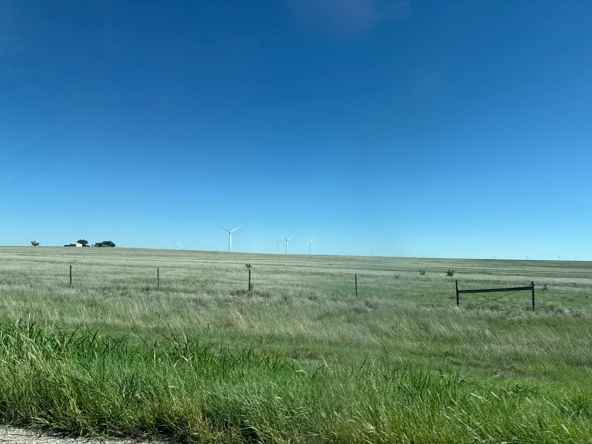
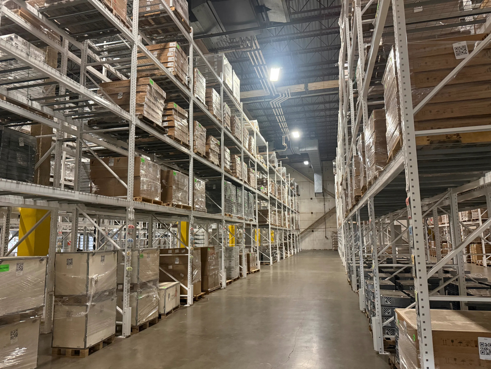
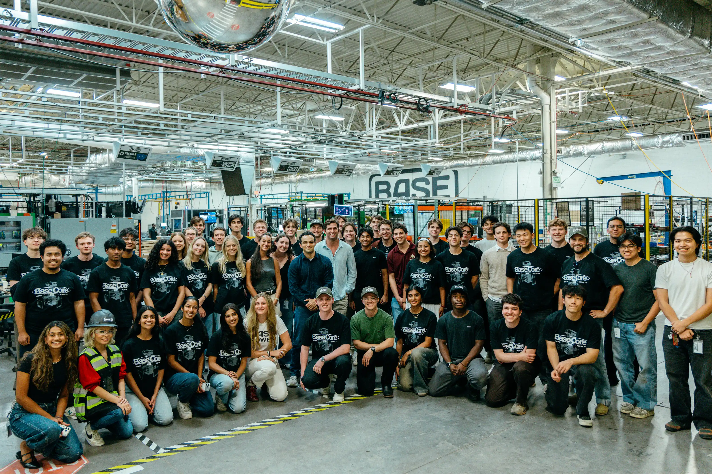

+++
title = "Base Power Company"
description = "The first beloved power company"
date = 2026-11-05T17:45:00-08:00
[extra]
type = "work"
start = 2026-06-22
end = 2026-09-04
+++

I first encountered Base in an article entitled ["Build What's
Fundable."][bwf] It was a compelling, if somewhat unintentional, sales
pitch. I applied, they emailed me to schedule an interview, and I shot
right back with some times. A couple days passed, I realized that there
was a good chance my email hosted from [a treehouse in Finland][cld] had
been sent to spam, and so tried again from my school email. We scheduled
an interview and a few months later I was on the road to Austin.

Once in Texas, I found myself on the Factory Software team. More
specifically, [WHIMSY]—the software that tracks every part across its
lifecycle and through deployment as part of a finished product in the
field. On the team, I was responsible for running the receiving bay:
parts would arrive at the factory and the first thing they would hit was
my software.

So I spent a bunch of time in the factory, with workers actually using
WHIMSY in their day-to-day, chasing down issues to their source and
fixing them on the spot to keep the line up and running. This was
quite gratifying for me. I've made a whole bunch of physical products,
but each object has been—for the most part—one of one. Scaling the
manufacture of physical goods from one to a thousand and beyond is a
whole different beast, and one that requires a wealth of systems that I
had never before encountered and tried to soak up at Base.

Many of the issues in WHIMSY at the receiving bay derived from suppliers
sending non-compliant pallets: so I also spent a bunch of time talking
to them. And not just over video-conference! I went to Mexico twice,
getting valuable face-to-face time and building relationships with
critical manufacturing partners. On one particularly memorable occasion,
I even did some Spanish-language programming on an ancient factory floor
computer hooked up to a label printer.[^1]

Working with suppliers didn't just mean onboarding them to our systems,
though: it also meant adapting our systems to their needs. More
specifically, it meant EDI.[^2] I designed and standardized Base's
[EDI856] format, and implemented my first-ever production Rust code to
parse and process submissions from suppliers.[^3] This code has a neat
trick: it presents itself to legacy [ERPs] as an SFTP server, while
behind the scenes converting uploaded files in-memory to representations
interoperable with Base's modern REST APIs. It's both a technically neat
trick, and a great way of bridging between the needs of suppliers and
the needs of a modern software organization like Base.

Having a bunch of nice dashboards constantly displayed on TVs above your
desk, urging you to make numbers go up, does mean that you're left with
quality tangible performance metrics at the end of your internship. My
systems received over 3,000 pallets into inventory during my time at
Base. When I first arrived, 81% of pallets were received off-nominally,
requiring manual and time-consuming attention before they could be put
to use. By the end, that number was a mere 15%—and overall throughput
had increased 16x. That's more pallets more correct, which means more
parts to build more batteries, which means more customers and more grid
capacity.

Austin itself was the quite the adventure. Many had warned me about
the heat, but as someone who is always cold, I found it a great joy!
South Austin is the place to be, a fun and funky city in its own right
with plenty to [do and eat]. It's a region of short buildings and few
building codes, which gives it the impression of a loose agglomeration
of waystations each with their own distinct character. I cooked—grocery
shopping at HEB is a big deal in Texas, I understand—bought some boots,
and did a healthy amount of Cyberpunk-ing and movie watching. Would
recommend.

I am so grateful to everyone at Base for making the summer such a
wonderful experience for me. A huge thanks goes out to my very tiki
teammates: Holden, Anjali, Emily, Nathan, Joel, Brett, Robbie, Joy,
and Pruthak. I have all the confidence in the future of Base and look
forward to watching its ascent.

---

[^1]: Please note that any and all Spanish I can manage to speak has
      come from internet memes and osmosis.
[^2]: Electronic Data Interchange, or EDI, is a file format invented
      to organize airdrops during the Cold War. It hasn't changed much
      since then. There's no standard for how said Data is actually
      to be sent between parties, but [SFTP] servers are the typical
      answer, though sometimes it's a thing called AS2 that no one has
      ever heard of. I made [merch].
[^3]: I did end up rewriting this in Go. Unfortunate, but more
      maintainable as there were fewer Rust programmers on the team.

[bwf]: https://investing101.substack.com/p/build-whats-fundable
[cld]: @/projects/cloudlab/index.md
[WHIMSY]: https://www.notboring.co/p/base-power-company-chapter-3
[EDI856]: https://www.stedi.com/edi/x12-008050/856
[ERPs]: https://en.wikipedia.org/wiki/Enterprise_resource_planning
[do and eat]: https://www.corner.inc/list/55bfd964-5e4b-4b75-a4b6-4701abb2e520

[SFTP]: https://datatracker.ietf.org/doc/html/draft-ietf-secsh-filexfer-02
[merch]: merch.webp
